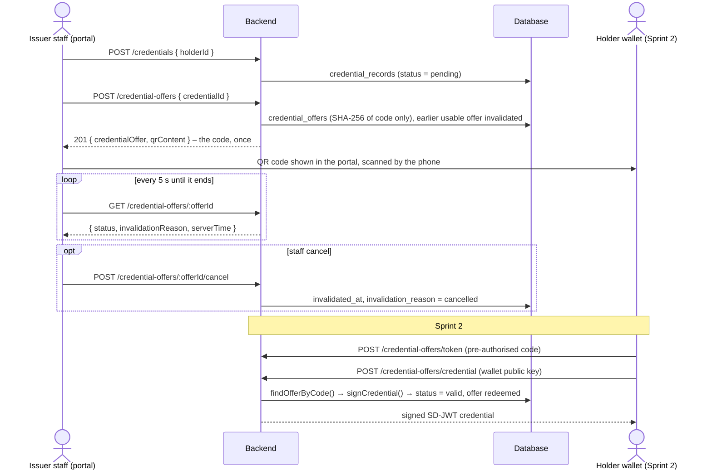

# Pre-authorised Credential Offer API

**Sprint:** 1 (cancel, reasons and server time: S2, Sprint 1 carry-over) · **Requirements:** FR-ISS-01, NFR-01, NFR-06, NFR-08
**Code:** `backend/src/routes/credential-offers.routes.ts`, `backend/src/services/credential-offers.service.ts`
· **Migrations:** `0004_offer_invalidation.sql`, `0008_offer_invalidation_reason.sql`; offers are also invalidated by revoke and reissue (`0005`, Decision 012)
**Tests:** `backend/test/credential-offers.test.ts` · **Decisions:** 011, 021 · **Portal:** the offer screen,
[issuer-portal.md](../frontend/issuer-portal.md) §11

## 1. Purpose

A **credential offer** is how a pending credential reaches the holder's wallet.
Issuer staff create a one-time offer for a pending credential; the issuer portal
shows it as a **QR code**; the holder scans it with the UniVault wallet, which
redeems it and receives the signed credential.

This task builds **offer creation and status**. Redemption by the wallet
(`POST /credential-offers/token` and `/credential`) is **Sprint 2** and still
returns `501`.

## 2. Flow



## 3. Endpoints (login required, officer or admin)

| Method | Path                                        | Purpose                                                     |
| ------ | ------------------------------------------- | ----------------------------------------------------------- |
| POST   | `/api/v1/credential-offers`                 | Create a one-time offer for a pending credential            |
| GET    | `/api/v1/credential-offers/:offerId`        | Offer status, polled by the portal (never the code)         |
| POST   | `/api/v1/credential-offers/:offerId/cancel` | Cancel an active offer (its code stops working at once)     |
| POST   | `/api/v1/credential-offers/token`           | Wallet: exchange the code (**501 – Sprint 2**, public)      |
| POST   | `/api/v1/credential-offers/credential`      | Wallet: receive the credential (**501 – Sprint 2**, public) |

### POST `/api/v1/credential-offers`

```json
{ "credentialId": "3b9f…-uuid" }
```

**What the server does, in one transaction:**

1. Locks the credential row, so simultaneous requests for one credential are
   handled one after the other.
2. Checks the credential belongs to the logged-in issuer, is `pending` and has
   not expired.
3. Generates the pre-authorised code: `crypto.randomBytes(32)` as base64url
   (43 characters, 256 bits). Stores **only its SHA-256 hash** (base64url, 43
   characters).
4. Sets `invalidated_at` (and `invalidation_reason = 'replaced'`) on any earlier
   offer for this credential that is not redeemed, not expired and not yet invalidated.
5. Inserts the offer with `expires_at` = now + `CREDENTIAL_OFFER_TTL_SECONDS`
   (default 300, i.e. 5 minutes; 600 until 26 Nov 2026), but never later than the credential's own expiry, and
   `created_by_staff_id`.

**Response:** `201 Created`, `Location: /api/v1/credential-offers/<offerId>`,
`Cache-Control: no-store`:

```json
{
  "offerId": "9a41…",
  "credentialId": "3b9f…",
  "credentialType": "EmploymentCredential",
  "holder": { "id": "8d1c…", "fullName": "Lahiru Silva", "externalRef": "STC-00001" },
  "status": "active",
  "expiresAt": "2026-11-20T09:05:00.000Z",
  "expiresInSeconds": 300,
  "serverTime": "2026-11-20T09:00:00.000Z",
  "credentialOffer": {
    "credential_issuer": "http://192.168.1.20:4000/api/v1/issuers/employer-a",
    "credential_configuration_ids": ["EmploymentCredential"],
    "grants": {
      "urn:ietf:params:oauth:grant-type:pre-authorized_code": {
        "pre-authorized_code": "Xq3…43 characters…"
      }
    }
  },
  "qrContent": "openid-credential-offer://?credential_offer=%7B%22credential_issuer%22%3A…"
}
```

- `qrContent` is `openid-credential-offer://?credential_offer=` followed by
  `encodeURIComponent(JSON.stringify(credentialOffer))`. The portal renders it
  as a QR code; the server doesn't generate images.
- **This is the only time the code is ever sent.** It is not stored, not logged
  and not returned by any other endpoint. If the QR is lost, create a new offer;
  that invalidates the old one. The portal keeps the response in memory only and
  never shows the same QR twice (Decision 021).
- `serverTime` is the server's clock when the offer was created (here equal to
  the creation time). The portal compares it with its own clock (at the middle of
  the request) and counts down `expiresAt` on the server's time, so a wrong PC
  clock cannot show a QR code the server has already expired.
- **Offers are only for `pending` credentials** (signed, revoked or superseded →
  `409 CREDENTIAL_NOT_PENDING`; tested for signed and revoked).

### GET `/api/v1/credential-offers/:offerId`

The portal polls this to show "waiting for the wallet…", then "collected".
`Cache-Control: no-store`.

```json
{
  "offerId": "9a41…",
  "credentialId": "3b9f…",
  "credentialType": "EmploymentCredential",
  "credentialStatus": "pending",
  "holder": { "id": "8d1c…", "fullName": "Lahiru Silva", "externalRef": "STC-00001" },
  "status": "active",
  "createdAt": "2026-11-20T09:00:00.000Z",
  "expiresAt": "2026-11-20T09:05:00.000Z",
  "redeemedAt": null,
  "invalidatedAt": null,
  "invalidationReason": null,
  "createdBy": { "id": "…", "displayName": "Serendib Trading Company (Demo) Officer" },
  "serverTime": "2026-11-20T09:04:12.000Z"
}
```

It **never** contains the code or its hash. Another issuer's offer returns `404`.
`invalidationReason` is set exactly when `status` is `invalidated` (section 4);
`serverTime` is the server's clock when the answer was made (the portal re-measures
its clock offset on every poll).

### POST `/api/v1/credential-offers/:offerId/cancel` (officer or admin)

No body. In one transaction it locks the offer (and its credential), checks it
belongs to the logged-in issuer and is `active`, and sets `invalidated_at` with
`invalidation_reason = 'cancelled'`. The code stops working at once
(`findOfferByCode` reports `invalidated`); a new offer can be created afterwards.

**Response:** `200`, `Cache-Control: no-store`, the offer as `GET` returns it
(`status: "invalidated"`, `invalidationReason: "cancelled"`).

- Another issuer's or an unknown offer: `404 OFFER_NOT_FOUND` (unchanged).
- Not active (redeemed, expired, or already invalidated for any reason):
  `409 OFFER_NOT_ACTIVE` with `details: { "status": "<current status>" }`; nothing
  changes.
- Logged as "Credential offer cancelled" with offer, credential, issuer and staff
  ids only. The plain code is not known to the server and nothing about it is
  recorded.

### Also: `activeOffer` on GET `/api/v1/credentials/:credentialId`

The credential detail carries `activeOffer: { offerId, expiresAt } | null`: the
newest offer that is not redeemed, not invalidated and not expired (only while the
credential is `pending`). Never the code. The portal uses it to tell staff, after a
reload, that the QR code cannot be shown again (Decision 021).

## 4. Offer statuses

The status is worked out when the offer is read; it isn't stored.

| Status        | When                                                                                                        | Precedence |
| ------------- | ----------------------------------------------------------------------------------------------------------- | ---------- |
| `redeemed`    | `redeemed_at` is set (the wallet collected the credential)                                                  | 1 (wins)   |
| `invalidated` | `invalidated_at` is set: a newer offer replaced this one, or the credential was **revoked** or **reissued** | 2          |
| `expired`     | `expires_at` has passed                                                                                     | 3          |
| `active`      | none of the above: the code can still be redeemed                                                           | –          |

`redeemed` wins over `expired`: an offer collected before it expired stays
`redeemed` afterwards. The database refuses an offer that is both redeemed and
invalidated (CHECK constraint in `0004_offer_invalidation.sql`).

**Why an offer was invalidated** (`invalidationReason`, column
`invalidation_reason`, migration 0008):

| Reason                  | Set by                                            | Portal message                                      |
| ----------------------- | ------------------------------------------------- | --------------------------------------------------- |
| `replaced`              | `POST /credential-offers` for the same credential | "A newer QR code was generated for this credential" |
| `cancelled`             | `POST /credential-offers/:offerId/cancel`         | "Offer cancelled"                                   |
| `credential_revoked`    | `POST /credentials/:id/revoke`                    | "This credential can no longer be offered"          |
| `credential_superseded` | `POST /credentials/:id/reissue`                   | "This credential can no longer be offered"          |

Two CHECKs: the reason is one of these four, and it is set **exactly when**
`invalidated_at` is. A new reason needs a new migration. Rows invalidated before
0008 were backfilled: `replaced` when another offer of the same credential was
created at the invalidation instant, otherwise from the credential's status
(`revoked` / `superseded`), otherwise `replaced`.

**Invalidated by revoke and reissue.** `POST /credentials/:id/revoke` and
`POST /credentials/:id/reissue` set `invalidated_at` on **every** offer of the
affected credential that is not redeemed and not already invalidated (expired
ones included), in the same transaction as the status change. Polling
`GET /credential-offers/:offerId` then shows `status: "invalidated"` with
`credentialStatus: "revoked"` or `"superseded"`. A reissue never creates an
offer for the replacement: the portal calls `POST /credential-offers` for the
new pending credential. See [credentials-api.md](credentials-api.md) section 6.

## 5. Why OpenID4VCI

The offer follows the **OpenID for Verifiable Credential Issuance** (OpenID4VCI)
credential offer format, pre-authorised code flow:

- It is the standard way an issuer hands a credential offer to a wallet by QR
  code, and is the issuance protocol used by the EU Digital Identity Wallet and
  SD-JWT VC implementations.
- **Pre-authorised code** fits the issuer portal: staff have already checked the
  holder in person, so the wallet doesn't need to log in to the issuer; the
  one-time code is the authorisation.
- Using the standard field names (`credential_issuer`,
  `credential_configuration_ids`, `grants`) keeps the wallet and backend
  interoperable with other tools, and makes the design easy to justify in the report.
- `credential_configuration_ids` holds the credential type
  (`EmploymentCredential` or `KYCCredential`).

**Checked against OpenID4VCI 1.0** (§4.1.1 Credential Offer parameters, §4.1.2
offer by value) by a test (`checkOpenId4VciOffer` in `credential-offers.test.ts`):
only `credential_issuer`, `credential_configuration_ids` and `grants`; the
issuer is an `https` URL in production (`http` allowed in development) with no
query, fragment or trailing slash; the configuration ids are a non-empty array of
unique strings that includes the credential's type; the grant
`urn:ietf:params:oauth:grant-type:pre-authorized_code` has `pre-authorized_code`
and **no `tx_code`** (not supported yet, Decision 021); the QR URI has only the
`credential_offer` parameter. All field names already matched the specification.
`loadConfig()` now refuses a non-`https` `PUBLIC_BASE_URL` in production, because
`credential_issuer` is built from it.

The issuer metadata endpoint and the token/credential exchange that complete
OpenID4VCI are Sprint 2 work. See Decision 011 (Draft – review).

## 6. Security

| Measure                   | Detail                                                                                                                                                                   |
| ------------------------- | ------------------------------------------------------------------------------------------------------------------------------------------------------------------------ |
| 256-bit code              | `crypto.randomBytes(32)`, base64url. Guessing it is not feasible                                                                                                         |
| Hash only                 | Only SHA-256(code) is stored, so a database leak can't be used to claim credentials. The code is looked up by its hash (`findOfferByCode`), never compared in plain text |
| Shown once                | The code appears only in the create response; never logged, never returned by `GET`                                                                                      |
| `Cache-Control: no-store` | No browser or proxy keeps a copy of the create response                                                                                                                  |
| Short expiry              | 5 minutes by default (`CREDENTIAL_OFFER_TTL_SECONDS`), and never beyond the credential's expiry                                                                          |
| One-time                  | Sprint 2 redemption will set `redeemed_at`; a redeemed offer can't be used again                                                                                         |
| One usable offer          | A new offer invalidates the earlier usable one; the credential row is locked so simultaneous requests can't leave two                                                    |
| Issuer isolation          | Another issuer's credential or offer returns `404`                                                                                                                       |
| Brute-force protection    | `failed_attempts` is reserved for Sprint 2: redemption will count wrong attempts and stop an offer after too many                                                        |

The default and `backend/.env.example` are both `CREDENTIAL_OFFER_TTL_SECONDS=300` (5 minutes;
reduced from 10 minutes on 26 Nov 2026, Decisions 011 and 021): enough time for the holder to
scan and accept, and a shorter window for an intercepted QR code to be misused.

## 7. Errors

| Situation                                          | Status | Code                     |
| -------------------------------------------------- | ------ | ------------------------ |
| Not logged in                                      | 401    | `UNAUTHENTICATED`        |
| Malformed `credentialId` or `offerId`              | 400    | `VALIDATION_ERROR`       |
| Unknown credential, or another issuer's credential | 404    | `CREDENTIAL_NOT_FOUND`   |
| Credential is not `pending`                        | 409    | `CREDENTIAL_NOT_PENDING` |
| Credential has expired                             | 409    | `CREDENTIAL_EXPIRED`     |
| Unknown offer, or another issuer's offer           | 404    | `OFFER_NOT_FOUND`        |
| Cancelling an offer that is not `active`           | 409    | `OFFER_NOT_ACTIVE`       |

## 8. For Sprint 2: redemption

- `findOfferByCode(code)` in `credential-offers.service.ts` hashes the code and
  looks the offer up by hash. It returns `null` for a malformed or unknown code,
  and otherwise the offer's ID, credential, issuer, `credentialStatus`, derived
  status, expiry and `failedAttempts`, but never the hash. Redemption must
  accept only `status === 'active'`. As a second line of defence, an offer whose
  credential is no longer `pending` (revoked, superseded or already valid) is
  reported as `invalidated` even if `invalidated_at` was never set, and
  `signCredential` itself only updates `WHERE status = 'pending'`.
- Redemption then calls `signCredential(credentialId, walletPublicJwk)`
  (`credentials.service.ts`) and records `redeemed_at` and
  `redeemed_wallet_thumbprint`.

### Phone testing: `PUBLIC_BASE_URL`

`credential_issuer` is built from `PUBLIC_BASE_URL`. When a **phone** scans the
QR, `localhost` means the phone itself, so in Sprint 2 `PUBLIC_BASE_URL` must be
the laptop's **LAN IP**, e.g. `http://192.168.1.20:4000` (find it with
`ipconfig`). The wallet's `EXPO_PUBLIC_API_BASE_URL` must point to the same address.
