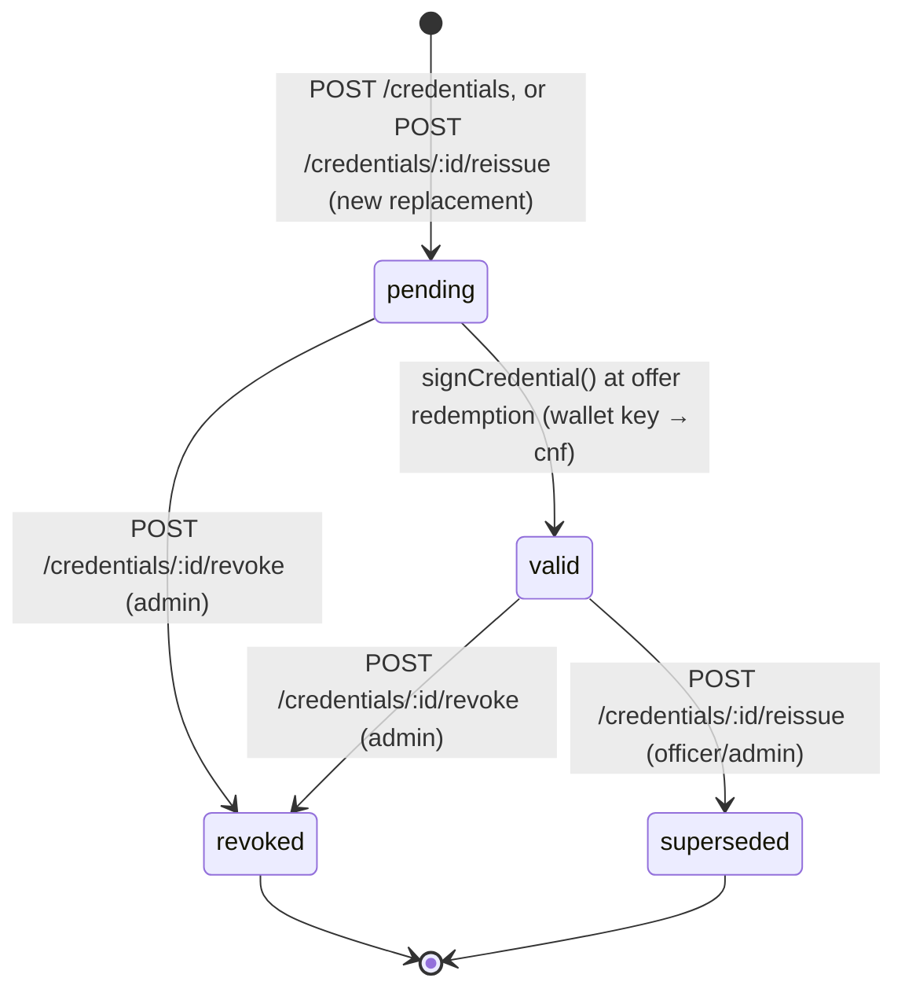

# Credential Issuance, Revocation and Reissue API

**Sprint:** 1 · **Requirements:** FR-ISS-01, FR-ISS-02, FR-ISS-03, NFR-01, NFR-06, NFR-08
**Code:** `backend/src/routes/credentials.routes.ts`, `backend/src/services/credentials.service.ts`,
`crypto-core/src/common/jwk-thumbprint.ts` · **Migrations:** `0001` (`credential_records`),
`0005_revocation_and_status_events.sql` (revoke/supersede columns, `credential_status_events`),
`0006_reason_value_checks.sql` (reason values limited to the API enums)
**Tests:** `backend/test/credentials.test.ts`, `backend/test/credential-revocation.test.ts`,
`crypto-core/test/jwk-thumbprint.test.ts` · **Decisions:** 010, 012
**Evidence script:** `scripts/evidence/s1-revocation.ps1`

## 1. Purpose

Issuer staff turn a **holder record** (an employee or customer) into a
**credential**: an RS256-signed SD-JWT VC that is bound to the holder's wallet.

Issuance happens in **two steps**:

1. **Create (this sprint, `POST /credentials`).** Staff create a **pending**
   credential record. Its claims are re-validated and snapshotted, and its expiry
   is fixed. **Nothing is signed yet.**
2. **Sign (built and tested now; called in Sprint 2).** When the wallet redeems
   the QR offer, the redemption endpoint calls
   `signCredential(credentialId, holderPublicJwk)`. This signs the SD-JWT with
   the issuer's active key and marks the record **valid**.

### Why signing waits for redemption

Every credential carries `cnf.jwk`: the public key of the holder's wallet. This
binds the credential to the device, and later the wallet proves possession with
a key-binding JWT (ES256). The wallet key only exists once the holder scans the
offer, so the server cannot sign any earlier. **A credential is never signed
without a holder key, and never twice.**

## 2. Lifecycle



| Status       | Signed?                           | Set by                                                                          | Recorded on the row                                      |
| ------------ | --------------------------------- | ------------------------------------------------------------------------------- | -------------------------------------------------------- |
| `pending`    | No                                | `POST /credentials`, or a reissue (the replacement)                             | `replaces_credential_id` when it is a replacement        |
| `valid`      | Yes                               | `signCredential()` – `issued_at`, `issuer_kid`, `holder_key_thumbprint` are set | signing data                                             |
| `revoked`    | Only if it was revoked when valid | `POST /credentials/:id/revoke`                                                  | `revoked_at`, `revoked_by_staff_id`, `revocation_reason` |
| `superseded` | Yes                               | `POST /credentials/:id/reissue`                                                 | `superseded_at`, `superseded_by_staff_id`                |

**Allowed transitions** (anything else is refused):

| From \ action | revoke                           | reissue                          | sign (redemption)            |
| ------------- | -------------------------------- | -------------------------------- | ---------------------------- |
| `pending`     | → `revoked`                      | 409 `CREDENTIAL_NOT_REISSUABLE`  | → `valid`                    |
| `valid`       | → `revoked`                      | → `superseded` + new `pending`   | 409 `CREDENTIAL_NOT_PENDING` |
| `revoked`     | 409 `CREDENTIAL_ALREADY_REVOKED` | 409 `CREDENTIAL_ALREADY_REVOKED` | 409 `CREDENTIAL_NOT_PENDING` |
| `superseded`  | 409 `CREDENTIAL_SUPERSEDED`      | 409 `CREDENTIAL_SUPERSEDED`      | 409 `CREDENTIAL_NOT_PENDING` |

`revoked` and `superseded` are final. Every transition, including creation and
signing, is written to the append-only `credential_status_events` table in the
same transaction (section 6, Decision 012).

The database enforces the row rules (migration `0005`): signing data is set all
together or not at all; `valid` and `superseded` credentials were signed and
`pending` ones never are; revocation columns are set only when `revoked`, and
`superseded_at` only when `superseded`; a credential has at most one
replacement and cannot replace itself. Migration `0006` limits
`revocation_reason` and the status-history `reason` to the API enum values
below (`NOT VALID`: free-text reasons stored before 0005/0006 are kept).

## 3. Endpoints (login required)

| Method | Path                                                | Access           | Purpose                                                                   |
| ------ | --------------------------------------------------- | ---------------- | ------------------------------------------------------------------------- |
| POST   | `/api/v1/credentials`                               | Officer or admin | Create a pending credential from a holder record                          |
| POST   | `/api/v1/credentials/preview`                       | Officer or admin | What POST would create, without writing anything                          |
| GET    | `/api/v1/credentials`                               | Officer or admin | List the issuer's credentials (filters, search, sort, paging, tab counts) |
| GET    | `/api/v1/credentials/:credentialId`                 | Officer or admin | One credential's metadata                                                 |
| POST   | `/api/v1/credentials/:credentialId/revoke`          | **Admin only**   | Pending, valid or expired → revoked (section 6.1, 6.5)                    |
| POST   | `/api/v1/credentials/:credentialId/reissue`         | Officer or admin | Valid or expired → superseded, plus a new pending replacement (6.2, 6.5)  |
| POST   | `/api/v1/credentials/:credentialId/reissue/preview` | Officer or admin | What reissue would produce, without writing anything (6.6)                |
| GET    | `/api/v1/credentials/:credentialId/events`          | Officer or admin | Status history, oldest first (6.3)                                        |

All routes are issuer-scoped through `req.auth`: another issuer's credential is
`404 CREDENTIAL_NOT_FOUND`. (`requireOwnIssuer` is not used, because these
paths have no `:issuerId`.)

### POST `/api/v1/credentials`

```json
{ "holderId": "8d1c…-uuid", "credentialType": "EmploymentCredential", "validUntil": "2027-06-30" }
```

| Field            | Required | Rule                                                                                                             |
| ---------------- | -------- | ---------------------------------------------------------------------------------------------------------------- |
| `holderId`       | Yes      | UUID of a holder record **of the logged-in issuer**                                                              |
| `credentialType` | No       | Derived from the issuer type (employer → `EmploymentCredential`, bank → `KYCCredential`). If sent, it must match |
| `validUntil`     | No       | `YYYY-MM-DD` (00:00 UTC): an earlier end, after today and no later than the capped expiry (added 26 Nov 2026)    |

The issuer always comes from the login token. An `issuerId` in the body is ignored.

**What the server does:**

1. Locks the holder row for the rest of the transaction, so two simultaneous
   requests for one holder cannot both pass the duplicate check.
2. Recalculates `age_over_18` from `date_of_birth` (KYC, Decision 005) and
   validates the claims against the credential schema again, because the holder
   record may have been stored under an older schema version.
3. Rejects a second credential of the same type while one is `pending` or
   `valid`. Changes go through reissue.
4. Requires the issuer to have an **active** signing key.
5. Stores the record: `status = 'pending'`, `claims_snapshot`, `vct` and
   `schema_version` from the schema's `x-univault` block,
   `created_by_staff_id`, and `expires_at` (section 5).

**Response:** `201 Created` with `Location: /api/v1/credentials/<id>`:

```json
{
  "id": "3b9f…",
  "issuerId": "employer-a",
  "holder": { "id": "8d1c…", "externalRef": "STC-00001", "fullName": "Lahiru Silva" },
  "credentialType": "EmploymentCredential",
  "vct": "urn:univault:vct:EmploymentCredential:1",
  "schemaVersion": "1.0",
  "status": "pending",
  "effectiveStatus": "pending",
  "issuerKid": null,
  "issuedAt": null,
  "expiresAt": "2027-11-20T08:41:12.000Z",
  "statusUpdatedAt": "2026-11-20T08:41:12.345Z",
  "revokedAt": null,
  "revocationReason": null,
  "revokedBy": null,
  "supersededAt": null,
  "supersededBy": null,
  "replacesCredentialId": null,
  "replacedByCredentialId": null,
  "createdBy": { "id": "…", "displayName": "Serendib Trading Company (Demo) Officer" },
  "createdAt": "2026-11-20T08:41:12.345Z"
}
```

`status` is the **stored** status. `effectiveStatus` is the status at the time of
the request, from the same `effectiveStatus()` function as the public status endpoint
([status-api.md](status-api.md) section 4): the stored status, or `expired` for a `valid`
credential whose `expiresAt` has passed (inclusive). Nothing writes `expired` to the
database. `expiresAt` is always a whole second, so it equals the SD-JWT `exp` exactly.

`replacesCredentialId` is the credential this one was reissued from;
`replacedByCredentialId` is set once this one has been superseded. `revokedBy`
and `supersededBy` are `{ id, displayName }` of the staff member.

The response is **metadata only**: the holder's name and reference (as in the
holder list) and no other claims. It never contains a signature or any key
material. The holder-key thumbprint is not returned either.

### GET `/api/v1/credentials`

The issuer portal's credentials table ([issuer-portal.md](../frontend/issuer-portal.md) §12).

| Query             | Default  | Meaning                                                                                                                                             |
| ----------------- | -------- | --------------------------------------------------------------------------------------------------------------------------------------------------- |
| `status`          | –        | Stored status: `pending`, `valid`, `revoked` or `superseded`                                                                                        |
| `effectiveStatus` | –        | Computed status: the four above or `expired`. `expired` = stored `valid` with `expires_at <= now`; `valid` = stored `valid` with `expires_at > now` |
| `holderId`        | –        | Only this holder's credentials (UUID)                                                                                                               |
| `q`               | –        | Trimmed, at most 100 characters (empty = no search). Holder name or reference **containing** it (any case), or a credential id **starting** with it |
| `sort`            | `newest` | `newest`, `oldest` (creation time), `expires`, `expires_desc`, `holder`, `holder_desc` (holder name). Ties: creation time, then id                  |
| `limit`           | 20       | 1–100                                                                                                                                               |
| `offset`          | 0        | Number of records to skip                                                                                                                           |

**Response:**

```json
{
  "credentials": [
    {
      "id": "3b9f…",
      "holder": { "id": "…", "externalRef": "STC-00003", "fullName": "Malith Wijesinghe" },
      "credentialType": "EmploymentCredential",
      "vct": "urn:…",
      "status": "valid",
      "effectiveStatus": "expired",
      "issuedAt": "…",
      "expiresAt": "…",
      "createdAt": "…",
      "replacesCredentialId": null,
      "replacedByCredentialId": null,
      "hasActiveOffer": false,
      "…": "the other metadata fields of section 3"
    }
  ],
  "total": 7,
  "limit": 20,
  "offset": 0,
  "counts": { "all": 18, "pending": 3, "valid": 7, "expired": 1, "revoked": 2, "superseded": 5 }
}
```

- **Rows are metadata only.** The holder appears as id, reference and name, with no ID numbers
  or other claims. `issuedAt` is the signing time (null while pending).
- **`hasActiveOffer`**: the credential is `pending` and has an offer that is not redeemed, not
  invalidated and not expired. This is the same rule as `activeOffer` on the detail. The code is
  never included.
- **`counts`**: per effective status, the credentials that match the issuer, `holderId` and `q`
  filters but **not** the status filter, so the portal can show its tab counts. They use the
  same SQL rule as the filter (`effectiveStatusCondition`), so a tab's count always equals that
  tab's `total`. Revoked-while-pending credentials count as `revoked` here; the dashboard leaves
  them out of its issued figures.
- **No N+1:** each page takes a fixed number of queries (page ids sorted with the holder
  joined, the total, the counts, the rows' metadata, the rows with an active offer).

Only the logged-in issuer's credentials are listed. A `holderId` belonging to another issuer
gives an empty list.

### GET `/api/v1/credentials/:credentialId`

Returns the same metadata object. Another issuer's credential returns `404`.

It adds **`activeOffer`**: `{ offerId, expiresAt }` of the credential's newest offer that is
not redeemed, not invalidated and not expired (only while the credential is `pending`), or
`null`. Never the code. The portal uses it to say that a QR code cannot be shown again
(Decision 021; [credential-offers-api.md](credential-offers-api.md)). List rows carry only the
`hasActiveOffer` boolean instead.

### POST `/api/v1/credentials/preview` (officer or admin)

What `POST /credentials` would create **now**, without writing anything (Decision 019). The
issuer portal shows it before staff confirm the issuance.

**Body:** the same as `POST /credentials`:
`{ "holderId": "…", "credentialType"?: "…", "validUntil"?: "YYYY-MM-DD" }`.

**One code path.** `create()` and `preview()` both run `prepareIssuance()` in
`services/credentials.service.ts`. It does five things, in order:

1. checks the type the issuer may issue;
2. reads the holder row of this issuer: **locked** `FOR UPDATE` for issuance, **not locked**
   for the preview (`prepareIssuance(…, { lock: false })`);
3. runs `prepareClaims()`: schema validation, `age_over_18` and the expiry caps;
4. checks that the holder has no other active credential of this type;
5. checks that the issuer has an active key.

`create()` runs it in a transaction, then inserts the pending row and its event. `preview()`
runs it without a transaction or lock and writes nothing: no credential, no status event, no
log of claims. A preview therefore never blocks an issuance; the issuance repeats every check
under the lock, so a preview that raced another issuance cannot create a second credential.

**Response:** `200`, `Cache-Control: no-store` (it contains the holder's claims):

```json
{
  "credentialType": "KYCCredential",
  "vct": "urn:univault:vct:KYCCredential:1",
  "schemaVersion": "1.0",
  "issuer": { "id": "bank-a", "name": "UniVault Demo Bank" },
  "holder": { "id": "…", "externalRef": "KYC-REC-0001", "fullName": "Lahiru Silva" },
  "alwaysVisible": {
    "iss": "http://localhost:4000/api/v1/issuers/bank-a",
    "issuer_name": "UniVault Demo Bank",
    "vct": "urn:univault:vct:KYCCredential:1",
    "schema_version": "1.0",
    "jti": null,
    "iat": "2026-11-26T04:30:00.000Z",
    "exp": "2028-11-26T04:30:00.000Z",
    "cnf": null,
    "status": null,
    "kyc_verification_date": "2026-11-26"
  },
  "disclosable": [{ "name": "full_name", "value": "Lahiru Silva" }, "…"],
  "derived": [{ "name": "age_over_18", "value": true }],
  "expiry": {
    "expiresAt": "2028-11-26T04:30:00.000Z",
    "defaultExpiresAt": "2028-11-26T04:30:00.000Z",
    "cappedBy": null,
    "validUntilRange": { "min": "2026-11-27", "max": "2028-11-26" }
  },
  "warnings": []
}
```

| Field                     | Meaning                                                                                                                                                                                                                                                                                                                                                                                                                                                                      |
| ------------------------- | ---------------------------------------------------------------------------------------------------------------------------------------------------------------------------------------------------------------------------------------------------------------------------------------------------------------------------------------------------------------------------------------------------------------------------------------------------------------------------- |
| `alwaysVisible`           | The envelope claims the signer adds (the same builder, `envelopeClaims()`), always visible to verifiers. **`iat` is planned:** the signed `iat` is the signing time, when the wallet accepts the offer. **`exp` is final** (`expires_at` is fixed when the credential is created). `jti`, `cnf` and `status` are `null`: the id is assigned on issue, the wallet key is bound at acceptance, and the status URI contains the id. ISO strings here; NumericDate in the SD-JWT |
| `disclosable`             | The subject claims in `x-univault.selectivelyDisclosable` order that the record has (minus derived ones): each becomes a disclosure the holder may withhold                                                                                                                                                                                                                                                                                                                  |
| `derived`                 | Claims the server calculates (`x-univault.derivedClaims`, today `age_over_18`). **Recalculated again at signing**, so a holder who turns 18 before accepting gets `true`                                                                                                                                                                                                                                                                                                     |
| `expiry.expiresAt`        | The expiry the credential would get (whole seconds)                                                                                                                                                                                                                                                                                                                                                                                                                          |
| `expiry.defaultExpiresAt` | Now + the schema's `defaultValidity` (P1Y Employment, P2Y KYC)                                                                                                                                                                                                                                                                                                                                                                                                               |
| `expiry.cappedBy`         | `null` (the default applies), `id_document_expiry` (passport or driving licence expiry), `18th_birthday` (`age_over_18` false) or `validUntil` (an earlier date chosen by staff)                                                                                                                                                                                                                                                                                             |
| `expiry.validUntilRange`  | The dates `validUntil` may take, inclusive: from tomorrow to the capped expiry date                                                                                                                                                                                                                                                                                                                                                                                          |
| `warnings`                | Codes: `holder_under_18` (the credential ends on the 18th birthday)                                                                                                                                                                                                                                                                                                                                                                                                          |

**Errors:** exactly those of `POST /credentials` (same code). They are `400 VALIDATION_ERROR`
(body, wrong `credentialType` for the issuer type, `validUntil` out of range), `404
HOLDER_NOT_FOUND` (also another issuer's holder), `422 HOLDER_DATA_INVALID`, `409
ACTIVE_CREDENTIAL_EXISTS` (`details.credentialId`) and `409 ISSUER_KEY_MISSING`.
`503 ISSUER_KEY_UNAVAILABLE` cannot come from a preview or an issuance: neither decrypts a
key (signing does, at redemption). The portal still explains it like the missing key.

**Logging:** `Credential previewed` at **debug**, with holder, issuer and staff ids only.

**Tests:** `backend/test/credential-preview.test.ts`. They cover:

- preview equals a real issuance (claims snapshot and expiry) for the same input and clock;
- row counts unchanged and no lock held;
- every cap;
- every error;
- isolation.

## 4. Signing: `signCredential(credentialId, holderPublicJwk)`

A service function in `credentials.service.ts`, with no HTTP route of its own.
The Sprint 2 offer-redemption endpoint (`POST /credential-offers/credential`)
will call it after checking the pre-authorised code.

**Checks, in order (nothing is signed if any fails):**

| Check                                                                                                                                            | Error                                                                                                   |
| ------------------------------------------------------------------------------------------------------------------------------------------------ | ------------------------------------------------------------------------------------------------------- |
| `holderPublicJwk` is an EC **P-256 public** JWK: `kty: EC`, `crv: P-256`, 32-byte `x` and `y`, **no `d`**, and a point on the curve              | 400 `INVALID_HOLDER_KEY`                                                                                |
| The credential exists                                                                                                                            | 404 `CREDENTIAL_NOT_FOUND`                                                                              |
| It is `pending`                                                                                                                                  | 409 `CREDENTIAL_NOT_PENDING`                                                                            |
| Its `expires_at` is in the future                                                                                                                | 409 `CREDENTIAL_EXPIRED`                                                                                |
| The issuer has an active key                                                                                                                     | 409 `ISSUER_KEY_MISSING`                                                                                |
| The key store returns the issuer's active key: found, encrypted, decrypted with `ISSUER_KEY_PASSPHRASE`, kid and public key match (Decision 014) | 503 `ISSUER_KEY_UNAVAILABLE` (generic message; the detailed code is logged with issuer id and kid only) |

**Then:**

1. Recalculates `age_over_18` on the **signing date**, which is the credential's issuance date.
2. Builds the envelope (below) and makes each subject claim listed in
   `x-univault.selectivelyDisclosable` that is present into a disclosure.
3. Calls crypto-core `createSdJwt` with the issuer's **active** key. After a
   rotation, new credentials use the new key, and older ones still verify with
   the retired key, which stays in the JWKS.
4. Updates the record **`WHERE status = 'pending'`**: `status = 'valid'`,
   `issued_at`, `issuer_kid`, `holder_key_thumbprint`, `status_updated_at`, and
   writes the `pending → valid` event (no staff member: wallet-driven) in the
   same transaction. If no row is updated, because another redemption won the
   race or the credential was revoked meanwhile, the new SD-JWT is thrown away
   and the call fails with `409 CREDENTIAL_NOT_PENDING`. So a credential is
   signed at most once, and a revoked or superseded credential is never signed.
5. Returns `{ sdJwt, credential }`. The compact SD-JWT goes **to the caller
   only**: it is never stored or logged.

`cnf.jwk` contains only `kty`, `crv`, `x` and `y`. Any other members the wallet
sends (`kid`, `alg`, …) are dropped. `holder_key_thumbprint` is the RFC 7638
thumbprint of that key (SHA-256 over `{"crv","kty","x","y"}`), computed by
crypto-core's universal `computeEcJwkThumbprint`, so the wallet can compute the
same value.

### Envelope claims (always visible)

| Claim                   | Value                                                                                                                 |
| ----------------------- | --------------------------------------------------------------------------------------------------------------------- |
| `iss`                   | `PUBLIC_BASE_URL/api/v1/issuers/<issuerId>`                                                                           |
| `issuer_name`           | Issuer display name                                                                                                   |
| `vct`                   | From the schema, e.g. `urn:univault:vct:KYCCredential:1`                                                              |
| `schema_version`        | From the schema, `"1.0"`                                                                                              |
| `jti`                   | The credential record ID. Always visible (in crypto-core's `NON_DISCLOSABLE_CLAIMS`): the key for the status endpoint |
| `iat`                   | Signing time (NumericDate)                                                                                            |
| `exp`                   | `expires_at` in seconds (NumericDate); exactly equal, because `expires_at` is always a whole second                   |
| `cnf`                   | `{ "jwk": <holder's EC P-256 public key> }`                                                                           |
| `status`                | `{ "status_uri": "PUBLIC_BASE_URL/api/v1/status/<id>" }`: the public status endpoint ([status-api.md](status-api.md)) |
| `kyc_verification_date` | **KYC only:** `YYYY-MM-DD` the pending record was created (when bank staff confirmed the CDD data)                    |
| `_sd`, `_sd_alg`        | Disclosure digests, `sha-256`                                                                                         |

The JWT header is `{ "alg": "RS256", "typ": "dc+sd-jwt", "kid": "<issuer key thumbprint>" }`.
A verifier picks the key from `GET /api/v1/issuers/:issuerId/keys` by that `kid`.

## 5. Expiry rules

`expires_at` is fixed when the pending record is created (credential-schemas.md §6, Decision 005):

| Rule                                              | Value                                                                                         |
| ------------------------------------------------- | --------------------------------------------------------------------------------------------- |
| Default                                           | now + `x-univault.defaultValidity`: **P1Y** Employment, **P2Y** KYC                           |
| KYC with `id_document_expiry` (passport, licence) | No later than **00:00 UTC on the document's expiry date**                                     |
| `age_over_18` is `false`                          | No later than **00:00 UTC on the 18th birthday**. The credential is then reissued with `true` |

The earliest of these wins. An ID document that has already expired is
rejected with `422 HOLDER_DATA_INVALID` (`claims.id_document_expiry`). Durations are added in UTC,
and a day that doesn't exist in the target month is clamped (29 Feb + P1Y → 28 Feb).

A reissue applies exactly the same rules (same code path) from the reissue date,
plus an optional earlier `validUntil` (section 6.2).

## 6. Revocation, reissue and status history (Decision 012)

### 6.1 POST `/api/v1/credentials/:credentialId/revoke` – admin only

```json
{ "reason": "employment_ended", "note": "Optional free text" }
```

| Field    | Required                   | Rule                                                                                                                    |
| -------- | -------------------------- | ----------------------------------------------------------------------------------------------------------------------- |
| `reason` | Yes                        | `details_changed`, `employment_ended`, `relationship_ended`, `wallet_lost_or_compromised`, `issued_in_error` or `other` |
| `note`   | Only when `reason = other` | Trimmed; at most 500 characters; an empty note counts as missing. Stored in the status history only, **never logged**   |

**What the server does (one transaction, credential row locked):**

1. Allowed from `valid` **and** `pending`. A pending credential would otherwise
   block new issuance for that holder (`ACTIVE_CREDENTIAL_EXISTS`) until it expired.
   An **expired** credential (stored `valid`, past its expiry) can be revoked too
   (section 6.5).
2. Sets `status = 'revoked'`, `revoked_at`, `revoked_by_staff_id`,
   `revocation_reason`, `status_updated_at`.
3. Invalidates every offer of the credential that is neither redeemed nor already
   invalidated (`credential_offers.invalidated_at`), so its QR code can no longer
   be redeemed.
4. Writes the event `pending|valid → revoked` with reason, note and staff member.

**Response:** `200 OK` with the updated credential, the same object as
`GET /credentials/:id`:

```json
{
  "id": "3b9f…",
  "status": "revoked",
  "revokedAt": "2026-11-24T07:33:01.458Z",
  "revocationReason": "employment_ended",
  "revokedBy": { "id": "11d8…", "displayName": "Serendib Trading Company (Demo) Admin" },
  "supersededAt": null,
  "replacesCredentialId": null,
  "replacedByCredentialId": null,
  "…": "other metadata fields as in section 3"
}
```

After a revocation a new credential can be issued for the same holder.

### 6.2 POST `/api/v1/credentials/:credentialId/reissue` – officer or admin

```json
{ "reason": "details_changed", "note": "New designation", "validUntil": "2027-06-30" }
```

| Field        | Required                   | Rule                                                                                                                                  |
| ------------ | -------------------------- | ------------------------------------------------------------------------------------------------------------------------------------- |
| `reason`     | Yes                        | `details_changed`, `wallet_lost_or_compromised`, `validity_extension` or `other`                                                      |
| `note`       | Only when `reason = other` | As for revoke                                                                                                                         |
| `validUntil` | No                         | `YYYY-MM-DD`. Must be after today and **not later** than the expiry the issuance rules give (section 5). See the note below the table |

**`validUntil` means 00:00 UTC at the start of that date.** The credential is
no longer valid from that instant, so `"validUntil": "2027-06-30"` gives
`expiresAt: "2027-06-30T00:00:00.000Z"`, and its last valid day is 29 June
2027 (UTC). This matches the other expiry caps in section 5 (document expiry,
18th birthday), which also end at 00:00 UTC. In Sri Lanka (UTC+05:30) that
instant is 05:30 local time on the same date.

Only a **valid** credential can be reissued, and stored `valid` **includes expired** ones:
reissuing an expired credential is a renewal (section 6.5). A pending one has not been
delivered, so it is revoked and issued again instead (`409 CREDENTIAL_NOT_REISSUABLE`).

All checks before any write live in one function, `prepareReissue()`, which the reissue
preview (section 6.6) shares. They run in this order: the credential of this issuer (404), not
pending (409 `CREDENTIAL_NOT_REISSUABLE`), not revoked or superseded (409), the holder's current
record through `prepareClaims()` (422 / 400 `validUntil`), an active signing key (409), and no
**other** active credential of the type (409 `ACTIVE_CREDENTIAL_EXISTS`; the credential being
replaced does not count).

**What the server does (one transaction):**

1. Locks the old credential row, then the holder row. A second reissue of the
   same credential waits on the lock, then sees `superseded` and gets `409`.
2. Builds the replacement from the holder's **current** record, through the same
   code as `POST /credentials`: schema validation again, `age_over_18`
   recalculated, expiry caps (default, ID document expiry, 18th birthday,
   `validUntil`). Holder data that fails validation → **422
   `HOLDER_DATA_INVALID`**, exactly as in issuance; no active issuer key →
   `409 ISSUER_KEY_MISSING`.
3. Sets the old credential to `superseded` (`superseded_at`,
   `superseded_by_staff_id`). The one-active-credential check in step 1 already
   leaves it out, so the replacement passes.
4. Inserts the replacement as `pending` with `replaces_credential_id` = old id
   (UNIQUE: a credential has at most one replacement).
5. Invalidates the old credential's open offers.
6. Writes events: `valid → superseded` (old, with reason and note) and
   `null → pending` (new).

No offer is created: the portal calls `POST /credential-offers` for the new
credential next. Until the holder redeems it, they have no valid credential of
that type (Decision 012).

**Response:** `201 Created`, `Location: /api/v1/credentials/<new id>`:

```json
{
  "credential": {
    "id": "9b03…",
    "status": "pending",
    "replacesCredentialId": "fa1c…",
    "replacedByCredentialId": null,
    "…": "other metadata fields"
  },
  "replaces": { "id": "fa1c…", "status": "superseded" }
}
```

### 6.3 GET `/api/v1/credentials/:credentialId/events`

The credential's status history, **oldest first** (ties at the same instant are
ordered creation → signing → later changes):

```json
{
  "credentialId": "fa1c…",
  "events": [
    {
      "id": "…",
      "fromStatus": null,
      "toStatus": "pending",
      "reason": null,
      "note": null,
      "staff": { "id": "72d6…", "displayName": "Serendib Trading Company (Demo) Officer" },
      "createdAt": "2026-11-24T07:33:01.399Z"
    },
    {
      "id": "…",
      "fromStatus": "pending",
      "toStatus": "valid",
      "reason": null,
      "note": null,
      "staff": null,
      "createdAt": "2026-11-24T07:33:01.423Z"
    },
    {
      "id": "…",
      "fromStatus": "valid",
      "toStatus": "superseded",
      "reason": "details_changed",
      "note": "New designation",
      "staff": { "id": "72d6…", "displayName": "…" },
      "createdAt": "2026-11-24T07:33:01.688Z"
    }
  ]
}
```

`staff` is `null` for wallet-driven events (signing at redemption) and for
events backfilled by migration `0005` whose staff member is unknown. The
replacement's history starts with its own creation; follow
`replacesCredentialId` for the earlier credential.

### 6.5 Expired credentials: renew by reissue, revoke allowed

An **expired** credential is stored `valid` with `expires_at <= now`; `expired` is never stored
(Decision 013).

| Action  | Expired credential  | Why                                                                                                                                                                                   |
| ------- | ------------------- | ------------------------------------------------------------------------------------------------------------------------------------------------------------------------------------- |
| Reissue | **Allowed**         | A renewal: the old one becomes `superseded`, the replacement is `pending` with a new expiry counted from today (section 5). Any reissue reason; `validity_extension` is the usual one |
| Revoke  | **Allowed** (admin) | It hides nothing (it is not valid anyway) and records the issuer's intent (e.g. `employment_ended`); the public status changes from `expired` to `revoked`                            |

The portal shows **Renew** instead of **Reissue** for an expired credential; it is the same
endpoint. `test/credentials-table.test.ts` covers both rules. Both follow from the stored-status
checks of Decision 012 (recorded in its consequences), so there is no new decision.

### 6.6 POST `/api/v1/credentials/:credentialId/reissue/preview` – officer or admin

What `POST /credentials/:id/reissue` would produce **now**, without writing anything. The body
is the same as for reissue (`reason`, `note`, `validUntil`) and is validated the same way. It
runs the same `prepareReissue()` up to the writes, without a lock or a transaction, so it
raises **the same errors in the same order**: 404; 409 `CREDENTIAL_NOT_REISSUABLE`,
`CREDENTIAL_ALREADY_REVOKED`, `CREDENTIAL_SUPERSEDED`, `ISSUER_KEY_MISSING`,
`ACTIVE_CREDENTIAL_EXISTS`; 422 `HOLDER_DATA_INVALID`; 400 `validUntil`. As with the issuance
preview (Decision 019), a later reissue can still fail if something changes in between.

**Response:** `200 OK`, `Cache-Control: no-store` (it holds claims; the debug log has ids and
the reason only):

```json
{
  "credentialId": "fa1c…",
  "credentialType": "EmploymentCredential",
  "holder": { "id": "…", "externalRef": "STC-00003", "fullName": "Malith Wijesinghe" },
  "current": {
    "claims": { "designation": "HR Executive", "…": "…" },
    "expiresAt": "2027-10-01T05:00:00.000Z",
    "effectiveStatus": "valid"
  },
  "replacement": {
    "claims": { "designation": "Senior HR Executive", "…": "…" },
    "expiresAt": "2027-11-26T05:00:00.000Z",
    "defaultExpiresAt": "2027-11-26T05:00:00.000Z",
    "cappedBy": null,
    "validUntilRange": { "min": "2026-11-27", "max": "2027-11-26" }
  },
  "changedFields": ["designation"],
  "warnings": []
}
```

- `current.claims` is the snapshot the old credential was created with. `replacement.claims` is
  built from the holder's **current** record (`age_over_18` recalculated).
- `changedFields`: the top-level claim names whose value differs, sorted. Objects are compared
  by content in any key order; added and removed claims count. It may be empty: a reissue is
  still allowed, for example after a lost wallet or to extend the validity.
- `cappedBy`, `defaultExpiresAt` and `validUntilRange` mean the same as in the issuance preview.
- `warnings`: `holder_under_18` when `age_over_18` is false.

`test/credentials-table.test.ts` checks that the preview equals a following real reissue at the
same clock (claims and expiry) and that it writes nothing (credential rows, events and offers
are unchanged).

### 6.4 Development-only: simulated redemption and expiry (temporary)

Until Sprint 2 builds wallet redemption, a pending credential can only become
`valid` through `POST /api/v1/dev/credentials/:credentialId/simulate-redemption`
(admin, own issuer). It is **mounted only when `DEV_SIMULATE_REDEMPTION=true`**
(default `false`), the server logs one warning at start-up when it is enabled,
and `loadConfig` refuses that setting in production. It calls `signCredential()`
with a throwaway P-256 key generated on the server and returns
`{ "simulated": true, "credential": … }` – never the SD-JWT. Code:
`backend/src/routes/dev.routes.ts`; tests: `backend/test/dev-routes.test.ts`.

`POST /api/v1/dev/credentials/:credentialId/simulate-expiry` (same flag and guards:
admin, own issuer, refused in production, metadata only) shows the `expired` status
without waiting a year. For a credential whose effective status is `valid`, in one
transaction it:

1. sets `expires_at` to one minute before now (whole seconds);
2. moves `issued_at` to one second before the new expiry if the credential was signed
   within the last minute, so the database rule `expires_at > issued_at` still holds;
3. records a status event `valid → valid` with reason `dev_simulated_expiry` and the
   admin as staff (migration 0007 allows that one same-status event).

Any other effective status → `409 CREDENTIAL_NOT_VALID` (`details.effectiveStatus`).

**Remove both routes in Sprint 2 when wallet redemption ships** (routes, config
variable, start-up warning and tests). Keep migration 0007: history rows that use the
reason must stay valid.

## 7. Errors

| Situation                                                                                                               | Status | Code                                                                                                                                            |
| ----------------------------------------------------------------------------------------------------------------------- | ------ | ----------------------------------------------------------------------------------------------------------------------------------------------- |
| Not logged in                                                                                                           | 401    | `UNAUTHENTICATED`                                                                                                                               |
| Invalid request body, ID or query (e.g. `holderId` not a UUID)                                                          | 400    | `VALIDATION_ERROR`                                                                                                                              |
| `credentialType` doesn't match the issuer type                                                                          | 400    | `VALIDATION_ERROR` (`details[].path = credentialType`)                                                                                          |
| Issue or reissue: the stored holder record no longer passes the schema, or its ID document expired                      | 422    | `HOLDER_DATA_INVALID` (`details[].path` such as `claims.designation`; a portrait over 40 KB: "Photo must be under 40 KB – use a smaller image") |
| Unknown holder, or another issuer's holder                                                                              | 404    | `HOLDER_NOT_FOUND`                                                                                                                              |
| Unknown credential, or another issuer's credential                                                                      | 404    | `CREDENTIAL_NOT_FOUND`                                                                                                                          |
| Holder already has a pending or valid credential of this type                                                           | 409    | `ACTIVE_CREDENTIAL_EXISTS` (`details.credentialId`)                                                                                             |
| Issuer has no active signing key (issue or reissue)                                                                     | 409    | `ISSUER_KEY_MISSING` (run `npm run keys:init`)                                                                                                  |
| Revoke or reissue: missing/unknown `reason`, `note` missing for `other` or over 500 characters, bad `validUntil` format | 400    | `VALIDATION_ERROR` (`details[].path` = `reason`, `note` or `validUntil`)                                                                        |
| Issue, preview or reissue: `validUntil` not after today, or later than the issuance cap                                 | 400    | `VALIDATION_ERROR` (`details[].path = validUntil`)                                                                                              |
| Revoke by an officer                                                                                                    | 403    | `FORBIDDEN`                                                                                                                                     |
| Revoke or reissue a revoked credential                                                                                  | 409    | `CREDENTIAL_ALREADY_REVOKED`                                                                                                                    |
| Revoke or reissue a superseded credential                                                                               | 409    | `CREDENTIAL_SUPERSEDED` (`details.replacedBy` = replacement id)                                                                                 |
| Reissue (or its preview) of a pending credential                                                                        | 409    | `CREDENTIAL_NOT_REISSUABLE` (revoke it and issue a new one)                                                                                     |
| Dev only: simulate expiry of a credential that is not effectively `valid`                                               | 409    | `CREDENTIAL_NOT_VALID` (`details.effectiveStatus`)                                                                                              |

Signing errors are listed in section 4.

> **400 vs 422.** `400 VALIDATION_ERROR` means the **request** is invalid (body,
> path or query). `422 HOLDER_DATA_INVALID` means the request is valid but the
> **stored holder record** fails its credential schema (e.g. saved under an
> older schema, or the ID document has since expired); the fix is to update the
> holder record, not to change the request. Issuance and reissue share one code
> path (`prepareClaims`), so they return the same status, code and `details`
> shape: `[{ "path": "claims.<field>", "message": "…" }]`.

## 8. Privacy and security

| Rule                                      | How                                                                                                                                          |
| ----------------------------------------- | -------------------------------------------------------------------------------------------------------------------------------------------- |
| Issuer isolation                          | Every query filters on the issuer from `req.auth`; other issuers' data looks like `404`                                                      |
| No signed credentials on the server       | The SD-JWT is returned to the caller only; the test checks the database holds no signature or disclosure                                     |
| No personal data in logs                  | Logs carry `credentialId`, `holderId`, `issuerId`, `staffId`, `action`, `reason` only; notes never (`note` paths are also in `REDACT_PATHS`) |
| Audit trail                               | `credential_status_events` is append-only (a trigger refuses UPDATE and DELETE); staff with events cannot be deleted                         |
| Revoked/superseded never redeemable       | Open offers invalidated in the same transaction; `findOfferByCode` also reports an offer whose credential is not `pending` as `invalidated`  |
| No key material in responses              | Metadata only; private keys stay encrypted in `ISSUER_KEYS_DIR`                                                                              |
| Holder key is public only                 | A JWK with `d` is refused, so a wallet can't leak its private key into a credential                                                          |
| Single use                                | `UPDATE … WHERE status = 'pending'`                                                                                                          |
| One active credential per holder and type | Holder row locked (`SELECT … FOR UPDATE`) during the check                                                                                   |

## 9. Not in scope yet

- **Redemption** (Sprint 2): `/credential-offers/token` and `/credential` redeem
  the offer and call `signCredential`. Offer creation (`POST /credential-offers`)
  is done: see [credential-offers-api.md](credential-offers-api.md). Then remove
  the development-only simulate route (section 6.4).
- **Holder record updates:** there is no update endpoint yet, so "reissue with
  the holder's current data" only differs from the original once holder updates exist.
- **Expiring stale pending credentials:** a pending credential that is never
  redeemed keeps blocking a new one until it expires; staff can now revoke it.
