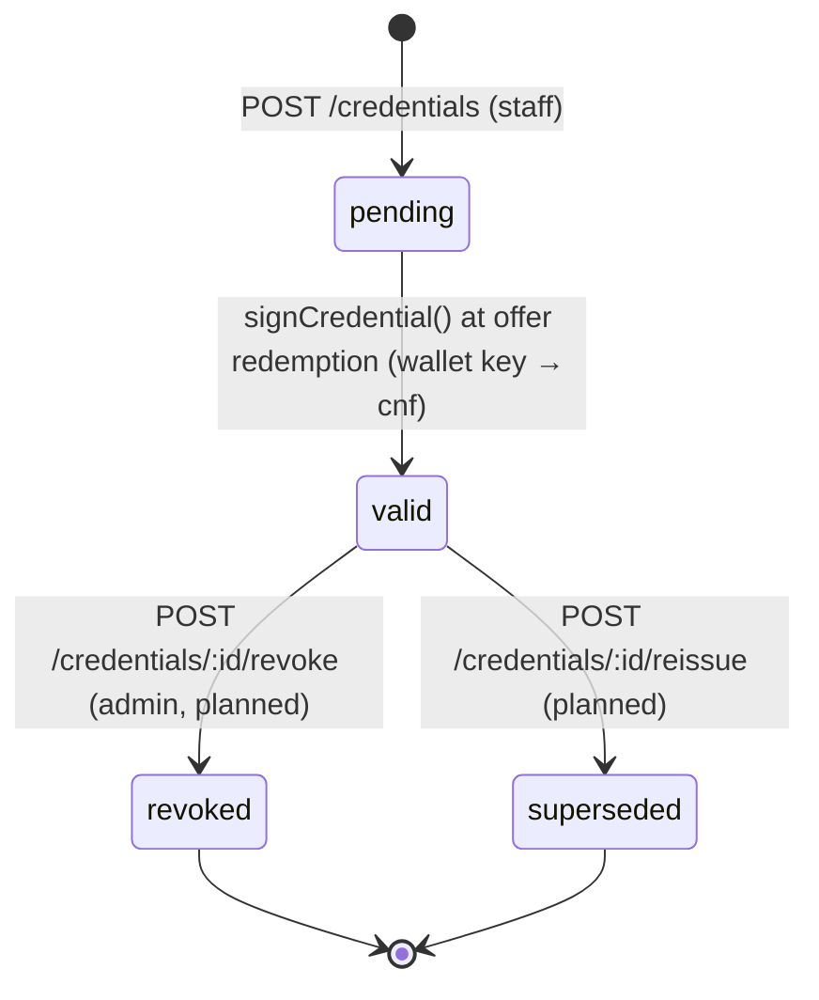

# Credential Issuance API

**Sprint:** 1 · **Requirements:** FR-ISS-01, FR-ISS-02, NFR-01, NFR-06, NFR-08
**Code:** `backend/src/routes/credentials.routes.ts`, `backend/src/services/credentials.service.ts`,
`crypto-core/src/common/jwk-thumbprint.ts` · **Migration:** none (uses `credential_records` from `0001`)
**Tests:** `backend/test/credentials.test.ts`, `crypto-core/test/jwk-thumbprint.test.ts`

## 1. Purpose

Issuer staff turn a **holder record** (an employee or customer) into a
**credential**: an RS256-signed SD-JWT VC that is bound to the holder's wallet.

Issuance happens in **two steps**:

1. **Create (this sprint, `POST /credentials`).** Staff create a **pending**
   credential record. Its claims are re-validated and snapshotted, and its expiry
   is fixed. **Nothing is signed yet.**
2. **Sign (built and tested now; called in Sprint 2).** When the wallet redeems
   the QR offer, the redemption endpoint calls
   `signCredential(credentialId, holderPublicJwk)`. This signs the SD-JWT with
   the issuer's active key and marks the record **valid**.

### Why signing waits for redemption

Every credential carries `cnf.jwk`: the public key of the holder's wallet. This
binds the credential to the device, and later the wallet proves possession with
a key-binding JWT (ES256). The wallet key only exists once the holder scans the
offer, so the server cannot sign any earlier. **A credential is never signed
without a holder key, and never twice.**

## 2. Lifecycle



| Status       | Signed? | Set by                                                                          |
| ------------ | ------- | ------------------------------------------------------------------------------- |
| `pending`    | No      | `POST /credentials`                                                             |
| `valid`      | Yes     | `signCredential()` – `issued_at`, `issuer_kid`, `holder_key_thumbprint` are set |
| `revoked`    | Yes     | Revoke (planned)                                                                |
| `superseded` | Yes     | Reissue (planned)                                                               |

The database enforces this: any status other than `pending` requires
`issued_at`, `issuer_kid` and `holder_key_thumbprint` (CHECK constraint in
`0001_initial_schema.sql`).

## 3. Endpoints (login required)

| Method | Path                                | Access           | Purpose                                          |
| ------ | ----------------------------------- | ---------------- | ------------------------------------------------ |
| POST   | `/api/v1/credentials`               | Officer or admin | Create a pending credential from a holder record |
| GET    | `/api/v1/credentials`               | Officer or admin | List the issuer's credentials (filter, paging)   |
| GET    | `/api/v1/credentials/:credentialId` | Officer or admin | One credential's metadata                        |

### POST `/api/v1/credentials`

```json
{ "holderId": "8d1c…-uuid", "credentialType": "EmploymentCredential" }
```

| Field            | Required | Rule                                                                                                             |
| ---------------- | -------- | ---------------------------------------------------------------------------------------------------------------- |
| `holderId`       | Yes      | UUID of a holder record **of the logged-in issuer**                                                              |
| `credentialType` | No       | Derived from the issuer type (employer → `EmploymentCredential`, bank → `KYCCredential`). If sent, it must match |

The issuer always comes from the login token. An `issuerId` in the body is ignored.

**What the server does:**

1. Locks the holder row for the rest of the transaction, so two simultaneous
   requests for one holder cannot both pass the duplicate check.
2. Recalculates `age_over_18` from `date_of_birth` (KYC, Decision 005) and
   validates the claims against the credential schema again, because the holder
   record may have been stored under an older schema version.
3. Rejects a second credential of the same type while one is `pending` or
   `valid`. Changes go through reissue.
4. Requires the issuer to have an **active** signing key.
5. Stores the record: `status = 'pending'`, `claims_snapshot`, `vct` and
   `schema_version` from the schema's `x-univault` block,
   `created_by_staff_id`, and `expires_at` (section 5).

**Response:** `201 Created` with `Location: /api/v1/credentials/<id>`:

```json
{
  "id": "3b9f…",
  "issuerId": "employer-a",
  "holder": { "id": "8d1c…", "externalRef": "STC-00001", "fullName": "Lahiru Silva" },
  "credentialType": "EmploymentCredential",
  "vct": "urn:univault:vct:EmploymentCredential:1",
  "schemaVersion": "1.0",
  "status": "pending",
  "issuerKid": null,
  "issuedAt": null,
  "expiresAt": "2027-11-20T08:41:12.345Z",
  "statusUpdatedAt": "2026-11-20T08:41:12.345Z",
  "revokedAt": null,
  "createdBy": { "id": "…", "displayName": "Serendib Trading Company (Demo) Officer" },
  "createdAt": "2026-11-20T08:41:12.345Z"
}
```

The response is **metadata only**: the holder's name and reference (as in the
holder list) and no other claims. It never contains a signature or any key
material. The holder-key thumbprint is not returned either.

### GET `/api/v1/credentials`

| Query      | Default | Meaning                                       |
| ---------- | ------- | --------------------------------------------- |
| `status`   | –       | `pending`, `valid`, `revoked` or `superseded` |
| `holderId` | –       | Only this holder's credentials (UUID)         |
| `limit`    | 20      | 1–100                                         |
| `offset`   | 0       | Number of records to skip                     |

**Response:** `{ "credentials": [ …metadata as above… ], "total": 7, "limit": 20, "offset": 0 }`,
newest first. Only the logged-in issuer's credentials are listed. A `holderId`
belonging to another issuer gives an empty list.

### GET `/api/v1/credentials/:credentialId`

Returns the same metadata object. Another issuer's credential returns `404`.

## 4. Signing: `signCredential(credentialId, holderPublicJwk)`

A service function in `credentials.service.ts`, with no HTTP route of its own.
The Sprint 2 offer-redemption endpoint (`POST /credential-offers/credential`)
will call it after checking the pre-authorised code.

**Checks, in order (nothing is signed if any fails):**

| Check                                                                                                                               | Error                                                  |
| ----------------------------------------------------------------------------------------------------------------------------------- | ------------------------------------------------------ |
| `holderPublicJwk` is an EC **P-256 public** JWK: `kty: EC`, `crv: P-256`, 32-byte `x` and `y`, **no `d`**, and a point on the curve | 400 `INVALID_HOLDER_KEY`                               |
| The credential exists                                                                                                               | 404 `CREDENTIAL_NOT_FOUND`                             |
| It is `pending`                                                                                                                     | 409 `CREDENTIAL_NOT_PENDING`                           |
| Its `expires_at` is in the future                                                                                                   | 409 `CREDENTIAL_EXPIRED`                               |
| The issuer has an active key                                                                                                        | 409 `ISSUER_KEY_MISSING`                               |
| `ISSUER_KEY_PASSPHRASE` is configured                                                                                               | 503 `KEY_PASSPHRASE_NOT_CONFIGURED`                    |
| The private key loads (`loadIssuerPrivateKey`)                                                                                      | 500 `ISSUER_KEY_UNAVAILABLE` (no paths in the message) |

**Then:**

1. Recalculates `age_over_18` on the **signing date**, which is the credential's issuance date.
2. Builds the envelope (below) and makes each subject claim listed in
   `x-univault.selectivelyDisclosable` that is present into a disclosure.
3. Calls crypto-core `createSdJwt` with the issuer's **active** key. After a
   rotation, new credentials use the new key, and older ones still verify with
   the retired key, which stays in the JWKS.
4. Updates the record **`WHERE status = 'pending'`**: `status = 'valid'`,
   `issued_at`, `issuer_kid`, `holder_key_thumbprint`, `status_updated_at`. If
   no row is updated, because another redemption won the race, the new SD-JWT is
   thrown away and the call fails with `409`. So a credential is signed at most once.
5. Returns `{ sdJwt, credential }`. The compact SD-JWT goes **to the caller
   only**: it is never stored or logged.

`cnf.jwk` contains only `kty`, `crv`, `x` and `y`. Any other members the wallet
sends (`kid`, `alg`, …) are dropped. `holder_key_thumbprint` is the RFC 7638
thumbprint of that key (SHA-256 over `{"crv","kty","x","y"}`), computed by
crypto-core's universal `computeEcJwkThumbprint`, so the wallet can compute the
same value.

### Envelope claims (always visible)

| Claim                   | Value                                                                                              |
| ----------------------- | -------------------------------------------------------------------------------------------------- |
| `iss`                   | `PUBLIC_BASE_URL/api/v1/issuers/<issuerId>`                                                        |
| `issuer_name`           | Issuer display name                                                                                |
| `vct`                   | From the schema, e.g. `urn:univault:vct:KYCCredential:1`                                           |
| `schema_version`        | From the schema, `"1.0"`                                                                           |
| `jti`                   | The credential record ID                                                                           |
| `iat`                   | Signing time (NumericDate)                                                                         |
| `exp`                   | `expires_at` (NumericDate)                                                                         |
| `cnf`                   | `{ "jwk": <holder's EC P-256 public key> }`                                                        |
| `status`                | `{ "status_uri": "PUBLIC_BASE_URL/api/v1/status/<id>" }`                                           |
| `kyc_verification_date` | **KYC only:** `YYYY-MM-DD` the pending record was created (when bank staff confirmed the CDD data) |
| `_sd`, `_sd_alg`        | Disclosure digests, `sha-256`                                                                      |

The JWT header is `{ "alg": "RS256", "typ": "dc+sd-jwt", "kid": "<issuer key thumbprint>" }`.
A verifier picks the key from `GET /api/v1/issuers/:issuerId/keys` by that `kid`.

## 5. Expiry rules

`expires_at` is fixed when the pending record is created (credential-schemas.md §6, Decision 005):

| Rule                                              | Value                                                                                         |
| ------------------------------------------------- | --------------------------------------------------------------------------------------------- |
| Default                                           | now + `x-univault.defaultValidity`: **P1Y** Employment, **P2Y** KYC                           |
| KYC with `id_document_expiry` (passport, licence) | No later than **00:00 UTC on the document's expiry date**                                     |
| `age_over_18` is `false`                          | No later than **00:00 UTC on the 18th birthday**. The credential is then reissued with `true` |

The earliest of these wins. An ID document that has already expired is
rejected with `400` (`claims.id_document_expiry`). Durations are added in UTC,
and a day that doesn't exist in the target month is clamped (29 Feb + P1Y → 28 Feb).

## 6. Errors

| Situation                                                       | Status | Code                                                               |
| --------------------------------------------------------------- | ------ | ------------------------------------------------------------------ |
| Not logged in                                                   | 401    | `UNAUTHENTICATED`                                                  |
| Invalid body, ID or query (e.g. `holderId` not a UUID)          | 400    | `VALIDATION_ERROR`                                                 |
| `credentialType` doesn't match the issuer type                  | 400    | `VALIDATION_ERROR` (`details[].path = credentialType`)             |
| Holder claims no longer pass the schema, or ID document expired | 400    | `VALIDATION_ERROR` (`details[].path` such as `claims.designation`) |
| Unknown holder, or another issuer's holder                      | 404    | `HOLDER_NOT_FOUND`                                                 |
| Unknown credential, or another issuer's credential              | 404    | `CREDENTIAL_NOT_FOUND`                                             |
| Holder already has a pending or valid credential of this type   | 409    | `ACTIVE_CREDENTIAL_EXISTS` (`details.credentialId`)                |
| Issuer has no active signing key                                | 409    | `ISSUER_KEY_MISSING` (run `npm run keys:init`)                     |

Signing errors are listed in section 4.

## 7. Privacy and security

| Rule                                      | How                                                                                                      |
| ----------------------------------------- | -------------------------------------------------------------------------------------------------------- |
| Issuer isolation                          | Every query filters on the issuer from `req.auth`; other issuers' data looks like `404`                  |
| No signed credentials on the server       | The SD-JWT is returned to the caller only; the test checks the database holds no signature or disclosure |
| No personal data in logs                  | Logs carry `credentialId`, `holderId`, `issuerId`, `staffId` only                                        |
| No key material in responses              | Metadata only; private keys stay encrypted in `ISSUER_KEYS_DIR`                                          |
| Holder key is public only                 | A JWK with `d` is refused, so a wallet can't leak its private key into a credential                      |
| Single use                                | `UPDATE … WHERE status = 'pending'`                                                                      |
| One active credential per holder and type | Holder row locked (`SELECT … FOR UPDATE`) during the check                                               |

## 8. Not in scope yet

- **Credential offers and redemption** (Sprint 2): `POST /credential-offers`
  creates the QR offer; `/credential-offers/token` and `/credential` redeem it
  and call `signCredential`.
- **Revoke and reissue** (next task): `POST /credentials/:id/revoke` and `/reissue`.
- **Status endpoint:** `GET /status/:credentialId`, the `status_uri` in every credential.
- **Expiring stale pending credentials:** a pending credential that is never
  redeemed keeps blocking a new one until it expires or is revoked.
  Revoke should also accept `pending` credentials.
