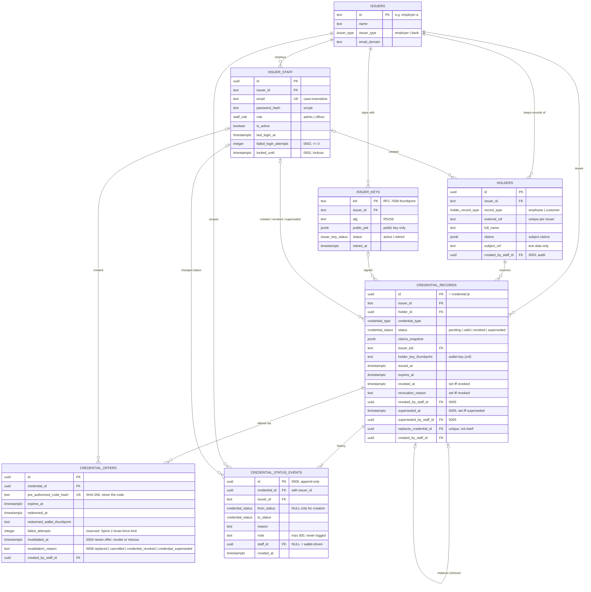
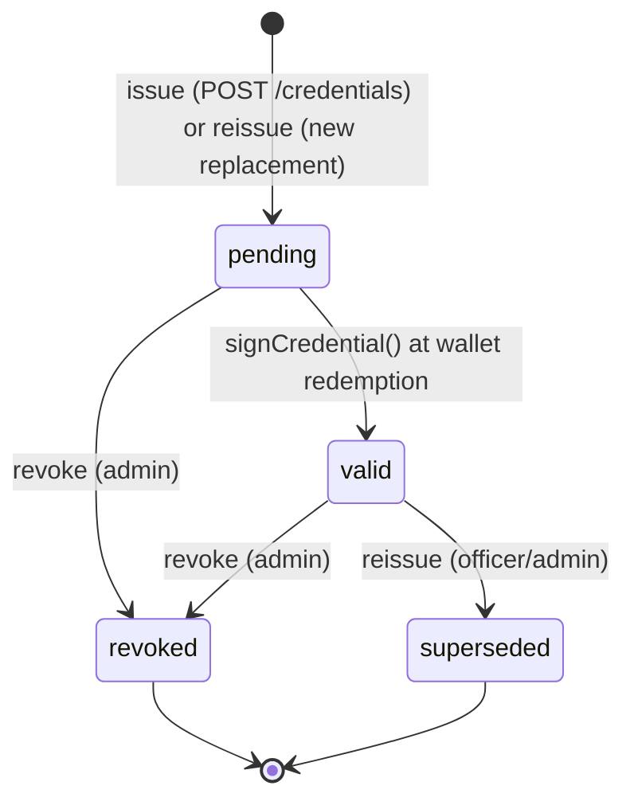

# UniVault Database Design (v1)

**Sprint:** 1 · **Database:** PostgreSQL · **Migrations:** `backend/migrations/0001`–`0008` (section 8)
**Requirements supported:** FR-ISS-01, FR-ISS-02, FR-ISS-03, FR-WAL-05, FR-BAK-01, NFR-08

## 1. Technology decision

| Choice                                                                  | Reason                                                                                                                                                                                                                                                                                                   |
| ----------------------------------------------------------------------- | -------------------------------------------------------------------------------------------------------------------------------------------------------------------------------------------------------------------------------------------------------------------------------------------------------- |
| **PostgreSQL**                                                          | Relational data with real relationships (issuer → holder → credential → offer, reissue chains). The database enforces integrity itself through foreign keys, CHECK constraints and unique indexes, not only application code. `jsonb` stores credential claims, which differ between Employment and KYC. |
| **PGlite** (embedded PostgreSQL, WebAssembly) for development and tests | Genuine PostgreSQL 17 with nothing to install and no native binaries. Data is kept in `backend/.data/` (git-ignored); tests use an in-memory database.                                                                                                                                                   |
| **Hosted PostgreSQL** (e.g. Neon, Supabase) for deployment              | Same SQL and queries; only `DATABASE_URL` changes. Production refuses the embedded database.                                                                                                                                                                                                             |
| **Hand-written SQL migrations**                                         | Reviewable DDL that can be quoted in the report. Each file is applied once, in order, inside a transaction. Edited files are detected by checksum.                                                                                                                                                       |
| **Drizzle ORM** for queries                                             | Typed queries and joins in TypeScript. A test checks the Drizzle definitions match the SQL tables column by column.                                                                                                                                                                                      |

## 2. Entity-relationship diagram

## 3. Tables

| Table                      | Purpose                                                                       | Key rules enforced by the database                                                                                                                                                                                                                                                                                                                                                                                        |
| -------------------------- | ----------------------------------------------------------------------------- | ------------------------------------------------------------------------------------------------------------------------------------------------------------------------------------------------------------------------------------------------------------------------------------------------------------------------------------------------------------------------------------------------------------------------- |
| `issuers`                  | Employers and banks                                                           | ID format `^[a-z0-9-]{3,40}$`; type is an enum                                                                                                                                                                                                                                                                                                                                                                            |
| `issuer_keys`              | RS256 **public** keys (private keys stay encrypted on disk)                   | `kid` is a 43-character thumbprint and must equal the JWK's `kid`; **only one active key per issuer** (partial unique index); a retired key must record `retired_at`                                                                                                                                                                                                                                                      |
| `issuer_staff`             | Issuer portal users                                                           | Email unique regardless of case; only scrypt hashes accepted (no plain-text passwords); `failed_login_attempts` counts consecutive failures (never negative) and `locked_until` holds a temporary lockout (migration 0002)                                                                                                                                                                                                |
| `holders`                  | An issuer's employee or customer record                                       | `external_ref` unique per issuer; the same person at two issuers is two rows; `claims` must be a JSON object; `created_by_staff_id` records which staff member created the record (migration 0003, set to NULL if that staff member is deleted)                                                                                                                                                                           |
| `credential_records`       | One row per credential (`id` = `jti`)                                         | See section 4                                                                                                                                                                                                                                                                                                                                                                                                             |
| `credential_offers`        | Pre-authorised offers behind the QR code                                      | Only a SHA-256 hash of the code is stored, unique; it cannot be created already expired; redemption time and wallet key are recorded together; `invalidated_at` is set when a newer offer replaces it or the credential is revoked or reissued, and an offer can never be both redeemed and invalidated (migration 0004); `invalidation_reason` says why, set exactly when `invalidated_at` is (migration 0008)           |
| `credential_status_events` | Append-only status history of every credential (migration 0005, Decision 012) | A trigger refuses UPDATE and DELETE; composite FK `(credential_id, issuer_id)` → `credential_records (id, issuer_id)`, so an event's issuer is always its credential's issuer; `from_status` is NULL exactly for creation (`→ pending`) and differs from `to_status`; `note` ≤ 500 characters; `staff_id` is `ON DELETE RESTRICT` (a staff member with history cannot be deleted); index on `(credential_id, created_at)` |
| `schema_migrations`        | Applied migrations and checksums                                              | Created by the migration runner                                                                                                                                                                                                                                                                                                                                                                                           |

## 4. Credential lifecycle and status

**`expired` is computed, not stored.** The diagram shows the stored statuses only (the
`credential_status` enum). A `valid` credential whose `expires_at` has passed
(`now >= expires_at`) is reported as `expired` by `effectiveStatus()` in
`backend/src/services/credential-status.ts`, which the public status endpoint and the
portal's `effectiveStatus` field both use (precedence revoked > superseded > expired >
valid). Nothing ever writes `expired` to the database, so no job is needed to keep it
up to date. `expires_at` is stored in whole seconds, so it equals the SD-JWT `exp`.

| Status       | Meaning                                        | Required fields (CHECK constraints, migration 0005)                                                                                                            |
| ------------ | ---------------------------------------------- | -------------------------------------------------------------------------------------------------------------------------------------------------------------- |
| `pending`    | Created by staff, offered, not yet in a wallet | No signing data, no revocation or supersede data                                                                                                               |
| `valid`      | Signed and delivered to the wallet             | `issued_at`, `issuer_kid`, `holder_key_thumbprint` (all three); `expires_at > issued_at`                                                                       |
| `revoked`    | Withdrawn by the issuer                        | `revoked_at` and `revocation_reason`; `revoked_by_staff_id` (NULL only if that staff member was deleted). Signing data only if it was revoked after redemption |
| `superseded` | Replaced by a reissued credential              | Signing data, `superseded_at` and `superseded_by_staff_id`; exactly one newer record points to it                                                              |

Revocation columns are NULL for every other status, and `superseded_at` /
`superseded_by_staff_id` are NULL unless `superseded`
(`credential_records_revocation_fields`, `credential_records_supersede_fields`,
`credential_records_signing_fields`). Migration 0005 replaced two 0001 rules:
"anything past pending was signed" (a pending credential can now be revoked
unsigned) and "revoked or superseded ⇒ `revoked_at`".

**Reason values (migration 0006).** `credential_records.revocation_reason` must be
one of the API's revocation reasons (`details_changed`, `employment_ended`,
`relationship_ended`, `wallet_lost_or_compromised`, `issued_in_error`, `other`),
and `credential_status_events.reason` one of the revocation or reissue reasons
(adds `validity_extension`), or NULL (`credential_records_revocation_reason_value`,
`credential_status_events_reason_value`). Both CHECKs were added `NOT VALID`:
rows stored earlier with free-text reasons are not checked and survive, while
every new row is. PostgreSQL would also check an UPDATE of an old row, but
revoked and superseded rows are final and events are append-only, so old rows
are never updated. A new reason needs a new migration (drop and re-add the
CHECK, again `NOT VALID`).

**Reissue (FR-ISS-03, Decision 012).** In one transaction:

1. The old record becomes `superseded` immediately.
2. A new `pending` record is created from the holder's current record, with
   `replaces_credential_id` = the old ID.
3. The old record's open offers are invalidated, and both changes are written to
   `credential_status_events`.

`replaces_credential_id` is **unique**, so a credential can be replaced only
once, and it can never point to itself. The full history can be followed in both
directions (API: `replacesCredentialId` / `replacedByCredentialId`).

**One active credential per holder and type.** A holder can have at most one
`pending` or `valid` credential of each type. This is enforced by the API, not by
a database constraint: issuance and reissue lock the holder row
(`SELECT … FOR UPDATE`) while they check, so two simultaneous requests can't both
succeed. Reissue supersedes the old record before the check, so a partial unique
index on `(holder_id, credential_type)` for pending and valid rows would also
work and could be added later as a backstop.

**Status history.** Every change is an event row: creation (`NULL → pending`,
staff), signing (`pending → valid`, no staff: wallet-driven), revocation and
supersede (with reason, optional note and staff). Migration 0005 backfilled
creation, signing and the last change for credentials that already existed.

**Status checks (FR-BAK-01, Decision 013).** `GET /api/v1/status/:credentialId` reads only
`status` and `expires_at` (one primary-key lookup) and returns the computed status, the
expiry and the check time ([status-api.md](../api/status-api.md)). Lookups are not stored
in the database. Credentials that were never signed (`issued_at IS NULL`: pending, or
revoked while pending) get the same 404 as unknown IDs.

**Development-only simulated expiry (migration 0007, temporary).** The dev route
`simulate-expiry` moves a valid credential's `expires_at` into the past and records a
`valid → valid` event with reason `dev_simulated_expiry`.
`credential_status_events_changes_status` now allows a same-status event for that reason
only, and the reason CHECK lists it (still `NOT VALID`).

## 5. Privacy and security decisions (PDPA, NFR-08)

- **No signed credentials are stored.** The issuer keeps only what it needs for
  status, revocation, reissue and audit.
- **No private keys in the database.** Only public JWKs.
- **No pre-authorised codes in the database.** Only their SHA-256 hash, so a
  database leak cannot be used to claim credentials.
- **Holder keys are stored as a thumbprint (fingerprint) only.**
- **Staff passwords are hashed with scrypt** (salted, memory-hard).
- **Deletes are restricted.** An issuer with holders, or a holder with
  credentials, cannot be deleted by accident.
- **Notes are personal data.** Revocation and reissue notes live only in
  `credential_status_events.note` (≤ 500 characters), are returned only to the
  credential's own issuer, and are never logged.
- **The audit trail cannot be rewritten.** `credential_status_events` is
  append-only (trigger), and a staff member who appears in it cannot be deleted.

## 6. Sample data

`npm run db:seed` loads the synthetic data from Task 4:

- **3 issuers**
- **6 staff logins:** one admin and one officer per issuer
- **100 holders:** 50 employees across the two employers, 50 bank customers

Credential records and offers are not seeded. Credential records are created
by the issuance API (`POST /api/v1/credentials`, as `pending`) and signed with
the issuer's real key when the wallet redeems its offer (Sprint 2). Offers are
created by `POST /api/v1/credential-offers` (only the SHA-256 hash of the
code is stored).

## 7. Commands (from `backend/`)

| Command              | Purpose                                                                     |
| -------------------- | --------------------------------------------------------------------------- |
| `npm run db:migrate` | Apply new migrations                                                        |
| `npm run db:seed`    | Migrate, then load sample issuers, staff and holders                        |
| `npm run db:inspect` | Show tables, row counts and sample rows                                     |
| `npm run db:reset`   | Delete the embedded development database and recreate it (development only) |

## 8. Migrations

Files in `backend/migrations/`, applied in order by `npm run db:migrate` (or at
start-up when `DB_AUTO_MIGRATE=true`). Each one runs once, inside a transaction,
and is recorded with its checksum in `schema_migrations`. An applied file must
never be edited; changes go in a new file.

| File                                    | Changes                                                                                                                                                                                                                                                                                                                                                                                                                                                                                            |
| --------------------------------------- | -------------------------------------------------------------------------------------------------------------------------------------------------------------------------------------------------------------------------------------------------------------------------------------------------------------------------------------------------------------------------------------------------------------------------------------------------------------------------------------------------- |
| `0001_initial_schema.sql`               | Enum types, the `set_updated_at` trigger function, and the six tables with their keys, CHECK constraints and indexes                                                                                                                                                                                                                                                                                                                                                                               |
| `0002_staff_login_protection.sql`       | `issuer_staff.failed_login_attempts` (integer, default 0, CHECK `>= 0`) and `issuer_staff.locked_until` (timestamptz) for the login lockout                                                                                                                                                                                                                                                                                                                                                        |
| `0003_holder_audit.sql`                 | `holders.created_by_staff_id` (uuid, references `issuer_staff`, `ON DELETE SET NULL`): which staff member created each holder record (audit)                                                                                                                                                                                                                                                                                                                                                       |
| `0004_offer_invalidation.sql`           | `credential_offers.invalidated_at` (timestamptz, NULL = not invalidated) and CHECK `invalidated_at IS NULL OR redeemed_at IS NULL`: a new offer invalidates the earlier usable one                                                                                                                                                                                                                                                                                                                 |
| `0005_revocation_and_status_events.sql` | `credential_records.revoked_by_staff_id`, `superseded_at`, `superseded_by_staff_id` (reusing 0001's `revoked_at`, `revocation_reason`, `replaces_credential_id`); drops 0001's `credential_records_check1` and `_check3` and adds the signing / revocation / supersede CHECKs; UNIQUE `(id, issuer_id)`; table `credential_status_events` with its append-only trigger and index; backfills events for existing credentials and moves the old superseded time from `revoked_at` to `superseded_at` |
| `0006_reason_value_checks.sql`          | CHECK `credential_records_revocation_reason_value` and `credential_status_events_reason_value`: reasons limited to the API enum values (or NULL). Added `NOT VALID`, so existing rows (free-text reasons from before 0005) are not checked                                                                                                                                                                                                                                                         |
| `0007_dev_simulated_expiry_event.sql`   | Re-adds `credential_status_events_reason_value` with `dev_simulated_expiry` (`NOT VALID`); replaces `credential_status_events_changes_status` so a `valid → valid` event is allowed only with that reason (validated). For the temporary dev route `simulate-expiry`; kept when the route is removed                                                                                                                                                                                               |
| `0008_offer_invalidation_reason.sql`    | `credential_offers.invalidation_reason` (text): `replaced` (newer offer), `cancelled` (`POST /credential-offers/:id/cancel`), `credential_revoked`, `credential_superseded`; CHECKs: one of these values, and set exactly when `invalidated_at` is. Older invalidated rows backfilled (newer offer created at that instant → `replaced`, else from the credential's status, else `replaced`). Decision 021                                                                                         |

`backend/src/db/schema.ts` (Drizzle) must match; `backend/test/db/schema.test.ts`
checks the two agree.
