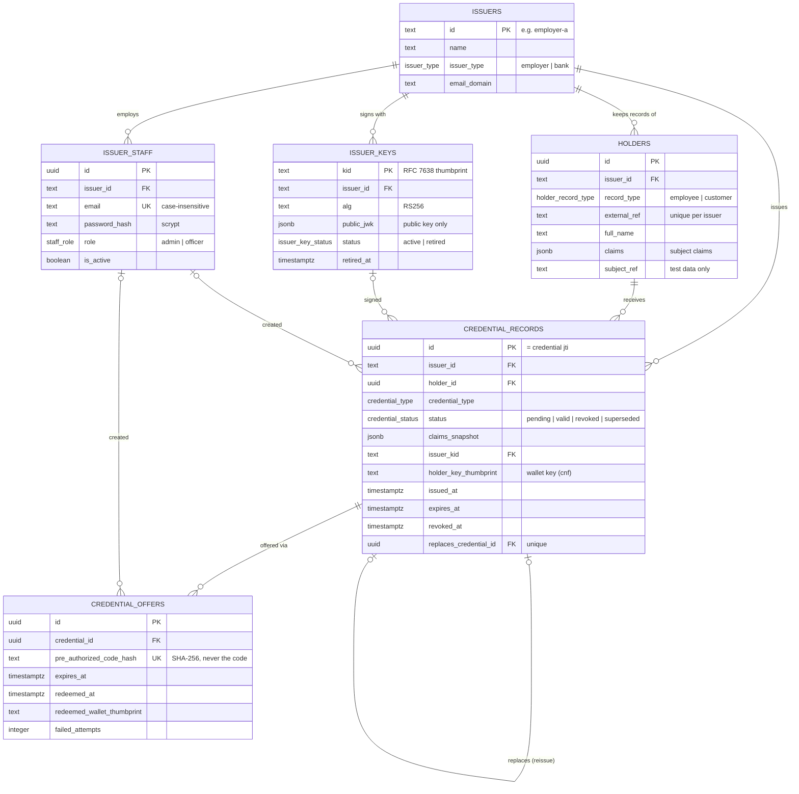

# UniVault Database Design (v1)

**Sprint:** 1 · **Database:** PostgreSQL · **Migration:** `backend/migrations/0001_initial_schema.sql`
**Requirements supported:** FR-ISS-01, FR-ISS-02, FR-ISS-03, FR-WAL-05, FR-BAK-01, NFR-08

## 1. Technology decision

| Choice                                                                  | Reason                                                                                                                                                                                                                                                                                                   |
| ----------------------------------------------------------------------- | -------------------------------------------------------------------------------------------------------------------------------------------------------------------------------------------------------------------------------------------------------------------------------------------------------- |
| **PostgreSQL**                                                          | Relational data with real relationships (issuer → holder → credential → offer, reissue chains). The database enforces integrity itself through foreign keys, CHECK constraints and unique indexes, not only application code. `jsonb` stores credential claims, which differ between Employment and KYC. |
| **PGlite** (embedded PostgreSQL, WebAssembly) for development and tests | Genuine PostgreSQL 17 with nothing to install and no native binaries. Data is kept in `backend/.data/` (git-ignored); tests use an in-memory database.                                                                                                                                                   |
| **Hosted PostgreSQL** (e.g. Neon, Supabase) for deployment              | Same SQL and queries; only `DATABASE_URL` changes. Production refuses the embedded database.                                                                                                                                                                                                             |
| **Hand-written SQL migrations**                                         | Reviewable DDL that can be quoted in the report. Each file is applied once, in order, inside a transaction. Edited files are detected by checksum.                                                                                                                                                       |
| **Drizzle ORM** for queries                                             | Typed queries and joins in TypeScript. A test checks the Drizzle definitions match the SQL tables column by column.                                                                                                                                                                                      |

## 2. Entity-relationship diagram

## 3. Tables

| Table                | Purpose                                                     | Key rules enforced by the database                                                                                                                                   |
| -------------------- | ----------------------------------------------------------- | -------------------------------------------------------------------------------------------------------------------------------------------------------------------- |
| `issuers`            | Employers and banks                                         | ID format `^[a-z0-9-]{3,40}$`; type is an enum                                                                                                                       |
| `issuer_keys`        | RS256 **public** keys (private keys stay encrypted on disk) | `kid` is a 43-character thumbprint and must equal the JWK's `kid`; **only one active key per issuer** (partial unique index); a retired key must record `retired_at` |
| `issuer_staff`       | Issuer portal users                                         | Email unique regardless of case; only scrypt hashes accepted (no plain-text passwords)                                                                               |
| `holders`            | An issuer's employee or customer record                     | `external_ref` unique per issuer; the same person at two issuers is two rows; `claims` must be a JSON object                                                         |
| `credential_records` | One row per credential (`id` = `jti`)                       | See section 4                                                                                                                                                        |
| `credential_offers`  | Pre-authorised offers behind the QR code                    | Only a SHA-256 hash of the code is stored, unique; it cannot be created already expired; redemption time and wallet key are recorded together                        |
| `schema_migrations`  | Applied migrations and checksums                            | Created by the migration runner                                                                                                                                      |

## 4. Credential lifecycle and status

| Status       | Meaning                                        | Required fields (CHECK constraints)                                          |
| ------------ | ---------------------------------------------- | ---------------------------------------------------------------------------- |
| `pending`    | Created by staff, offered, not yet in a wallet | none extra                                                                   |
| `valid`      | Signed and delivered to the wallet             | `issued_at`, `issuer_kid`, `holder_key_thumbprint`; `expires_at > issued_at` |
| `revoked`    | Withdrawn by the issuer (e.g. resignation)     | `revoked_at` (plus optional `revocation_reason`)                             |
| `superseded` | Replaced by a reissued credential              | `revoked_at`; a newer record points to it                                    |

**Reissue (FR-ISS-03).** When a holder's data changes:

1. The old record becomes `superseded`.
2. A new record is created with `replaces_credential_id` = the old ID.

This column is **unique**, so a credential can be replaced only once, and it can
never point to itself. The full history can be followed in both directions.

**Status checks (FR-BAK-01).** `status`, `status_updated_at` and `revoked_at`
are what the wallet and verifiers read through the status endpoint.

## 5. Privacy and security decisions (PDPA, NFR-08)

- **No signed credentials are stored.** The issuer keeps only what it needs for
  status, revocation, reissue and audit.
- **No private keys in the database.** Only public JWKs.
- **No pre-authorised codes in the database.** Only their SHA-256 hash, so a
  database leak cannot be used to claim credentials.
- **Holder keys are stored as a thumbprint (fingerprint) only.**
- **Staff passwords are hashed with scrypt** (salted, memory-hard).
- **Deletes are restricted.** An issuer with holders, or a holder with
  credentials, cannot be deleted by accident.

## 6. Sample data

`npm run db:seed` loads the synthetic data from Task 4:

- **3 issuers**
- **6 staff logins:** one admin and one officer per issuer
- **100 holders:** 50 employees across the two employers, 50 bank customers

Credential records and offers are created by the issuance API (later Sprint 1
tasks), because they must be signed with the issuer's real key.

## 7. Commands (from `backend/`)

| Command              | Purpose                                                                     |
| -------------------- | --------------------------------------------------------------------------- |
| `npm run db:migrate` | Apply new migrations                                                        |
| `npm run db:seed`    | Migrate, then load sample issuers, staff and holders                        |
| `npm run db:inspect` | Show tables, row counts and sample rows                                     |
| `npm run db:reset`   | Delete the embedded development database and recreate it (development only) |
