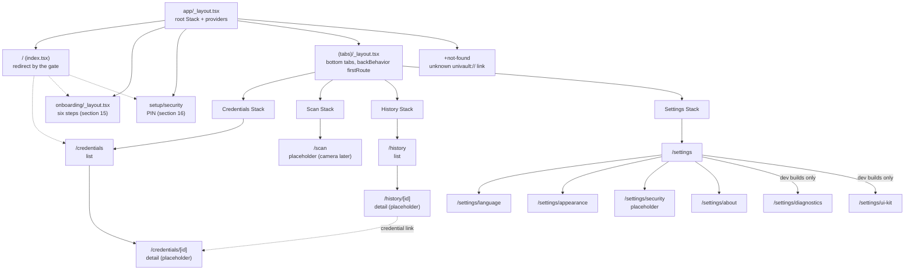
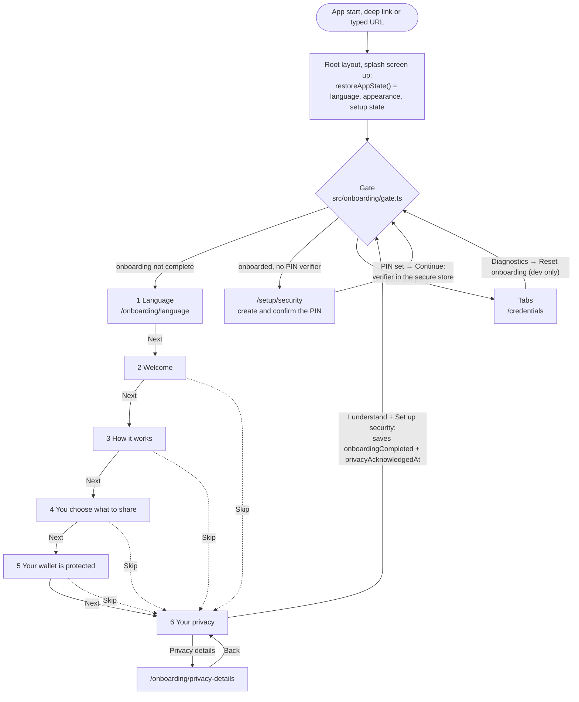
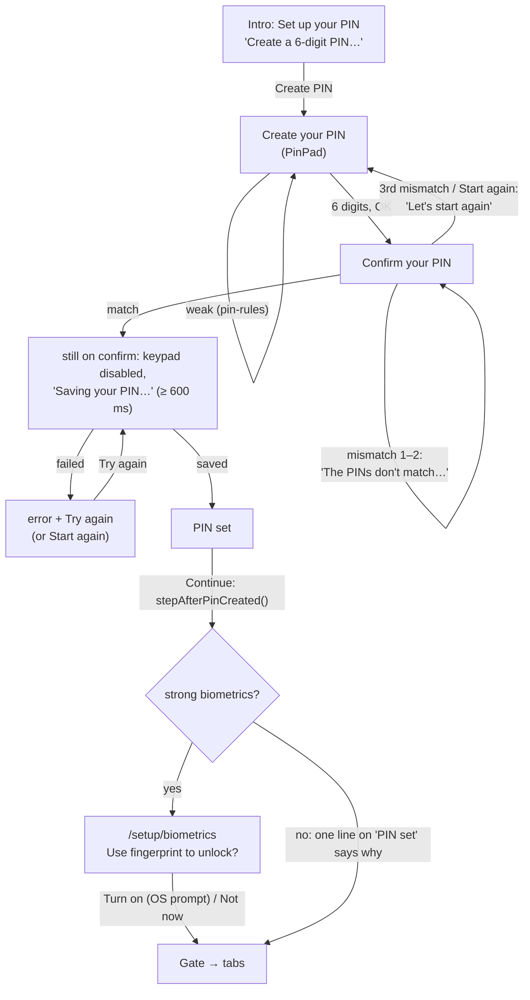

# Mobile wallet (React Native + Expo)

**Sprint:** 2 · **Requirements:** NFR-02 (English / Sinhala), NFR-05, NFR-06 · **Decision:**
022 (Expo Router + Expo Go for Sprint 2) · **Code:** [`wallet/`](../../wallet/) ·
**Setup:** [wallet/README.md](../../wallet/README.md)

The holder's app. This document describes the project as initialised on 27 Nov 2026
(navigation, theme, languages, shared code, Diagnostics) and the **application shell** added the
same day: a stack per tab, the shared component set, credential status badges, light/dark
theming with a contrast rule, saved preferences and the developer UI kit. On 28 Nov 2026 it gained
**onboarding** (first start), the **gate** that keeps the wallet closed until onboarding and
security setup are done (section 15), and the **Appearance** setting (section 7); later that
day the **PIN** (section 16, [wallet-pin.md](../security/wallet-pin.md), Decision 025) and the
**wallet typography and layout pass** (section 17). Credential redemption (OpenID4VCI),
biometrics, app lock, the encrypted vault and presentations are added by the next Sprint 2 tasks
and will extend this document.

## 1. Stack

| Part        | Choice                                                                                                               |
| ----------- | -------------------------------------------------------------------------------------------------------------------- |
| Runtime     | Expo **SDK 58** (expo 58.1.0), React Native 0.88.1, React 19.3.0, Hermes                                             |
| Navigation  | Expo Router 58 (file-based): a root Stack, JavaScript bottom tabs (`expo-router/js-tabs`)                            |
| Language    | TypeScript **6.0.3**, strict (`exactOptionalPropertyTypes`, `noUncheckedIndexedAccess`)                              |
| i18n        | i18next 27.2.7 + react-i18next 18.0.3 + expo-localization                                                            |
| Preferences | `@react-native-async-storage/async-storage` 2.2.0 (language, appearance, onboarding flags; section 9)                |
| Drawings    | `react-native-svg` 15.16.0 (`npx expo install`; the onboarding illustrations, section 15)                            |
| PIN         | `expo-secure-store` 58.0.3, `expo-screen-capture` 58.0.6 (`npx expo install`), `@noble/hashes` 2.4.0 (scrypt)        |
| Fonts       | Noto Sans 400/500/600 + Noto Sans Sinhala 400/600 (`@expo-google-fonts/*` 0.4.2, OFL, per-weight imports), expo-font |
| Icons       | `@expo/vector-icons` (Ionicons), decorative only                                                                     |
| Tests       | Jest 30 + jest-expo 58 + React Native Testing Library 14                                                             |
| Shared code | `@univault/crypto-core` (universal entry), `@univault/portal-ui/tokens`                                              |

Every version is pinned exactly; the Expo-managed packages were added with `npx expo install`
so they match SDK 58, and `npm run doctor` (expo-doctor) checks the alignment (20/20 checks).

**Why TypeScript 6.0.3 here only:** Expo's version registry, `npx expo install --check` and
expo-doctor all expect `typescript ~6.0.3` for SDK 58, and Expo Go runs only the current SDK.
The other packages stay on 5.9.3; never TypeScript 7 (typescript-eslint does not support it).
Root lint parses every package with the root's TypeScript 6.0.3 and typescript-eslint 8.73.0
(supports TypeScript ≥ 4.8.4 < 6.1.0) and uses no type-aware rules, so the mix lints cleanly.

## 2. Structure

```
wallet/
  index.ts                  entry: src/lib/crypto-setup first, then expo-router/entry
  app/                      routes (Expo Router), section 3
  src/components/           the shared components, section 5
  src/credentials/          status.ts: backend status → wallet state, tone and icon (section 6)
  src/onboarding/           steps.ts, gate.ts (THE gate rule), SetupProvider, security-setup.ts
                            (a PIN verifier exists), OnboardingStep, illustrations (section 15)
  src/security/             pin.ts (verifier, verifyPin, attempt record), pin-rules.ts,
                            constant-time.ts, screen-capture.ts, setup-flow.ts (section 16)
  src/theme/                theme from the shared tokens (light/dark), useTheme(), appearance.tsx
                            (Appearance setting), reduce-motion.ts, contrast.ts
  src/i18n/                 i18next; languages.ts; locales/en.ts, locales/si.ts
  src/lib/                  crypto-setup.ts, crypto-check.ts, preferences.ts, app-state.ts, format.ts
  src/navigation/           routes.ts (THE route table), tabs.ts, TabStack.tsx, stack-options.tsx,
                            status-bar.tsx, navigation-theme.ts
  src/services/             api-client.ts (EXPO_PUBLIC_API_BASE_URL)
  src/config/               env.ts (API URL rules), app-info.ts (versions, __DEV__ gates)
  src/fixtures/             synthetic SD-JWT for Diagnostics; sample-data.ts (dev builds only)
```

## 3. Navigation

### 3.1 Map

A root Stack holds onboarding, security setup and the tab navigator; **each tab has its own
Stack**, so a tab keeps its place when you switch away and back, and the tab bar stays visible
inside a tab. The gate (section 15) decides which of the three a holder may see.



| Route                   | File                              | Screen                                                                                                     |
| ----------------------- | --------------------------------- | ---------------------------------------------------------------------------------------------------------- |
| `/`                     | `index.tsx`                       | Redirect where the gate says: onboarding, setup or `/credentials`                                          |
| `/credentials`          | `(tabs)/credentials/index.tsx`    | Dev: sample CredentialCards (labelled); release: EmptyState                                                |
| `/credentials/[id]`     | `(tabs)/credentials/[id].tsx`     | Status, issuer, holder, expiry (sample data); unknown id → "not found"                                     |
| `/scan`                 | `(tabs)/scan/index.tsx`           | EmptyState: offers and verification requests (camera in a later task)                                      |
| `/history`              | `(tabs)/history/index.tsx`        | Dev: sample entries; release: EmptyState                                                                   |
| `/history/[id]`         | `(tabs)/history/[id].tsx`         | With, when, link to the credential; unknown id → "not found"                                               |
| `/settings`             | `(tabs)/settings/index.tsx`       | Language, Security, About; Developer section (dev builds)                                                  |
| `/settings/language`    | `(tabs)/settings/language.tsx`    | English / සිංහල radio group, saved                                                                          |
| `/settings/appearance`  | `(tabs)/settings/appearance.tsx`  | Automatic / Light / Dark radio group, saved (section 7)                                                    |
| `/settings/security`    | `(tabs)/settings/security.tsx`    | Unlock with fingerprint switch, what the phone supports, Test unlock, Change PIN (coming soon); section 18 |
| `/settings/lock-delay`  | `(tabs)/settings/lock-delay.tsx`  | "Lock after leaving the app": Immediately / 30 s / 1 min / 5 min (section 19)                              |
| `/settings/about`       | `(tabs)/settings/about.tsx`       | Description, app version, Expo SDK, Noto Sans Sinhala licence (OFL 1.1)                                    |
| `/settings/diagnostics` | `(tabs)/settings/diagnostics.tsx` | Dev builds only (section 11)                                                                               |
| `/settings/ui-kit`      | `(tabs)/settings/ui-kit.tsx`      | Dev builds only (section 10)                                                                               |
| `/onboarding/*`         | `onboarding/*.tsx`                | The six onboarding steps and Privacy details (section 15)                                                  |
| `/setup/security`       | `setup/security.tsx`              | Create and confirm the 6-digit PIN, "PIN set" (section 16)                                                 |
| `/setup/biometrics`     | `setup/biometrics.tsx`            | "Use fingerprint to unlock?" (only with strong biometrics; section 18)                                     |
| anything else           | `+not-found.tsx`                  | "Page not found" + Go to my credentials                                                                    |

### 3.2 Typed, stable route names

Every path comes from **`src/navigation/routes.ts`** (`ROUTES.credentials`,
`ROUTES.credential(id)`, …; ids are URL-encoded as one segment). No screen writes a path string.
`test/routes.test.tsx` checks `ROUTE_FILES` against the files in `app/` in both directions and
renders every route on the real tree. Expo Router's own typed routes
(`experiments.typedRoutes`) stay **off**: their types are generated into the git-ignored
`.expo/types` by `expo start`, so a fresh clone (CI, `npm run typecheck`) would check against
different types than a developer machine.

### 3.3 Back navigation

- **Header back button:** the shared `Header` (drawn by every Stack through
  `src/navigation/stack-options.tsx`) shows a back button (iOS chevron, Android arrow, spoken
  "Back", 44 pt) only when the stack has a screen to go back to, so a tab's root never has one.
- **Deep links:** each tab stack sets `unstable_settings.anchor = 'index'`, so a link straight
  to `/credentials/<id>` still has the list underneath and Back goes to the list.
- **Android hardware back button** (follows the platform norm): pops the current tab's stack; at
  a tab's root it goes to the Credentials tab (`backBehavior: 'firstRoute'`); only at the
  Credentials root is it left unhandled, so Android closes (backgrounds) the app.
  `ConfirmDialog` closes on back (`onRequestClose` = cancel). `test/navigation.test.tsx`
  simulates `BackHandler` and checks each step.
- **Not found:** unknown routes render `+not-found`; unknown credential / history ids show a
  "not found" state with a way back to the list.

The deep-link scheme is `univault://` (`app.config.ts`). OS-level handling of
`openid-credential-offer://` links is a development-build feature (section 12).

## 4. Shared code and design tokens

### 4.1 crypto-core

- `@univault/crypto-core` is a `file:../crypto-core` dependency, built by the `pre*` hooks
  (`build:deps`), like the backend. Only the **universal entry** (`"."`) is used; Metro refuses
  `@univault/crypto-core/node` with an explanatory error (it needs `node:crypto`).
- **Metro** (`metro.config.js`): crypto-core is a watch folder (the npm symlink points outside
  `wallet/`), and modules resolve from `wallet/node_modules` first, then crypto-core's own
  `node_modules` (`@sd-jwt/core`, `@noble/hashes`). Paths are built with `path.join`, and the
  block list accepts either separator, so it works on Windows.
- **Hermes setup** (`src/lib/crypto-setup.ts`, imported first by `index.ts`): installs
  `crypto.getRandomValues` from `expo-crypto` (Hermes has none; spike limitation L3) and
  checks `TextEncoder`, `TextDecoder` (needed by `@owf/identity-common`, L4) and `BigInt` (L5),
  throwing a clear error at start-up if one is missing. No base64 polyfill: `@sd-jwt/core` and
  `@owf/identity-common` carry their own base64url code (no `atob`, `btoa` or `Buffer`).
  `crypto.subtle` is not available and not used.
- **Jest** runs the same code: `.mjs` files (`@sd-jwt/core`, `@owf/identity-common` are
  ESM-only) get jest-expo's Babel transform, and `modulePaths` resolves the symlinked files'
  imports from `wallet/node_modules`.

### 4.2 Design tokens

- **Single source:** `portal-ui/src/tokens.ts` ("Navy and azure", Decision 024; plain data:
  light and dark colours with the design-system names, usage tokens, status sets, component
  token sets, font families, the type scale, spacing, layout lengths, radii).
  `portal-ui/theme.css` is **generated** from it by `npm run build` in portal-ui
  (`renderThemeCss()`), and a portal-ui test fails if the committed CSS differs from what the
  tokens generate (the portal CSS changes with the tokens on purpose).
- **Wallet:** imports `@univault/portal-ui/tokens`. portal-ui is **not** an npm dependency of
  the wallet: a `file:` link exposed portal-ui's own development copy of React (for its web
  tests) to expo-doctor's duplicate-native-module check. Instead the specifier is mapped
  straight to the **source** file `portal-ui/src/tokens.ts` (plain TypeScript, no imports), so
  a fresh clone needs no portal-ui build: Metro (`resolveRequest`), TypeScript (`paths`) and Jest
  (`moduleNameMapper`). `app.config.ts` imports `../portal-ui/src/tokens.ts` (Expo's config
  loader; hence `allowImportingTsExtensions`), and the artwork script loads it with Node's
  built-in type stripping. Proven on 27 Nov 2026 with `portal-ui/dist` deleted: typecheck,
  tests, `npx expo export --platform android` and expo-doctor all pass.
- **`src/theme`** IS the tokens: `lightColors` / `darkColors` with the design-system names
  (section 7), the type scale (px = points), spacing on a 4 pt base, radii. No colour, size or radius
  value is written in the wallet: a test scans `src/` and `app/` for hex colours, and ESLint's
  `react-native/no-color-literals` rejects colour literals in styles.

## 5. Components (`src/components`)

Themed only from the tokens, accessible (section 8) and tested (`test/components.test.tsx`).
Text comes in already translated (`t()`); the few fixed words a component shows itself (Back,
Cancel, Try again, Loading…, Dismiss message, Status last checked …) it translates itself.

| Component         | One line                                                                                                                                                                                                                                                                                                                                                       |
| ----------------- | -------------------------------------------------------------------------------------------------------------------------------------------------------------------------------------------------------------------------------------------------------------------------------------------------------------------------------------------------------------- |
| `AppText`         | Themed text in the design type scale (`display` … `caption`; `mono` = system monospace, Diagnostics only), tones text / muted / subtle / accent / error / on-brand / on-brand-muted, Noto Sans or Noto Sans Sinhala by weight, dynamic type (capped 2×)                                                                                                        |
| `Screen`          | `bg` page, safe-area aware (left/right; the Header handles the top), space-4 sides and top, space-6 between sections and at the bottom, at most 560 pt wide (centred on tablets), scrolls by default                                                                                                                                                           |
| `Header`          | Title (wraps; h2 20 on tab roots, h3 16 on detail screens), optional back button, up to two icon actions; taller bar (space-4 / space-3 around the title on roots, space-2 on detail) below the safe-area inset; side padding space-4; `tone` surface or brand (the Credentials home)                                                                          |
| `Button`          | Design kinds `primary` (accent), `secondary` (surface + border-strong), `text` (accent-text), `destructive` (status-revoked), `onBrand` (role-tag-bg, on navy only); `loading` and `disabled`; optional icon; 44 pt, radius-md, label 16 / 600                                                                                                                 |
| `ChoiceList`      | A single choice as a radio group (`radio` + `checked`, filled / empty radio icon, selected = accent fill): labels only, body 16, rows ≥ 56 pt (Language, Appearance, onboarding language)                                                                                                                                                                      |
| `Checkbox`        | A `checkbox` row with its checked state, box / ticked-box icon, 44 pt, wrapping label ("I understand")                                                                                                                                                                                                                                                         |
| `Card`            | `surface` with a hairline `border` and an optional `h3` header title                                                                                                                                                                                                                                                                                           |
| `CredentialCard`  | `brand` card, radius-lg: issuer initial on a role-tag-bg circle, issuer and expiry `on-brand-muted`, title and holder `on-brand`, StatusBadge in its own pill; pressable                                                                                                                                                                                       |
| `StatusBadge`     | A credential's state: icon + word in its status set's pill (section 6)                                                                                                                                                                                                                                                                                         |
| `Badge`           | Pill (radius-sm) with a word and optional icon: a status set (valid, expired, revoked, pending) or neutral                                                                                                                                                                                                                                                     |
| `ListItem`        | Row inside a Card (min 56 pt): leading icon (text-muted), optional field `label` above the title (14, muted), title (16), subtitle and trailing value (14, muted), chevron; a pressable row is one button                                                                                                                                                      |
| `SectionHeader`   | `h3` heading above a group; `Section` = heading + content kept together (space-2), the Screen puts space-6 between sections                                                                                                                                                                                                                                    |
| `PinPad`          | Six dots (filled / outlined) announced as "3 of 6 digits entered" (never the digits, polite live region) and a 1–9 / 0 / Delete pad, keys ≥ 56 pt, the position left of 0 an invisible spacer (no border or fill, not focusable or announced), no system keyboard, shake on error unless reduce motion; controlled (the parent clears the value on completion) |
| `BottomActions`   | Footer of onboarding and setup screens: surface, border top, full-width buttons stacked (primary first), space-4 + bottom inset, ≤ 560 pt                                                                                                                                                                                                                      |
| `Toggle`          | On/off switch in the tokens (accent / border-strong track, surface thumb that moves), role `switch` with checked and disabled announced, 44 pt; controlled                                                                                                                                                                                                     |
| `ProcessingState` | Indeterminate spinner (native) + message ("Saving your PIN…", "Checking your PIN…") as one busy progressbar, announced on appearance; used with `withMinimumDuration` (≥ 600 ms) and `yieldToUi` from `src/lib/timing.ts`                                                                                                                                      |
| `LoadingState`    | Spinner + visible message, announced as busy                                                                                                                                                                                                                                                                                                                   |
| `EmptyState`      | Decorative icon (text-muted on surface-sunken), title, explanation, optional action                                                                                                                                                                                                                                                                            |
| `ErrorState`      | Alert icon (revoked colours), title, message announced as an alert, optional "Try again"                                                                                                                                                                                                                                                                       |
| `OfflineNotice`   | Stale / offline banner: `status-expired-bg` with `status-expired-text` and an offline icon, "Status last checked …" (for the status-check task; in the UI kit now)                                                                                                                                                                                             |
| `Toast`           | `ToastProvider` + `useToast().show({ message, tone })`: inverted (text colour as background), one at a time, FIFO queue (max 3), 4 s, close button                                                                                                                                                                                                             |
| `ConfirmDialog`   | Modal title + message, Confirm / Cancel, destructive variant, loading; back button and backdrop (brand scrim) cancel                                                                                                                                                                                                                                           |
| `Icon`            | The one wrapper over `@expo/vector-icons` Ionicons: theme colour, decorative unless given a `label`                                                                                                                                                                                                                                                            |
| `ErrorBoundary`   | Friendly fallback with "Try again"; reports the error name only                                                                                                                                                                                                                                                                                                |

## 6. Credential status badge

`src/credentials/status.ts` holds the ONE mapping from the backend's effective status (the public
status endpoint, `effectiveStatus()`) to the wallet state, `walletStatusFromBackend()`, plus two
wallet-only states. Each state uses one of the design system's four status colour sets, with its
own icon and word. Anything else (including `pending`, which never reaches a wallet) is shown as
"Not checked yet" rather than guessed.

| Backend effective status | Wallet state | Colour set | English         | Sinhala          | Icon (Ionicons)    |
| ------------------------ | ------------ | ---------- | --------------- | ---------------- | ------------------ |
| `valid`                  | `valid`      | valid      | Valid           | වලංගුයි            | `checkmark-circle` |
| `expired`                | `expired`    | expired    | Expired         | කල් ඉකුත් වූ         | `time` (clock)     |
| `revoked`                | `revoked`    | revoked    | Revoked         | අවලංගු කළ         | `ban`              |
| `superseded`             | `replaced`   | pending    | Replaced        | ප්‍රතිස්ථාපනය කළ    | `swap-horizontal`  |
| – (stale / offline)      | `notChecked` | expired    | Not checked yet | තවම පරීක්ෂා කර නැත | `cloud-offline`    |
| – (request running)      | `checking`   | pending    | Checking…       | පරීක්ෂා කරමින්…      | `sync` (refresh)   |

- **Design rules:** stale or offline status uses the expired colours; verification failures and
  anomalies (later) use the revoked colours; status colours mean nothing else. A status icon
  never sits directly on navy: on a credential card it is always in its `status-*-bg` badge (radius-sm)
  (tested).
- **Same words as the issuer portal:** the four shared labels ("Valid" replaced "Active" on
  27 Nov 2026) are copied from the portal's `credentials.statuses` in `en.ts` and `si.ts`, and the
  credential type names from its `credentialTypes`. `test/status.test.tsx` imports the portal's
  locale files and fails if any of them differ. The portal says "Replaced" / "ප්‍රතිස්ථාපනය කළ"
  for `superseded` everywhere (badge, holder page, dashboard).

## 7. Theming and contrast

- **"Navy and azure"** ([design-system.md](../design/design-system.md), Decision 024): light and
  dark. The same token names in both themes (`theme.colors.brand`, `textMuted`, `statusValidBg` …),
  values from `portal-ui/src/tokens.ts`. In dark, `brand` is lighter than `bg`, so credential
  cards still stand out, and `accent` is a lighter azure with a deep navy label.
- **Appearance setting** (Settings → Appearance, below Language; `src/theme/appearance.tsx`):
  "Automatic" (default), "Light" or "Dark", in that order, labels only (no helper text; the
  helper line tried earlier on 28 Nov was removed) (Sinhala ස්වයංක්‍රීය / ආලෝකමත් / අඳුරු, for native review);
  the Settings row shows the current label. The stored values are unchanged (`system` | `light` |
  `dark`): "Automatic" is only the new label for `system` (it was "Use device setting" until 28 Nov),
  so choices saved before the rename still work (tested). The **effective scheme** is the choice,
  or the phone's scheme (`useColorScheme()`) for Automatic; only then do live system changes
  apply. `useTheme()` reads it, so every screen,
  Header, the tab bar, dialogs and toasts change at once; the navigation container gets a theme
  from the same tokens (`navigation-theme.ts`) and the phone's root view the theme's `bg`
  (`expo-system-ui`). Native UI follows through `Appearance.setColorScheme()` (set in the same
  event as the choice; `unspecified` hands it back to the phone). Saved as `univault.appearance`
  and restored with the language before the first frame (no flash of the wrong theme).
- **Status bar** (`src/navigation/status-bar.tsx`): ONE `<StatusBar>` whose style is computed,
  never set imperatively: light content while a screen with the navy header is focused
  (`useBrandStatusBar()`, the Credentials home) in both themes; otherwise dark content on light,
  light content on dark. So a theme change, even a live system change on the home screen, never
  leaves dark icons on navy.
- **60-30-10 in the wallet:** `bg` screens, a `surface` bottom tab bar with a `border` top edge
  and `surface` list rows; a `brand` header on the Credentials home screen (with light status-bar
  content while it is focused) and `brand` credential cards (radius-lg); `accent` for the one
  primary action per screen and the active tab icon and label (inactive: `text-muted`).
- **Type:** the design scale (display 32/40 … caption 12/18, body 16/26), Noto Sans 400/500/600
  and Noto Sans Sinhala 400/600 (a 500 label uses Sinhala 600), the same sizes in both scripts.
  Only the five weights are bundled (per-weight imports; a package's index would add about 20
  unused font files; a test guards it). Mono: the system monospace on Diagnostics only (bundling
  JetBrains Mono for one developer screen was not worth the app size).
- **Contrast rule:** every pairing the design system uses (`DESIGN_PAIRS`) and every component
  pair (`colorPairs()`, built from `toneColors` / `buttonColors`) in `src/theme/contrast.ts` must
  meet **WCAG AA in light and dark**: 4.5:1 normal text; 3:1 large text, icons, input borders and
  the focus ring. Translucent `role-tag-bg` is composited over `brand`. `test/contrast.test.ts`
  checks 91 pairs in light and 90 in dark (since 28 Nov also the onboarding illustration lines on
  navy, the progress dots, the checkbox and point icons; lowest unchanged: text 4.58:1 light,
  4.90:1 dark; borders 3.08:1 light, 3.24:1 dark). One source pairing fails in dark: `text-subtle` on `brand-soft` 4.04:1, so
  wallet text on a brand-soft panel uses `text-muted` (5.77:1). Disabled controls (55 % opacity)
  are exempt, as in WCAG.
- **No hex anywhere:** no colour literal in `src/` or `app/` (`test/theme.test.ts`,
  `portal-ui/test/tokens.test.ts`, ESLint `react-native/no-color-literals`).

## 8. Accessibility and languages

- **Touch targets:** every pressable (buttons, header back/actions, list rows, credential cards,
  language options, tab items, toast close) has `minHeight` (and for icon buttons `minWidth`)
  44 pt (Apple HIG; Android's 48 dp through padding).
- **Roles and labels:** buttons `role="button"` with a label and disabled/busy state; language
  options are `radio`s in a `radiogroup` with `checked` and an explicit label; screen, card,
  section and dialog titles are `header`s; ErrorState and toasts are `alert`s; LoadingState is
  a busy `progressbar`; a CredentialCard is ONE button whose label reads type, issuer, holder,
  expiry and status; icon-only buttons always have a spoken label; decorative icons (`Icon`
  without `label`) are hidden from screen readers.
- **No colour-only meaning:** every status has its own icon AND its own words; selected tabs
  switch to a filled icon; the selected language shows a filled radio icon.
- **Dynamic type:** text scales with the OS text size (`allowFontScaling` stays on; capped at 2×
  by `maxFontSizeMultiplier` so extreme sizes do not break layouts). Screens scroll; text
  wraps (`flexShrink`, no `numberOfLines`); containers use `minHeight`, never fixed heights (the
  avatar and icon circles too); dialog buttons stack vertically.
- **Languages (NFR-02):** every string, including accessibility labels, goes through `t()`. The
  start language is Sinhala if the phone's first preferred language is Sinhala, otherwise
  English, unless a choice was saved (section 9). `si.ts` is marked "needs native-speaker
  review"; a test checks key parity, Sinhala script and placeholders.
- **Fonts:** Noto Sans and Noto Sans Sinhala are bundled and loaded with expo-font before the
  splash screen hides (if loading fails, the system font is used). While the UI is in Sinhala,
  text uses Noto Sans Sinhala; the design line heights are generous enough for its vowel signs
  in both scripts (the old 1.7 Sinhala multiplier is gone).

## 9. Preferences and the storage rule

- **AsyncStorage holds non-secret preferences only** (Decision 023). `src/lib/preferences.ts`
  lists every key in `PREFERENCE_KEYS`; `test/preferences.test.tsx` checks nothing else is ever
  written and each key only ever gets its allowed values:

  | Key                              | Values                                                                  | Written by                                          | Read for                           |
  | -------------------------------- | ----------------------------------------------------------------------- | --------------------------------------------------- | ---------------------------------- |
  | `univault.language`              | `en` \| `si` (same name as the portals' key)                            | Settings → Language, onboarding language step       | i18n before the first frame        |
  | `univault.appearance`            | `system` (shown as "Automatic") \| `light` \| `dark` (missing = system) | Settings → Appearance                               | the effective theme                |
  | `univault.onboardingCompleted`   | `true` (missing = not done)                                             | Privacy step, "Set up security" (with the next key) | the gate                           |
  | `univault.lockDelay`             | `immediately` \| `30s` \| `1m` \| `5m` (missing = immediately)          | Settings → Security → Lock after leaving the app    | the app lock                       |
  | `univault.privacyAcknowledgedAt` | JSON `{ "at": ISO instant, "version": "privacy-v1" }`                   | Privacy step, "Set up security" (one `multiSet`)    | the gate (version must be current) |

  Diagnostics → Reset onboarding removes the two onboarding keys (`SETUP_PROGRESS_KEYS`) and the
  PIN data, and keeps the language and appearance. The onboarding flags only choose the first
  screen; they protect nothing. Whether security is set up is NOT a preference: it is "a PIN
  verifier exists in the secure store". (The placeholder `univault.securitySetupCompleted` of
  the onboarding task was removed with the PIN.)

- **Secure store (`expo-secure-store`)**: `univault.pinVerifier` (the scrypt verifier) and
  `univault.pinAttempts` (failed-attempt record for app lock), both
  `WHEN_UNLOCKED_THIS_DEVICE_ONLY`, no OS prompt, excluded from Android backup (section 16).

- **Never in AsyncStorage:** keys, credentials, SD-JWTs, claims, tokens, PINs or anything
  personal. AsyncStorage is unencrypted (device backups, rooted phones). Those go in **secure
  storage** (`expo-secure-store`: iOS Keychain / Android Keystore) from the holder-key and
  vault tasks.
- **No flash of the wrong language, theme or screen:** the root layout keeps the splash screen
  up until the fonts and `restoreAppState()` (`src/lib/app-state.ts`: language applied, appearance,
  setup state) are done, so the first frame is already in the right language and theme, on the
  screen the gate allows (tested with held storage reads). A failing
  read falls back to the device language; a failing write still switches the language for this
  session, and the toast says it could not be saved.

## 10. UI kit (development builds only)

`/settings/ui-kit` shows every component and variant in the current language and colour
scheme: buttons in every kind × normal / disabled / loading (on-brand buttons on a navy panel),
every StatusBadge state, every badge tone, a CredentialCard per status (sample data), list items,
headers (with back and two actions), loading / empty / error states, the **OfflineNotice**, the
**disclosure panel** token set for the later disclosure screen (`componentTokens.disclosurePanel`:
`brand-soft` panel, `text` title, `text-muted` body, `accent-text-on-soft` link), and Toast
(single, queue of three) and ConfirmDialog (normal and destructive) triggers. For screenshots and
visual review. It is the one screen with several primary buttons (it is a catalogue).

**Hidden in release builds:** Settings shows no Developer section, and the screen itself says
"only available in development builds". The screen gates on an inline `!__DEV__ ||
!uiKitEnabled()`, which Metro folds in a release build, so the kit's code is dropped from the
bundle (checked with `npx expo export --platform android`: its test IDs are absent; a test keeps
the inline gate). The synthetic sample data (`src/fixtures/sample-data.ts`) is gated at the
screens but still imported, so its invented strings remain in the release bundle, never shown;
it goes when the vault replaces it.

## 11. Diagnostics (development builds only)

Gated by `__DEV__` (false in release builds; the Settings link is hidden and the screen says
"only available in development builds"). Since 28 Nov the screen gates on an inline
`!__DEV__ || !diagnosticsEnabled()`, so Metro drops its checks (and Reset onboarding) from release
bundles (checked with `npx expo export --platform android`: their test IDs are absent).

| Check             | What it does                                                                                                                                                                                                                 |
| ----------------- | ---------------------------------------------------------------------------------------------------------------------------------------------------------------------------------------------------------------------------- |
| App and device    | App version, Expo SDK, platform + OS version, Hermes on/off, API base URL (or what is wrong with it)                                                                                                                         |
| crypto-core check | Decodes `src/fixtures/diagnostics-credential.ts` with `decodeSdJwt`, re-validates every digest with `validateDisclosures`, checks the `vct` and the 5 expected claim names: "5 of 5 disclosures decoded" + Pass/Fail         |
| Reset onboarding  | `onboardingResetEnabled()` (dev only): a ConfirmDialog, then removes the onboarding and privacy flags and deletes the PIN verifier and attempt record (keeps language and appearance); the gate opens `/onboarding/language` |
| Screen capture    | "Block screenshots and recents preview" (`Toggle`, off by default, in memory only): turns on the release builds' whole-wallet block (`FLAG_SECURE` on Android) to try it in Expo Go (wallet-authentication.md §9)            |
| PIN hashing time  | One scrypt derivation with the default PIN parameters on random data (never a PIN): shows N / r / p, memory and the time in ms, to compare with the 250–500 ms target on a real phone (wallet-pin.md §5)                     |
| API reachability  | `GET <EXPO_PUBLIC_API_BASE_URL>/health` (8 s timeout): Reachable with the server status (`ok` / `degraded`) and HTTP code, or the error code (`NETWORK_ERROR`, `TIMEOUT`, …)                                                 |

The fixture is synthetic: invented claims, an `.example` issuer, signed by a throwaway RS256 key
that `npm run fixture:diagnostics` generates and discards (no private key exists anywhere; the
holder `cnf` key is public only). The same fixture is checked in Jest.

## 12. Expo Go now, development build later

| Feature                                                                                               | Expo Go (Sprint 2)                      | Needs a development build                 |
| ----------------------------------------------------------------------------------------------------- | --------------------------------------- | ----------------------------------------- |
| Navigation, theme, i18n, fonts, Diagnostics                                                           | ✅                                      |                                           |
| SD-JWT decode / present (crypto-core, @noble, pure JS)                                                | ✅ (spike: Hermes OK)                   |                                           |
| Random bytes, SHA digests, AES (`expo-crypto`)                                                        | ✅                                      |                                           |
| Camera QR scanning (`expo-camera`)                                                                    | ✅                                      |                                           |
| Secure key storage (`expo-secure-store`), fingerprint / device passcode (`expo-local-authentication`) | ✅                                      |                                           |
| Face ID on iOS (with UniVault's permission text)                                                      | ❌ (Expo Go falls back to the passcode) | ✅                                        |
| Push notifications (revocation alerts)                                                                | ❌ (removed from Expo Go on Android)    | ✅                                        |
| OS-level `openid-credential-offer://` links opening the app                                           | ❌ (Expo Go owns the links)             | ✅ (own scheme / intent filters)          |
| Native RSA (`react-native-quick-crypto`)                                                              | ❌                                      | ✅ (not planned: Decision 007 uses ES256) |
| Own icon, splash and app name on the home screen                                                      | ❌ (Expo Go's)                          | ✅                                        |

Decision 022 records the switch criterion: an EAS development build when push notifications or
OS-level offer links are needed (Sprint 4–5 at the latest for the Android release).

## 13. Configuration and privacy

- **`EXPO_PUBLIC_API_BASE_URL`** (`wallet/.env`): the backend base URL **including `/api/v1`**
  as reachable from the phone (LAN IP or tunnel, never `localhost`). Empty means not set;
  the `.env.example` placeholder is refused; a loopback host is flagged in Diagnostics.
- **Everything `EXPO_PUBLIC_*` is public** (compiled into the bundle). eslint-plugin-expo
  enforces reading it as `process.env.EXPO_PUBLIC_…` in full, so Expo can inline it.
- **App config** (`app.config.ts`) holds no secrets and no `extra` values; a test checks it.
  Permission texts: camera ("scan QR codes: credential offers… verification requests") and
  Face ID ("unlock your wallet and confirm before you share a credential"). Android shows its own
  permission wording; the app will explain each permission on screen before asking.
- **Backend:** listens on all interfaces already (`app.listen(PORT)` without a host); the
  Windows Firewall must allow TCP 4000 (backend) and 8081 (Metro). Once offers are redeemed from
  the phone, `PUBLIC_BASE_URL` must use the same LAN address or tunnel (it is the OpenID4VCI
  `credential_issuer` in the QR code).
- **Logging:** no request or response bodies, claim values or error messages are logged; the
  ErrorBoundary reports error names only, and Diagnostics shows counts and pass/fail only.

## 14. Tests

`wallet/test/` (Jest + React Native Testing Library), 22 files, 730 tests. `test/setup.ts`
fails any test that writes an unexpected `console.error` or `console.warn` (fix the cause;
the allow-list for unavoidable third-party noise is empty), so the suite runs silent. It also
installs AsyncStorage's official in-memory mock (emptied before every test, then seeded with a
holder who finished onboarding and has a PIN verifier for `TEST_PIN` in an in-memory secure-store
mock, `test/setup-state.ts`, so the gate opens the tabs; `expo-crypto`'s random fill comes from
Node's CSPRNG; gate and onboarding tests start from `freshInstall()` or
`seedOnboardedWithoutSecurity()`), the per-weight font
mocks and expo-font's `useFonts`, and the splash-screen mock for the root layout. Never `spyOn` +
restore the AsyncStorage mock's functions: restoring a `jest.fn` removes its in-memory
implementation (use `mock…Once`).

| File                     | Tests | Covers                                                                                                                                                                                                                                                                                                                                                                                                                                                                                                                                                                                                                                                                                                                                                                                                                                                                                                                                                                                                                                                                                                                                                   |
| ------------------------ | ----: | -------------------------------------------------------------------------------------------------------------------------------------------------------------------------------------------------------------------------------------------------------------------------------------------------------------------------------------------------------------------------------------------------------------------------------------------------------------------------------------------------------------------------------------------------------------------------------------------------------------------------------------------------------------------------------------------------------------------------------------------------------------------------------------------------------------------------------------------------------------------------------------------------------------------------------------------------------------------------------------------------------------------------------------------------------------------------------------------------------------------------------------------------------- |
| `onboarding.test.tsx`    |    91 | **The gate** (rule; first start → onboarding; onboarded without security → setup; both → tabs; typed tab URLs and `/setup/security` redirected; finished holders can't re-enter; an old privacy-text version re-runs onboarding); every step in **en and si**; language applies at once; **Next / Back / swipe / Skip**, Skip never passes Privacy; **"I understand" required, acknowledgement stored with date and version**; Privacy details; **Android back** (exit on step 1, previous step after, also after Skip); **"Step X of Y"** labels and live region (en, si); **reduce motion** (stack and dialog); **dark theme** and large-text-safe layout, one primary per step; setup placeholder (dev only, inline gate); **Reset onboarding** (confirm, keeps language and appearance, failure, hidden in release)                                                                                                                                                                                                                                                                                                                                  |
| `pin-rules.test.ts`      |    60 | Six digits only; every weak pattern (all the same, 20 sequences incl. wrapping, repeated blocks, counting pairs, mirrored, the common list, none duplicating a rule); 2,053 of 1,000,000 refused; ordinary PINs pass; the message has no PIN                                                                                                                                                                                                                                                                                                                                                                                                                                                                                                                                                                                                                                                                                                                                                                                                                                                                                                             |
| `pin.test.ts`            |    21 | Verifier `{ v, alg, params, salt, hash }`; random salt per setup; WHEN_UNLOCKED_THIS_DEVICE_ONLY + no prompt on every call; nothing in AsyncStorage; verifyPin right / wrong / malformed / failing (never throws), constant-time compare used, stored parameters used; bounds; gate check; delete; attempt record; Diagnostics timing                                                                                                                                                                                                                                                                                                                                                                                                                                                                                                                                                                                                                                                                                                                                                                                                                    |
| `app-lock.test.tsx`      |    33 | The return rule (delay, clock backwards, unknown time) and the prompt exemption window (min(delay, 30 s), 30 s for Immediately); away during a prompt: 5 s stays unlocked, 2 min (5 min delay) locks + dismisses as cancelled with no attempt counted, a cancel while still away after the window locks, within it does not, the lock screen's own prompt is untouched, a late fingerprint success after the dismissal does not count; whole-wallet screen capture blocked in release, the dev Diagnostics switch on / off and never saved; starts locked after setup, never in onboarding / setup; one automatic prompt, cancel → no loop, Unlock retries, wrong PIN stays locked; deep link shown after unlock; Android back leaves the app; lockout countdown on the lock screen; content hidden and untouchable; background → active with Immediately locks, 'inactive' alone never, 30 s delay (10 s / 31 s), clock backwards; privacy cover on inactive / background; our own prompt never re-locks; fingerprint auto prompt and Use PIN; Lock now (no auto prompt) and Diagnostics reason; the delay screen, saved and restored; onLock listeners |
| `biometrics.test.tsx`    |    58 | Capability mapping (no hardware, not enrolled, weak only, strong, strong without key binding, iOS Expo Go, native failure) and kind names; **enable stores 32 random bytes with `requireAuthentication` and this-device-only** (iOS read-back, Android prompt on store), failures leave nothing; **unlock only when the secret is released**, cancel / lockout / error classified; **invalidated → off + secret deleted**; **a boolean `authenticateAsync` success is never accepted**; authenticate(): no PIN, biometric once, fallback to the PIN prompt, one "Use fingerprint" retry, pinOnly, notice on changed biometrics; **attempt limits** (schedule, refused while locked, restart persistence, reset), countdown text and announcements every 10 s (fake clock); Settings → Security (status, switch on / off with PIN, Test unlock results, Change PIN); setup step shown / skipped with its line; **nothing secret in logs, results, routes or AsyncStorage**                                                                                                                                                                                |
| `pin-flow.test.tsx`      |    31 | PinPad keys, labels, ≥ 56 pt, dots "n of 6 digits entered", Delete, shake / reduce motion; flow intro → create (weak refused) → confirm (mismatch, retry, back to create after 3, start again, save failure) → "PIN set" → tabs; biometric hook route; Android back; gate (no verifier → setup, verifier → tabs, no tab flash); screen capture only when !**DEV**; **the PIN never in logs, routes, storage or errors**                                                                                                                                                                                                                                                                                                                                                                                                                                                                                                                                                                                                                                                                                                                                  |
| `appearance.test.tsx`    |    23 | Exactly Automatic / Light / Dark with **no helper text** (en and si), **a saved `system` still shows as Automatic**, the Settings row shows the selected label; effective scheme; native `Appearance.setColorScheme`; each option applies at once (screen, header, tab bar, other tabs, dialog) and is saved; not-saved toast; simulated restart: first frame already dark; "Automatic" follows a simulated live system change, Light / Dark ignore it; status bar per theme and light on the navy header; root view colour                                                                                                                                                                                                                                                                                                                                                                                                                                                                                                                                                                                                                              |
| `navigation.test.tsx`    |    18 | Real `app/` tree: `/` → Credentials, four labelled tabs, tab switching, each stack in and back, deep link keeps the list, Android BackHandler steps, not-found and unknown ids                                                                                                                                                                                                                                                                                                                                                                                                                                                                                                                                                                                                                                                                                                                                                                                                                                                                                                                                                                           |
| `routes.test.tsx`        |    16 | Route table = files in `app/` (both ways), a Stack per tab, id encoding, every route renders at its path, `/` redirect                                                                                                                                                                                                                                                                                                                                                                                                                                                                                                                                                                                                                                                                                                                                                                                                                                                                                                                                                                                                                                   |
| `design-system.test.tsx` |    40 | One primary per screen; brand header on the Credentials home only; screens on `bg`; active tab in `accent`; **wallet typography and layout on every route, onboarding step and the PIN screen** (only scale sizes, text-muted ≤ 14, headings 24 / 20 / 16, centred text only for hero headings, drawing labels and buttons; button labels 16 / 600; rows ≥ 56 pt; screen padding, section gap, 560 pt)                                                                                                                                                                                                                                                                                                                                                                                                                                                                                                                                                                                                                                                                                                                                                   |
| `components.test.tsx`    |    37 | Every component: the five Button kinds (token colours, radius-md, 44 pt), Badge status sets + neutral (radius-sm), roles / labels / states, hidden decorative icons, Header insets and tones, CredentialCard in brand with the badge in its own pill, OfflineNotice, Toast queue and timing, ConfirmDialog back/backdrop, AppText type scale and fonts                                                                                                                                                                                                                                                                                                                                                                                                                                                                                                                                                                                                                                                                                                                                                                                                   |
| `status.test.tsx`        |    26 | Backend → wallet mapping, unknown values → Not checked yet, **the status mapping table** (set, icon, English, Sinhala), distinct icon + word per state, **label parity with the issuer portal (en + si)**, type names                                                                                                                                                                                                                                                                                                                                                                                                                                                                                                                                                                                                                                                                                                                                                                                                                                                                                                                                    |
| `contrast.test.ts`       |   191 | WCAG maths incl. translucent compositing; no status colour on navy; text-subtle still lighter than text-muted; the before/after of the 27 Nov fixes; the one light-only pair; 91 pairs in light and 90 in dark (incl. onboarding illustrations, progress dots, checkbox), each ≥ 4.5:1 (text) or 3:1 (borders, focus, icons)                                                                                                                                                                                                                                                                                                                                                                                                                                                                                                                                                                                                                                                                                                                                                                                                                             |
| `dark-mode.test.tsx`     |     3 | System dark mode: screens and components render with the dark values of the same token names                                                                                                                                                                                                                                                                                                                                                                                                                                                                                                                                                                                                                                                                                                                                                                                                                                                                                                                                                                                                                                                             |
| `preferences.test.tsx`   |    16 | Language save/load, unknown value, storage failures, Language screen + toast, **simulated restart: first frame already in the saved language**; appearance and onboarding keys (defaults, malformed acknowledgement, reset keeps language and appearance, failures), `restoreAppState` never rejects; **storage rule: only the five listed keys, each only with its allowed values**                                                                                                                                                                                                                                                                                                                                                                                                                                                                                                                                                                                                                                                                                                                                                                     |
| `ui-kit.test.tsx`        |    15 | Every kind / state / status / card, on-brand buttons on navy, OfflineNotice, disclosure panel tokens, Toast and ConfirmDialog triggers; **release build: no link, "not available", inline `__DEV__` gate**; sample data hidden in release                                                                                                                                                                                                                                                                                                                                                                                                                                                                                                                                                                                                                                                                                                                                                                                                                                                                                                                |
| `i18n.test.tsx`          |     7 | Language switch changes text and font; About (version, SDK, font licence); key parity, Sinhala script, placeholders; review marker; device language                                                                                                                                                                                                                                                                                                                                                                                                                                                                                                                                                                                                                                                                                                                                                                                                                                                                                                                                                                                                      |
| `theme.test.ts`          |     6 | Theme = the tokens (design names, light and dark), 4 pt spacing, radii, 44 pt, type scale and fonts per weight and script, tones and button colours, no hex colour in `src/` or `app/`                                                                                                                                                                                                                                                                                                                                                                                                                                                                                                                                                                                                                                                                                                                                                                                                                                                                                                                                                                   |
| `app.test.tsx`           |    10 | Root layout waits for fonts and language, hides the splash, system-font fallback; only the five font weights imported; app config identifiers, permission texts, token colours, no secrets                                                                                                                                                                                                                                                                                                                                                                                                                                                                                                                                                                                                                                                                                                                                                                                                                                                                                                                                                               |
| `diagnostics.test.tsx`   |     8 | Facts shown; crypto check pass/fail; health reachable/unreachable; missing URL disables the check; release build shows "not available"                                                                                                                                                                                                                                                                                                                                                                                                                                                                                                                                                                                                                                                                                                                                                                                                                                                                                                                                                                                                                   |
| `crypto.test.ts`         |    11 | crypto-core check on the fixture; forged disclosure, wrong vct / claims, garbage fail; no private key in the fixture; Hermes polyfill and capability checks                                                                                                                                                                                                                                                                                                                                                                                                                                                                                                                                                                                                                                                                                                                                                                                                                                                                                                                                                                                              |
| `api-client.test.ts`     |     9 | URL from `EXPO_PUBLIC_API_BASE_URL` (empty, placeholder, invalid, loopback); `GET <base>/health`; degraded, network error, timeout, non-JSON                                                                                                                                                                                                                                                                                                                                                                                                                                                                                                                                                                                                                                                                                                                                                                                                                                                                                                                                                                                                             |

Coverage (28 Nov 2026, app lock): 99.4 % statements, 96.43 % branches, 99.19 % functions,
99.8 % lines; thresholds 99 / 96 / 99 / 99.

## 15. Onboarding and the gate

First start: six short screens, then security setup, then the wallet. Plain words, short
sentences (NFR-04), every string through `t()` in English and Sinhala (Sinhala needs
native-speaker review).

### 15.1 Flow



Back, Android's back button and a swipe right go to the previous step; a swipe left is Next. On
the first step Android's back button leaves the app.

### 15.2 The gate rule

`requiredArea(state)` in **`src/onboarding/gate.ts`** is the one rule; every layout that can be
opened applies it through `useGateRedirect(area)` and redirects with `<Redirect>`: `app/index.tsx`
(app start, `univault://`), `app/(tabs)/_layout.tsx`, `app/onboarding/_layout.tsx`,
`app/setup/_layout.tsx`. So a deep link or typed URL to any tab screen is redirected the same way
as the app start.

| Onboarding complete? | Security set up? | The holder sees                                               |
| -------------------- | ---------------- | ------------------------------------------------------------- |
| No                   | (any)            | `/onboarding/language` (also for `/setup/security` and tabs)  |
| Yes                  | No               | `/setup/security` (also for every tab URL and onboarding URL) |
| Yes                  | Yes              | The tabs (onboarding and setup URLs open `/credentials`)      |

- **Onboarding complete** = `onboardingCompleted` AND a privacy acknowledgement whose version is
  the current `PRIVACY_POLICY_VERSION` (`privacy-v1`). Changing the privacy text means bumping the
  version, which sends every holder through onboarding again.
- **Security set up** = `isSecuritySetupComplete()` (`src/onboarding/security-setup.ts`), the ONE
  function for it: a well-formed PIN verifier exists in the secure store (section 16). It is
  async; the root layout awaits it under the splash screen, so the tabs never flash first (tested
  with a held secure-store read).
- **No route skips security setup:** the tabs need both; `/setup/security` has no link into the
  tabs; Skip lands on Privacy, never past it; swipes never move forward from Privacy.
- State: `SetupProvider` (`src/onboarding/SetupProvider.tsx`) holds it, restored under the splash
  screen, and changes it only through `acknowledgePrivacy()`, `completeSecuritySetup()` (re-checks
  for the verifier after "PIN set") and `resetOnboarding()`. Each updates the state at once (the gate redirects
  straight away) and saves it; a failed save is reported in a toast and the holder continues for
  this session.

### 15.3 Screens

| Step | Route                              | Purpose                                                                                                                                                                                                                         |
| ---: | ---------------------------------- | ------------------------------------------------------------------------------------------------------------------------------------------------------------------------------------------------------------------------------- |
|    1 | `/onboarding/language`             | Choose English / සිංහල first: calm: h2 hero, the note in 14 muted, options at body size in 56 pt rows, applied at once and saved like Settings                                                                                   |
|    2 | `/onboarding/welcome`              | "UniVault keeps your digital identity on your phone." You decide what to share                                                                                                                                                  |
|    3 | `/onboarding/how-it-works`         | Issuer → holder → verifier: a building, a phone with a credential card and a person at a counter joined by accent arrows, with the role names under them; then three numbered rows (You receive it / You keep it / You show it) |
|    4 | `/onboarding/selective-disclosure` | You choose what to share, with the example "Prove you are over 18 without showing your birthday" in a card                                                                                                                      |
|    5 | `/onboarding/security`             | PIN or fingerprint before every share, encrypted on this phone, works without the internet                                                                                                                                      |
|    6 | `/onboarding/privacy`              | What stays on the phone, what is shared and only when you approve, nothing sent to UniVault when you share; "Privacy details" link; **"I understand" checkbox required** before "Set up security"                               |
|    – | `/onboarding/privacy-details`      | Static text (on the phone, sharing, what UniVault receives, removing the app) and the text version; shared header with Back                                                                                                     |
|    – | `/setup/security`                  | The PIN flow (section 16): intro, create, confirm, "PIN set"                                                                                                                                                                    |

### 15.4 Navigation, accessibility and design

- **Frame (one visual language, design-system.md "Onboarding visual pattern"):** `OnboardingStep`
  (`src/onboarding/OnboardingStep.tsx`): `bg` screen, Skip (text button, explanation steps 2–5
  only) at the top, ONE illustration in a `brand-soft` area (`radius-lg`, the same size on every
  step), the hero heading (`h2` 20, centred) and its short supporting text (`lead`, centred, at
  most 320 pt; 14 muted on the language step), then left-aligned rows: `OnboardingNumberedStep`
  (accent number circle, 16 / 600 title, 14 muted sentence; How it works) or `OnboardingPoint`
  (icon in a brand-soft circle, body sentence; security, privacy). The content fades in (220 ms)
  only with reduce motion off (the setting is cached, so a new step never starts a fade it should
  not). Footer: `BottomActions` with the progress dots, Next (**the one primary**; Privacy: "Set up
  security", disabled until "I understand" is ticked) and Back below it, full width. The content
  scrolls; no fixed heights around text.
- **Back:** Back, Android's back button (a `BackHandler` listener while the step is focused) and a
  swipe right `dismissTo` the previous step: pop to it, or replace the current screen with it after
  a Skip or a deep link, so Back always means "previous step". On step 1 Android's back button
  calls `BackHandler.exitApp()`. The native swipe-back gesture is off in the onboarding stack.
- **Swipe:** a horizontal move of at least 60 pt that is mostly sideways (touch start / end on the
  step; taps and vertical scrolling don't count). Left = Next (not on Privacy), right = Back.
- **Screen readers:** the progress is one `progressbar` element labelled "Step X of 6" (Sinhala:
  "පියවර 6 න් X වැන්න") with `accessibilityValue` and a polite live region; the same words are visible
  under the dots. The dots show progress by length and colour (the current dot is longer; done
  dots `accent`, the rest `border-strong`). Illustrations are decorative (hidden); the role names
  under the three-step drawing are text.
- **Reduce motion:** `useReduceMotion()` (`src/theme/reduce-motion.ts`, read at start and followed
  live); `useStackScreenOptions()` sets `animation: 'none'` for every stack (onboarding, setup,
  root and the tabs' stacks) and `ConfirmDialog` appears without fading.
- **Illustrations** (`src/onboarding/illustrations.tsx`): simple original flat drawings with
  `react-native-svg`, no text inside, no stock art, logos or gradients, token colours only on the
  `brand-soft` panel: `text` outlines, `surface` fills, small `brand` details with `on-brand`
  marks, `accent` arrows and ticks, `text-muted` details (navy alone is 1.08:1 on dark brand-soft,
  so every shape has an outline). Their pairs are in the contrast test (both themes). The setup
  intro reuses the security drawing on the same panel. The UI kit shows no illustrations.
- **Dark theme and large text:** tested per step (dark tokens on the screen, panel and button; no
  `numberOfLines` or `adjustsFontSizeToFit` on any text, wrapping footer); clipping at the largest
  OS font size is checked on the phone (evidence guide `s2-wallet-onboarding-guide.md`).

### 15.5 Reset onboarding (development builds only)

Diagnostics → Onboarding → "Reset onboarding" asks first (ConfirmDialog, destructive), then
`resetOnboarding()` removes `univault.onboardingCompleted` and `univault.privacyAcknowledgedAt`
and deletes the PIN verifier and attempt record from the secure store (language and appearance
stay), and the gate opens
`/onboarding/language`. Hidden in release builds (`onboardingResetEnabled()`, inside Diagnostics'
inline `__DEV__` gate; absent from the exported bundle).

## 16. PIN (security setup)

Details and the threat model: [docs/security/wallet-pin.md](../security/wallet-pin.md);
Decision 025.

### 16.1 Flow (`app/setup/security.tsx`)



- The entry is in state until its 6th digit, then cleared at once; the first PIN waits in a ref
  until it is confirmed and hashed, then cleared (also after 3 mismatches, Start again, Android
  back or a failed save). Nothing goes into route params: the whole flow is one screen.
- **Biometric step:** `stepAfterPinCreated()` (`src/security/setup-flow.ts`, decided when the PIN
  is saved) returns the `/setup/biometrics` route for available-strong phones (that screen calls
  `completeSecuritySetup()` after Turn on or Not now); otherwise setup completes and "PIN set"
  shows why biometric unlock is not offered (section 18).
- **Processing state** (design-system.md): on a match the confirm screen stays, the keypad is
  disabled and `ProcessingState` shows a spinner with "Saving your PIN…" (one busy progressbar,
  announced); `yieldToUi()` lets it draw before scrypt starts and `withMinimumDuration()` keeps it
  up for at least 600 ms (`src/lib/timing.ts`). "PIN set" appears only after the save resolved; a
  failure shows the error with **Try again** (saves the confirmed PIN again) and Start again.
- **PIN check** (`src/security/PinCheck.tsx`): used by `authenticate()`'s PIN prompt (section 18): PinPad plus the same pattern with "Checking your PIN…" while
  `verifyPin` runs, then `onResult(true | false)` (a wrong PIN shakes the dots).
- Android back: confirm (or a failed save) → create → intro → (unhandled) the app goes to the
  background; it is ignored while saving.
- **Screen capture** is blocked on this screen in release builds only (`useBlockScreenCapture`).
- Hero heading `h2` centred (also "PIN set"); the sentence under it left-aligned; full-width
  buttons in `BottomActions` on the intro, confirm (Start again, secondary), failed-save (Try
  again, Start again) and success steps; the pad steps have no primary. The intro drawing sits on a
  `brand-soft` panel like onboarding.

### 16.2 Rules, verifier, gate

- **Rules** (`src/security/pin-rules.ts`): 6 digits; refused: all the same, consecutive (up,
  down, wrapping), repeated blocks, counting pairs, mirrored, a short common-PIN list (2,053 of
  1,000,000). One message: "This PIN is too easy to guess. Avoid repeated or consecutive numbers."
- **Verifier** (`src/security/pin.ts`): `{ v: 1, alg: "scrypt", params: { N: 4096, r: 8, p: 1,
dkLen: 32 }, salt, hash }` (hex) in the secure store under `univault.pinVerifier`;
  `verifyPin()` re-derives with the stored parameters and compares in constant time.
- **Gate:** no well-formed verifier → `/setup/security`; verifier → the tabs.
- **Diagnostics → PIN hashing time** measures the real time on the phone (section 11).

## 17. Wallet typography and layout

The rules are in [design-system.md](../design/design-system.md), "Wallet typography and layout",
and are tested on every route (`test/design-system.test.tsx`). Applied on 28 Nov 2026:

| Where                                      | Change                                                                                                                                                                                                                                                   |
| ------------------------------------------ | -------------------------------------------------------------------------------------------------------------------------------------------------------------------------------------------------------------------------------------------------------- |
| `AppText`                                  | `tone="muted"` without a variant is `bodySm` 14: every hint, notice and description below became 14 in text-muted                                                                                                                                        |
| `Button`                                   | Label 16 / 600 (was `label` 14 / 500)                                                                                                                                                                                                                    |
| `Screen`                                   | Sides and top space-4, space-6 between sections (was 16) and at the bottom, content ≤ 560 pt and centred                                                                                                                                                 |
| `Card`, `Section`, `SectionHeader`         | Card gap space-2; new `Section` keeps a heading with its content (space-2); section headings `h3` 16 / 600 in text (were `label` 14 muted)                                                                                                               |
| `ListItem`                                 | Min 56 pt (was 44); title 16 (was 14 / 500); subtitle and trailing value 14 muted (were 12 / 16) and left-aligned (value was right-aligned); new `label` for field names; no double side padding inside cards                                            |
| `EmptyState`, `ErrorState`, `LoadingState` | Left-aligned (were centred); messages 14 muted                                                                                                                                                                                                           |
| `ChoiceList`, `Checkbox`                   | Option and box labels 16 (were 14 / 500); options ≥ 56 pt                                                                                                                                                                                                |
| `CredentialCard`                           | Issuer name 14 (was the 12 caption; the expiry stays a caption: metadata)                                                                                                                                                                                |
| Credentials list, History list             | Sample-data notice 14 muted                                                                                                                                                                                                                              |
| Credential detail, History detail          | Field name small above its value ("Issuer" / issuer name) instead of the value in 12 under a 14 title; placeholder sentence 14 muted                                                                                                                     |
| Scan, not-found, unknown ids               | Empty state left-aligned                                                                                                                                                                                                                                 |
| Settings                                   | Preferences / App / Developer as `Section`s (h3 headings, space-6 apart); 56 pt rows                                                                                                                                                                     |
| Language, Appearance                       | Hint 14 muted; options 16 and 56 pt                                                                                                                                                                                                                      |
| About                                      | Licences as a `Section`                                                                                                                                                                                                                                  |
| Diagnostics                                | Row names 14 muted with the value in text (were 14 / 500 name, muted 16 value); descriptions 14 muted; new PIN hashing card                                                                                                                              |
| UI kit                                     | Every group a `Section`; on-navy sample label 14 (was a caption); disclosure-panel body 14                                                                                                                                                               |
| Onboarding steps                           | Hero heading centred; second welcome sentence and the over-18 example in body text (were muted); language note 14 muted; drawing labels 14 (were 12); Back and Next full width and stacked in `BottomActions` (were side by side) with the primary first |
| Setup (PIN)                                | New screen built to the rules (hero centred, pad centred, buttons full width)                                                                                                                                                                            |

**Headings and header, final sizes (28 Nov 2026, after the UI refinements):** every heading one
step below the first pass, body text unchanged: header titles h2 20 on tab roots (were h1 24 for a
moment, h2 before) and h3 16 on detail screens; `Screen` titles h2 (were h1); onboarding and setup
hero headings h2 (were h1; the language step was already h2); empty / error state and dialog
titles h3 (were h2); section and card headings stay h3. The header bar is taller: space-4 above
and space-3 below the title on roots, space-2 / space-2 on detail screens (were space-1).

## 18. Biometric unlock and Settings → Security

Design, threat reasoning and platform table: [wallet-authentication.md](../security/wallet-authentication.md)
(Decision 026).

- **`authenticate({ reason, pinOnly? })`** (`src/security/authenticate.tsx`, `AuthenticationProvider`
  in the root layout, `useAuthenticate()`): the one way to confirm the holder. One OS prompt that
  must RELEASE the unlock secret (never a boolean), then the PIN prompt: a full-screen modal with
  the reason, PinPad + "Checking your PIN…", a live lockout countdown, "Use fingerprint" once,
  Cancel. Results: `{ ok, method }` or `{ ok: false, reason }`.
- **Capability** (`src/security/biometrics.ts`, expo-local-authentication 58.0.3): available-strong
  | available-weak-only | not-enrolled | no-hardware | unsupported-in-expo-go, named for the UI as
  "fingerprint", "face recognition" or "fingerprint or face".
- **Secure store** (Decision 023): `univault.biometricUnlockSecret` (32 random bytes, hex;
  `requireAuthentication: true`, this device only) and `univault.biometricEnabled` (`true` /
  `false`, not authenticated); the attempt record `univault.pinAttempts` now drives the limits
  (4 free, then 30 s, 1 min, 5 min, 15 min, 1 h).
- **Setup step** `/setup/biometrics`: "Use fingerprint to unlock?" / "Your fingerprint stays on
  this phone. UniVault never sees it." / Turn on (primary) / Not now (secondary).
- **Settings → Security**: Unlock section (the `Toggle` "Unlock with fingerprint": ON = OS prompt
  stores the secret, OFF = PIN only, then the secret is deleted; disabled with a hint when the
  phone is not available-strong; the status line under it); Test section (**Test unlock**, a
  secondary button: the method used or why not; in every build, changes nothing); PIN section
  (**Change PIN**: shown, "Coming soon").
- **Shared-biometrics notice** (`SharedBiometricNotice`): on the setup step above the buttons and
  in Settings under the switch (with "You can always use your PIN only."): anyone whose
  fingerprint / face is saved on the phone could unlock (wallet-authentication.md §8).
- **Onboarding privacy** gained the icon row "Your fingerprint or face data never leaves your
  phone."

## 19. App lock

Rules and the state diagram: [wallet-authentication.md](../security/wallet-authentication.md) §9
(Decision 026 consequences).

- **`LockProvider`** (`src/security/app-lock.tsx`) in the root layout, inside
  `AuthenticationProvider`, around the navigator: `locked` (memory only), `lock(reason)`,
  `unlock()` (= `authenticate()`; unlocks only on ok), `onLock(listener)`, `lastLockReason`,
  `delay` / `setDelay`. Starts locked when the gate's area is the tabs.
- **Lock screen** (above the navigator): navy brand area with the mark (`shield-checkmark` +
  "UniVault"), "UniVault is locked", "Unlock to continue"; footer Unlock (primary) and Use PIN
  (secondary, only with biometric unlock on); the PIN lockout countdown. Light status-bar
  content while shown.
- **Privacy cover**: navy + mark whenever the app is not active (not during our own prompts).
- **Long absence during a prompt** (follow-up): our prompts are exempt for min(delay, 30 s) only;
  after that the app locks and the prompt is dismissed (`useAuthControl().dismissPrompts()`,
  resolved as cancelled, no attempt counted); every prompt that resolves re-checks
  (`onAuthActivityEnd`). The lock screen's own prompt is untouched.
- **Screen capture**: release builds block it for the whole wallet (`useAppScreenCaptureBlock()`
  in the `LockProvider`, key `univault-app`; the Android recents card is blank); development
  builds only with Diagnostics → "Block screenshots and recents preview" (memory only, off by
  default).
- **Settings → Security**: a Lock section with "Lock after leaving the app" (the current value as
  trailing text; `/settings/lock-delay` choice screen) and **Lock now** (secondary).
- **Preference** `univault.lockDelay` = `immediately` | `30s` | `1m` | `5m` (Decision 023 table,
  section 9).
- **Diagnostics** (dev): "Last lock reason" (App start / Left the app / Lock now / Not locked yet)
  and the "Screen capture" card with the switch.
- **Tests:** `test/setup.ts` turns the start-up lock off (`lockOnAppStart`) for the other test
  files; `test/app-lock.test.tsx` turns it on.
