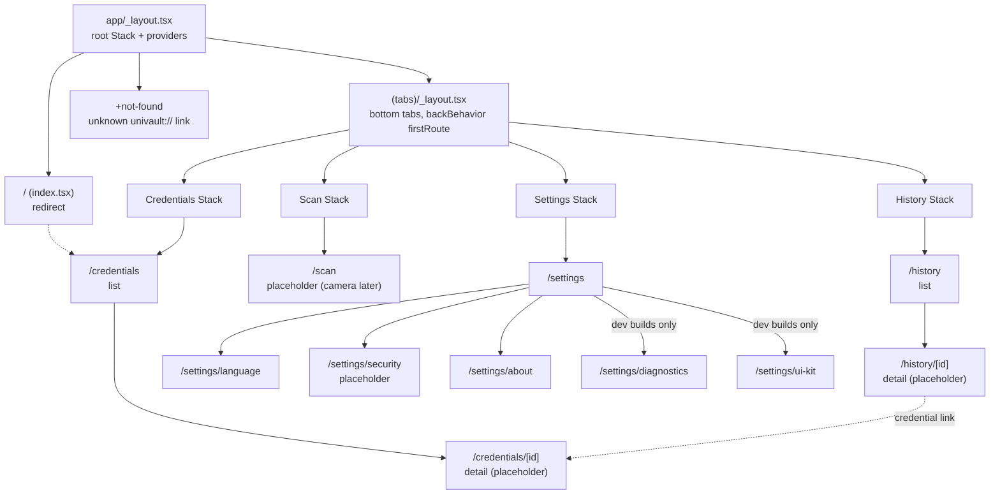

# Mobile wallet (React Native + Expo)

**Sprint:** 2 · **Requirements:** NFR-02 (English / Sinhala), NFR-05, NFR-06 · **Decision:**
022 (Expo Router + Expo Go for Sprint 2) · **Code:** [`wallet/`](../../wallet/) ·
**Setup:** [wallet/README.md](../../wallet/README.md)

The holder's app. This document describes the project as initialised on 27 Nov 2026
(navigation, theme, languages, shared code, Diagnostics) and the **application shell** added the
same day: a stack per tab, the shared component set, credential status badges, light/dark
theming with a contrast rule, saved preferences and the developer UI kit. Credential redemption
(OpenID4VCI), the encrypted vault and presentations are added by the next Sprint 2 tasks and
will extend this document.

## 1. Stack

| Part        | Choice                                                                                                               |
| ----------- | -------------------------------------------------------------------------------------------------------------------- |
| Runtime     | Expo **SDK 58** (expo 58.1.0), React Native 0.88.1, React 19.3.0, Hermes                                             |
| Navigation  | Expo Router 58 (file-based): a root Stack, JavaScript bottom tabs (`expo-router/js-tabs`)                            |
| Language    | TypeScript **6.0.3**, strict (`exactOptionalPropertyTypes`, `noUncheckedIndexedAccess`)                              |
| i18n        | i18next 27.2.7 + react-i18next 18.0.3 + expo-localization                                                            |
| Preferences | `@react-native-async-storage/async-storage` 2.2.0 (language only, section 9)                                         |
| Fonts       | Noto Sans 400/500/600 + Noto Sans Sinhala 400/600 (`@expo-google-fonts/*` 0.4.2, OFL, per-weight imports), expo-font |
| Icons       | `@expo/vector-icons` (Ionicons), decorative only                                                                     |
| Tests       | Jest 30 + jest-expo 58 + React Native Testing Library 14                                                             |
| Shared code | `@univault/crypto-core` (universal entry), `@univault/portal-ui/tokens`                                              |

Every version is pinned exactly; the Expo-managed packages were added with `npx expo install`
so they match SDK 58, and `npm run doctor` (expo-doctor) checks the alignment (20/20 checks).

**Why TypeScript 6.0.3 here only:** Expo's version registry, `npx expo install --check` and
expo-doctor all expect `typescript ~6.0.3` for SDK 58, and Expo Go runs only the current SDK.
The other packages stay on 5.9.3; never TypeScript 7 (typescript-eslint does not support it).
Root lint parses every package with the root's TypeScript 6.0.3 and typescript-eslint 8.73.0
(supports TypeScript ≥ 4.8.4 < 6.1.0) and uses no type-aware rules, so the mix lints cleanly.

## 2. Structure

```
wallet/
  index.ts                  entry: src/lib/crypto-setup first, then expo-router/entry
  app/                      routes (Expo Router), section 3
  src/components/           the shared components, section 5
  src/credentials/          status.ts: backend status → wallet state, tone and icon (section 6)
  src/theme/                theme from the shared tokens (light/dark), useTheme(), contrast.ts
  src/i18n/                 i18next; languages.ts; locales/en.ts, locales/si.ts
  src/lib/                  crypto-setup.ts, crypto-check.ts, preferences.ts, format.ts
  src/navigation/           routes.ts (THE route table), tabs.ts, TabStack.tsx, stack-options.tsx
  src/services/             api-client.ts (EXPO_PUBLIC_API_BASE_URL)
  src/config/               env.ts (API URL rules), app-info.ts (versions, __DEV__ gates)
  src/fixtures/             synthetic SD-JWT for Diagnostics; sample-data.ts (dev builds only)
```

## 3. Navigation

### 3.1 Map

A root Stack holds the tab navigator; **each tab has its own Stack**, so a tab keeps its place
when you switch away and back, and the tab bar stays visible inside a tab.



| Route                   | File                              | Screen                                                                  |
| ----------------------- | --------------------------------- | ----------------------------------------------------------------------- |
| `/`                     | `index.tsx`                       | Redirect to `/credentials`                                              |
| `/credentials`          | `(tabs)/credentials/index.tsx`    | Dev: sample CredentialCards (labelled); release: EmptyState             |
| `/credentials/[id]`     | `(tabs)/credentials/[id].tsx`     | Status, issuer, holder, expiry (sample data); unknown id → "not found"  |
| `/scan`                 | `(tabs)/scan/index.tsx`           | EmptyState: offers and verification requests (camera in a later task)   |
| `/history`              | `(tabs)/history/index.tsx`        | Dev: sample entries; release: EmptyState                                |
| `/history/[id]`         | `(tabs)/history/[id].tsx`         | With, when, link to the credential; unknown id → "not found"            |
| `/settings`             | `(tabs)/settings/index.tsx`       | Language, Security, About; Developer section (dev builds)               |
| `/settings/language`    | `(tabs)/settings/language.tsx`    | English / සිංහල radio group, saved                                       |
| `/settings/security`    | `(tabs)/settings/security.tsx`    | Placeholder (wallet lock, biometrics later)                             |
| `/settings/about`       | `(tabs)/settings/about.tsx`       | Description, app version, Expo SDK, Noto Sans Sinhala licence (OFL 1.1) |
| `/settings/diagnostics` | `(tabs)/settings/diagnostics.tsx` | Dev builds only (section 11)                                            |
| `/settings/ui-kit`      | `(tabs)/settings/ui-kit.tsx`      | Dev builds only (section 10)                                            |
| anything else           | `+not-found.tsx`                  | "Page not found" + Go to my credentials                                 |

### 3.2 Typed, stable route names

Every path comes from **`src/navigation/routes.ts`** (`ROUTES.credentials`,
`ROUTES.credential(id)`, …; ids are URL-encoded as one segment). No screen writes a path string.
`test/routes.test.tsx` checks `ROUTE_FILES` against the files in `app/` in both directions and
renders every route on the real tree. Expo Router's own typed routes
(`experiments.typedRoutes`) stay **off**: their types are generated into the git-ignored
`.expo/types` by `expo start`, so a fresh clone (CI, `npm run typecheck`) would check against
different types than a developer machine.

### 3.3 Back navigation

- **Header back button:** the shared `Header` (drawn by every Stack through
  `src/navigation/stack-options.tsx`) shows a back button (iOS chevron, Android arrow, spoken
  "Back", 44 pt) only when the stack has a screen to go back to, so a tab's root never has one.
- **Deep links:** each tab stack sets `unstable_settings.anchor = 'index'`, so a link straight
  to `/credentials/<id>` still has the list underneath and Back goes to the list.
- **Android hardware back button** (follows the platform norm): pops the current tab's stack; at
  a tab's root it goes to the Credentials tab (`backBehavior: 'firstRoute'`); only at the
  Credentials root is it left unhandled, so Android closes (backgrounds) the app.
  `ConfirmDialog` closes on back (`onRequestClose` = cancel). `test/navigation.test.tsx`
  simulates `BackHandler` and checks each step.
- **Not found:** unknown routes render `+not-found`; unknown credential / history ids show a
  "not found" state with a way back to the list.

The deep-link scheme is `univault://` (`app.config.ts`). OS-level handling of
`openid-credential-offer://` links is a development-build feature (section 12).

## 4. Shared code and design tokens

### 4.1 crypto-core

- `@univault/crypto-core` is a `file:../crypto-core` dependency, built by the `pre*` hooks
  (`build:deps`), like the backend. Only the **universal entry** (`"."`) is used; Metro refuses
  `@univault/crypto-core/node` with an explanatory error (it needs `node:crypto`).
- **Metro** (`metro.config.js`): crypto-core is a watch folder (the npm symlink points outside
  `wallet/`), and modules resolve from `wallet/node_modules` first, then crypto-core's own
  `node_modules` (`@sd-jwt/core`, `@noble/hashes`). Paths are built with `path.join`, and the
  block list accepts either separator, so it works on Windows.
- **Hermes setup** (`src/lib/crypto-setup.ts`, imported first by `index.ts`): installs
  `crypto.getRandomValues` from `expo-crypto` (Hermes has none; spike limitation L3) and
  checks `TextEncoder`, `TextDecoder` (needed by `@owf/identity-common`, L4) and `BigInt` (L5),
  throwing a clear error at start-up if one is missing. No base64 polyfill: `@sd-jwt/core` and
  `@owf/identity-common` carry their own base64url code (no `atob`, `btoa` or `Buffer`).
  `crypto.subtle` is not available and not used.
- **Jest** runs the same code: `.mjs` files (`@sd-jwt/core`, `@owf/identity-common` are
  ESM-only) get jest-expo's Babel transform, and `modulePaths` resolves the symlinked files'
  imports from `wallet/node_modules`.

### 4.2 Design tokens

- **Single source:** `portal-ui/src/tokens.ts` ("Navy and azure", Decision 024; plain data:
  light and dark colours with the design-system names, usage tokens, status sets, component
  token sets, font families, the type scale, spacing, layout lengths, radii).
  `portal-ui/theme.css` is **generated** from it by `npm run build` in portal-ui
  (`renderThemeCss()`), and a portal-ui test fails if the committed CSS differs from what the
  tokens generate (the portal CSS changes with the tokens on purpose).
- **Wallet:** imports `@univault/portal-ui/tokens`. portal-ui is **not** an npm dependency of
  the wallet: a `file:` link exposed portal-ui's own development copy of React (for its web
  tests) to expo-doctor's duplicate-native-module check. Instead the specifier is mapped
  straight to the **source** file `portal-ui/src/tokens.ts` (plain TypeScript, no imports), so
  a fresh clone needs no portal-ui build: Metro (`resolveRequest`), TypeScript (`paths`) and Jest
  (`moduleNameMapper`). `app.config.ts` imports `../portal-ui/src/tokens.ts` (Expo's config
  loader; hence `allowImportingTsExtensions`), and the artwork script loads it with Node's
  built-in type stripping. Proven on 27 Nov 2026 with `portal-ui/dist` deleted: typecheck,
  tests, `npx expo export --platform android` and expo-doctor all pass.
- **`src/theme`** IS the tokens: `lightColors` / `darkColors` with the design-system names
  (section 7), the type scale (px = points), spacing on a 4 pt base, radii. No colour, size or radius
  value is written in the wallet: a test scans `src/` and `app/` for hex colours, and ESLint's
  `react-native/no-color-literals` rejects colour literals in styles.

## 5. Components (`src/components`)

Themed only from the tokens, accessible (section 8) and tested (`test/components.test.tsx`).
Text comes in already translated (`t()`); the few fixed words a component shows itself (Back,
Cancel, Try again, Loading…, Dismiss message, Status last checked …) it translates itself.

| Component        | One line                                                                                                                                                                                                                                                |
| ---------------- | ------------------------------------------------------------------------------------------------------------------------------------------------------------------------------------------------------------------------------------------------------- |
| `AppText`        | Themed text in the design type scale (`display` … `caption`; `mono` = system monospace, Diagnostics only), tones text / muted / subtle / accent / error / on-brand / on-brand-muted, Noto Sans or Noto Sans Sinhala by weight, dynamic type (capped 2×) |
| `Screen`         | `bg` page, safe-area aware (left/right; the Header handles the top), 16 pt padding, scrolls by default                                                                                                                                                  |
| `Header`         | Title (wraps), optional back button, up to two icon actions, pads below the status bar; `tone` surface or brand (the Credentials home)                                                                                                                  |
| `Button`         | Design kinds `primary` (accent), `secondary` (surface + border-strong), `text` (accent-text), `destructive` (status-revoked), `onBrand` (role-tag-bg, on navy only); `loading` and `disabled`; optional icon; 44 pt, radius-md                          |
| `Card`           | `surface` with a hairline `border` and an optional `h3` header title                                                                                                                                                                                    |
| `CredentialCard` | `brand` card, radius-lg: issuer initial on a role-tag-bg circle, issuer and expiry `on-brand-muted`, title and holder `on-brand`, StatusBadge in its own pill; pressable                                                                                |
| `StatusBadge`    | A credential's state: icon + word in its status set's pill (section 6)                                                                                                                                                                                  |
| `Badge`          | Pill (radius-sm) with a word and optional icon: a status set (valid, expired, revoked, pending) or neutral                                                                                                                                              |
| `ListItem`       | `surface` row: leading icon (text-muted), title, subtitle, trailing value and chevron; a pressable row is one button                                                                                                                                    |
| `SectionHeader`  | Heading above a group of rows or cards                                                                                                                                                                                                                  |
| `LoadingState`   | Spinner + visible message, announced as busy                                                                                                                                                                                                            |
| `EmptyState`     | Decorative icon (text-muted on surface-sunken), title, explanation, optional action                                                                                                                                                                     |
| `ErrorState`     | Alert icon (revoked colours), title, message announced as an alert, optional "Try again"                                                                                                                                                                |
| `OfflineNotice`  | Stale / offline banner: `status-expired-bg` with `status-expired-text` and an offline icon, "Status last checked …" (for the status-check task; in the UI kit now)                                                                                      |
| `Toast`          | `ToastProvider` + `useToast().show({ message, tone })`: inverted (text colour as background), one at a time, FIFO queue (max 3), 4 s, close button                                                                                                      |
| `ConfirmDialog`  | Modal title + message, Confirm / Cancel, destructive variant, loading; back button and backdrop (brand scrim) cancel                                                                                                                                    |
| `Icon`           | The one wrapper over `@expo/vector-icons` Ionicons: theme colour, decorative unless given a `label`                                                                                                                                                     |
| `ErrorBoundary`  | Friendly fallback with "Try again"; reports the error name only                                                                                                                                                                                         |

## 6. Credential status badge

`src/credentials/status.ts` holds the ONE mapping from the backend's effective status (the public
status endpoint, `effectiveStatus()`) to the wallet state, `walletStatusFromBackend()`, plus two
wallet-only states. Each state uses one of the design system's four status colour sets, with its
own icon and word. Anything else (including `pending`, which never reaches a wallet) is shown as
"Not checked yet" rather than guessed.

| Backend effective status | Wallet state | Colour set | English         | Sinhala          | Icon (Ionicons)    |
| ------------------------ | ------------ | ---------- | --------------- | ---------------- | ------------------ |
| `valid`                  | `valid`      | valid      | Valid           | වලංගුයි            | `checkmark-circle` |
| `expired`                | `expired`    | expired    | Expired         | කල් ඉකුත් වූ         | `time` (clock)     |
| `revoked`                | `revoked`    | revoked    | Revoked         | අවලංගු කළ         | `ban`              |
| `superseded`             | `replaced`   | pending    | Replaced        | ප්‍රතිස්ථාපනය කළ    | `swap-horizontal`  |
| – (stale / offline)      | `notChecked` | expired    | Not checked yet | තවම පරීක්ෂා කර නැත | `cloud-offline`    |
| – (request running)      | `checking`   | pending    | Checking…       | පරීක්ෂා කරමින්…      | `sync` (refresh)   |

- **Design rules:** stale or offline status uses the expired colours; verification failures and
  anomalies (later) use the revoked colours; status colours mean nothing else. A status icon
  never sits directly on navy: on a credential card it is always in its `status-*-bg` pill
  (tested).
- **Same words as the issuer portal:** the four shared labels ("Valid" replaced "Active" on
  27 Nov 2026) are copied from the portal's `credentials.statuses` in `en.ts` and `si.ts`, and the
  credential type names from its `credentialTypes`. `test/status.test.tsx` imports the portal's
  locale files and fails if any of them differ. The portal says "Replaced" / "ප්‍රතිස්ථාපනය කළ"
  for `superseded` everywhere (badge, holder page, dashboard).

## 7. Theming and contrast

- **"Navy and azure"** ([design-system.md](../design/design-system.md), Decision 024): light and
  dark follow the phone (`userInterfaceStyle: "automatic"`, `useColorScheme()`); no manual switch.
  The same token names in both themes (`theme.colors.brand`, `textMuted`, `statusValidBg` …),
  values from `portal-ui/src/tokens.ts`. In dark, `brand` is lighter than `bg`, so credential
  cards still stand out, and `accent` is a lighter azure with a deep navy label.
- **60-30-10 in the wallet:** `bg` screens, a `surface` bottom tab bar with a `border` top edge
  and `surface` list rows; a `brand` header on the Credentials home screen (with light status-bar
  content while it is focused) and `brand` credential cards (radius-lg); `accent` for the one
  primary action per screen and the active tab icon and label (inactive: `text-muted`).
- **Type:** the design scale (display 32/40 … caption 12/18, body 16/26), Noto Sans 400/500/600
  and Noto Sans Sinhala 400/600 (a 500 label uses Sinhala 600), the same sizes in both scripts.
  Only the five weights are bundled (per-weight imports; a package's index would add about 20
  unused font files; a test guards it). Mono: the system monospace on Diagnostics only (bundling
  JetBrains Mono for one developer screen was not worth the app size).
- **Contrast rule:** every pairing the design system uses (`DESIGN_PAIRS`) and every component
  pair (`colorPairs()`, built from `toneColors` / `buttonColors`) in `src/theme/contrast.ts` must
  meet **WCAG AA in light and dark**: 4.5:1 normal text; 3:1 large text, icons, input borders and
  the focus ring. Translucent `role-tag-bg` is composited over `brand`. `test/contrast.test.ts`
  checks 74 pairs in light and 73 in dark (lowest: text 4.58:1 light, 4.90:1 dark; borders 3.08:1
  light, 3.24:1 dark). One source pairing fails in dark: `text-subtle` on `brand-soft` 4.04:1, so
  wallet text on a brand-soft panel uses `text-muted` (5.77:1). Disabled controls (55 % opacity)
  are exempt, as in WCAG.
- **No hex anywhere:** no colour literal in `src/` or `app/` (`test/theme.test.ts`,
  `portal-ui/test/tokens.test.ts`, ESLint `react-native/no-color-literals`).

## 8. Accessibility and languages

- **Touch targets:** every pressable (buttons, header back/actions, list rows, credential cards,
  language options, tab items, toast close) has `minHeight` (and for icon buttons `minWidth`)
  44 pt (Apple HIG; Android's 48 dp through padding).
- **Roles and labels:** buttons `role="button"` with a label and disabled/busy state; language
  options are `radio`s in a `radiogroup` with `checked` and an explicit label; screen, card,
  section and dialog titles are `header`s; ErrorState and toasts are `alert`s; LoadingState is
  a busy `progressbar`; a CredentialCard is ONE button whose label reads type, issuer, holder,
  expiry and status; icon-only buttons always have a spoken label; decorative icons (`Icon`
  without `label`) are hidden from screen readers.
- **No colour-only meaning:** every status has its own icon AND its own words; selected tabs
  switch to a filled icon; the selected language shows a filled radio icon.
- **Dynamic type:** text scales with the OS text size (`allowFontScaling` stays on; capped at 2×
  by `maxFontSizeMultiplier` so extreme sizes do not break layouts). Screens scroll; text
  wraps (`flexShrink`, no `numberOfLines`); containers use `minHeight`, never fixed heights (the
  avatar and icon circles too); dialog buttons stack vertically.
- **Languages (NFR-02):** every string, including accessibility labels, goes through `t()`. The
  start language is Sinhala if the phone's first preferred language is Sinhala, otherwise
  English, unless a choice was saved (section 9). `si.ts` is marked "needs native-speaker
  review"; a test checks key parity, Sinhala script and placeholders.
- **Fonts:** Noto Sans and Noto Sans Sinhala are bundled and loaded with expo-font before the
  splash screen hides (if loading fails, the system font is used). While the UI is in Sinhala,
  text uses Noto Sans Sinhala; the design line heights are generous enough for its vowel signs
  in both scripts (the old 1.7 Sinhala multiplier is gone).

## 9. Preferences and the storage rule

- **AsyncStorage holds UI preferences only:** today just the language, under
  `univault.language` (the same key name as the portals' localStorage). `src/lib/preferences.ts`
  lists every key in `PREFERENCE_KEYS`; a test checks nothing else is ever written.
- **Never in AsyncStorage:** keys, credentials, SD-JWTs, claims, tokens, PINs or anything
  personal. AsyncStorage is unencrypted (device backups, rooted phones). Those go in **secure
  storage** (`expo-secure-store`: iOS Keychain / Android Keystore) from the holder-key and
  vault tasks.
- **No flash of the wrong language:** the root layout keeps the splash screen up until both
  the font and `restoreLanguage()` are done (saved choice, else the phone's language), so the
  first frame is already in the right language (tested with a held storage read). A failing
  read falls back to the device language; a failing write still switches the language for this
  session, and the toast says it could not be saved.

## 10. UI kit (development builds only)

`/settings/ui-kit` shows every component and variant in the current language and colour
scheme: buttons in every kind × normal / disabled / loading (on-brand buttons on a navy panel),
every StatusBadge state, every badge tone, a CredentialCard per status (sample data), list items,
headers (with back and two actions), loading / empty / error states, the **OfflineNotice**, the
**disclosure panel** token set for the later disclosure screen (`componentTokens.disclosurePanel`:
`brand-soft` panel, `text` title, `text-muted` body, `accent-text-on-soft` link), and Toast
(single, queue of three) and ConfirmDialog (normal and destructive) triggers. For screenshots and
visual review. It is the one screen with several primary buttons (it is a catalogue).

**Hidden in release builds:** Settings shows no Developer section, and the screen itself says
"only available in development builds". The screen gates on an inline `!__DEV__ ||
!uiKitEnabled()`, which Metro folds in a release build, so the kit's code is dropped from the
bundle (checked with `npx expo export --platform android`: its test IDs are absent; a test keeps
the inline gate). The synthetic sample data (`src/fixtures/sample-data.ts`) is gated at the
screens but still imported, so its invented strings remain in the release bundle, never shown;
it goes when the vault replaces it.

## 11. Diagnostics (development builds only)

Gated by `__DEV__` (false in release builds; the Settings link is hidden and the screen says
"only available in development builds").

| Check             | What it does                                                                                                                                                                                                         |
| ----------------- | -------------------------------------------------------------------------------------------------------------------------------------------------------------------------------------------------------------------- |
| App and device    | App version, Expo SDK, platform + OS version, Hermes on/off, API base URL (or what is wrong with it)                                                                                                                 |
| crypto-core check | Decodes `src/fixtures/diagnostics-credential.ts` with `decodeSdJwt`, re-validates every digest with `validateDisclosures`, checks the `vct` and the 5 expected claim names: "5 of 5 disclosures decoded" + Pass/Fail |
| API reachability  | `GET <EXPO_PUBLIC_API_BASE_URL>/health` (8 s timeout): Reachable with the server status (`ok` / `degraded`) and HTTP code, or the error code (`NETWORK_ERROR`, `TIMEOUT`, …)                                         |

The fixture is synthetic: invented claims, an `.example` issuer, signed by a throwaway RS256 key
that `npm run fixture:diagnostics` generates and discards (no private key exists anywhere; the
holder `cnf` key is public only). The same fixture is checked in Jest.

## 12. Expo Go now, development build later

| Feature                                                                                               | Expo Go (Sprint 2)                      | Needs a development build                 |
| ----------------------------------------------------------------------------------------------------- | --------------------------------------- | ----------------------------------------- |
| Navigation, theme, i18n, fonts, Diagnostics                                                           | ✅                                      |                                           |
| SD-JWT decode / present (crypto-core, @noble, pure JS)                                                | ✅ (spike: Hermes OK)                   |                                           |
| Random bytes, SHA digests, AES (`expo-crypto`)                                                        | ✅                                      |                                           |
| Camera QR scanning (`expo-camera`)                                                                    | ✅                                      |                                           |
| Secure key storage (`expo-secure-store`), fingerprint / device passcode (`expo-local-authentication`) | ✅                                      |                                           |
| Face ID on iOS (with UniVault's permission text)                                                      | ❌ (Expo Go falls back to the passcode) | ✅                                        |
| Push notifications (revocation alerts)                                                                | ❌ (removed from Expo Go on Android)    | ✅                                        |
| OS-level `openid-credential-offer://` links opening the app                                           | ❌ (Expo Go owns the links)             | ✅ (own scheme / intent filters)          |
| Native RSA (`react-native-quick-crypto`)                                                              | ❌                                      | ✅ (not planned: Decision 007 uses ES256) |
| Own icon, splash and app name on the home screen                                                      | ❌ (Expo Go's)                          | ✅                                        |

Decision 022 records the switch criterion: an EAS development build when push notifications or
OS-level offer links are needed (Sprint 4–5 at the latest for the Android release).

## 13. Configuration and privacy

- **`EXPO_PUBLIC_API_BASE_URL`** (`wallet/.env`): the backend base URL **including `/api/v1`**
  as reachable from the phone (LAN IP or tunnel, never `localhost`). Empty means not set;
  the `.env.example` placeholder is refused; a loopback host is flagged in Diagnostics.
- **Everything `EXPO_PUBLIC_*` is public** (compiled into the bundle). eslint-plugin-expo
  enforces reading it as `process.env.EXPO_PUBLIC_…` in full, so Expo can inline it.
- **App config** (`app.config.ts`) holds no secrets and no `extra` values; a test checks it.
  Permission texts: camera ("scan QR codes: credential offers… verification requests") and
  Face ID ("unlock your wallet and confirm before you share a credential"). Android shows its own
  permission wording; the app will explain each permission on screen before asking.
- **Backend:** listens on all interfaces already (`app.listen(PORT)` without a host); the
  Windows Firewall must allow TCP 4000 (backend) and 8081 (Metro). Once offers are redeemed from
  the phone, `PUBLIC_BASE_URL` must use the same LAN address or tunnel (it is the OpenID4VCI
  `credential_issuer` in the QR code).
- **Logging:** no request or response bodies, claim values or error messages are logged; the
  ErrorBoundary reports error names only, and Diagnostics shows counts and pass/fail only.

## 14. Tests

`wallet/test/` (Jest + React Native Testing Library), 15 files, 343 tests. `test/setup.ts`
fails any test that writes an unexpected `console.error` or `console.warn` (fix the cause;
the allow-list for unavoidable third-party noise is empty), so the suite runs silent. It also
installs AsyncStorage's official in-memory mock (emptied before every test), the per-weight font
mocks and expo-font's `useFonts`, and the splash-screen mock for the root layout. Never `spyOn` +
restore the AsyncStorage mock's functions: restoring a `jest.fn` removes its in-memory
implementation (use `mock…Once`).

| File                     | Tests | Covers                                                                                                                                                                                                                                                                                                                                                 |
| ------------------------ | ----: | ------------------------------------------------------------------------------------------------------------------------------------------------------------------------------------------------------------------------------------------------------------------------------------------------------------------------------------------------------ |
| `navigation.test.tsx`    |    17 | Real `app/` tree: `/` → Credentials, four labelled tabs, tab switching, each stack in and back, deep link keeps the list, Android BackHandler steps, not-found and unknown ids                                                                                                                                                                         |
| `routes.test.tsx`        |    15 | Route table = files in `app/` (both ways), a Stack per tab, id encoding, every route renders at its path, `/` redirect                                                                                                                                                                                                                                 |
| `design-system.test.tsx` |    14 | At most one primary (azure) button on every screen but the UI kit; brand header on the Credentials home only, surface elsewhere; screens on `bg`; active tab label in `accent`, inactive `text-muted`                                                                                                                                                  |
| `components.test.tsx`    |    37 | Every component: the five Button kinds (token colours, radius-md, 44 pt), Badge status sets + neutral (radius-sm), roles / labels / states, hidden decorative icons, Header insets and tones, CredentialCard in brand with the badge in its own pill, OfflineNotice, Toast queue and timing, ConfirmDialog back/backdrop, AppText type scale and fonts |
| `status.test.tsx`        |    26 | Backend → wallet mapping, unknown values → Not checked yet, **the status mapping table** (set, icon, English, Sinhala), distinct icon + word per state, **label parity with the issuer portal (en + si)**, type names                                                                                                                                  |
| `contrast.test.ts`       |   157 | WCAG maths incl. translucent compositing; no status colour on navy; text-subtle still lighter than text-muted; the before/after of the 27 Nov fixes; the one light-only pair; 74 pairs in light and 73 in dark, each ≥ 4.5:1 (text) or 3:1 (borders, focus, icons)                                                                                     |
| `dark-mode.test.tsx`     |     3 | System dark mode: screens and components render with the dark values of the same token names                                                                                                                                                                                                                                                           |
| `preferences.test.tsx`   |    10 | Save/load, unknown value, storage failures, only listed keys written, Language screen + toast, **simulated restart: first frame already in the saved language**                                                                                                                                                                                        |
| `ui-kit.test.tsx`        |    15 | Every kind / state / status / card, on-brand buttons on navy, OfflineNotice, disclosure panel tokens, Toast and ConfirmDialog triggers; **release build: no link, "not available", inline `__DEV__` gate**; sample data hidden in release                                                                                                              |
| `i18n.test.tsx`          |     7 | Language switch changes text and font; About (version, SDK, font licence); key parity, Sinhala script, placeholders; review marker; device language                                                                                                                                                                                                    |
| `theme.test.ts`          |     6 | Theme = the tokens (design names, light and dark), 4 pt spacing, radii, 44 pt, type scale and fonts per weight and script, tones and button colours, no hex colour in `src/` or `app/`                                                                                                                                                                 |
| `app.test.tsx`           |     9 | Root layout waits for fonts and language, hides the splash, system-font fallback; only the five font weights imported; app config identifiers, permission texts, token colours, no secrets                                                                                                                                                             |
| `diagnostics.test.tsx`   |     7 | Facts shown; crypto check pass/fail; health reachable/unreachable; missing URL disables the check; release build shows "not available"                                                                                                                                                                                                                 |
| `crypto.test.ts`         |    11 | crypto-core check on the fixture; forged disclosure, wrong vct / claims, garbage fail; no private key in the fixture; Hermes polyfill and capability checks                                                                                                                                                                                            |
| `api-client.test.ts`     |     9 | URL from `EXPO_PUBLIC_API_BASE_URL` (empty, placeholder, invalid, loopback); `GET <base>/health`; degraded, network error, timeout, non-JSON                                                                                                                                                                                                           |

Coverage (27 Nov 2026, design system): 99.06 % statements, 95.61 % branches, 98.28 % functions,
99.79 % lines; thresholds 99 / 95 / 98 / 99.
