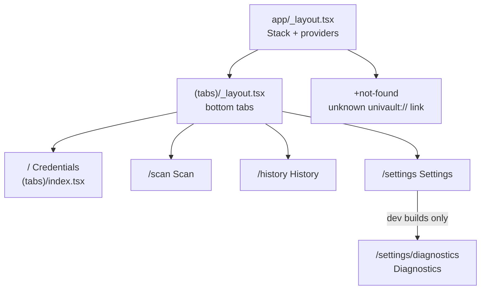

# Mobile wallet (React Native + Expo)

**Sprint:** 2 · **Requirements:** NFR-02 (English / Sinhala), NFR-05, NFR-06 · **Decision:**
022 (Expo Router + Expo Go for Sprint 2) · **Code:** [`wallet/`](../../wallet/) ·
**Setup:** [wallet/README.md](../../wallet/README.md)

The holder's app. This document describes the project as initialised on 27 Nov 2026:
navigation, theme, languages, shared code and the developer Diagnostics screen. Credential
redemption (OpenID4VCI), the encrypted vault and presentations are added by the next Sprint 2
tasks and will extend this document.

## 1. Stack

| Part        | Choice                                                                                     |
| ----------- | ------------------------------------------------------------------------------------------ |
| Runtime     | Expo **SDK 58** (expo 58.1.0), React Native 0.88.1, React 19.3.0, Hermes                   |
| Navigation  | Expo Router 58 (file-based): a root Stack, JavaScript bottom tabs (`expo-router/js-tabs`)  |
| Language    | TypeScript **6.0.3**, strict (`exactOptionalPropertyTypes`, `noUncheckedIndexedAccess`)    |
| i18n        | i18next 27.2.7 + react-i18next 18.0.3 + expo-localization                                  |
| Fonts       | Noto Sans Sinhala 400 / 700 (`@expo-google-fonts/noto-sans-sinhala` 0.4.2, OFL), expo-font |
| Icons       | `@expo/vector-icons` (Ionicons), decorative only                                           |
| Tests       | Jest 30 + jest-expo 58 + React Native Testing Library 14                                   |
| Shared code | `@univault/crypto-core` (universal entry), `@univault/portal-ui/tokens`                    |

Every version is pinned exactly; the Expo-managed packages were added with `npx expo install`
so they match SDK 58, and `npm run doctor` (expo-doctor) checks the alignment (20/20 checks).

**Why TypeScript 6.0.3 here only:** Expo's version registry, `npx expo install --check` and
expo-doctor all expect `typescript ~6.0.3` for SDK 58, and Expo Go runs only the current SDK.
The other packages stay on 5.9.3; never TypeScript 7 (typescript-eslint does not support it).
Root lint parses every package with the root's TypeScript 6.0.3 and typescript-eslint 8.73.0
(supports TypeScript ≥ 4.8.4 < 6.1.0) and uses no type-aware rules, so the mix lints cleanly.

## 2. Structure

```
wallet/
  index.ts                  entry: src/lib/crypto-setup first, then expo-router/entry
  app/                      routes (Expo Router)
  src/components/           Screen, Button, Card, StatusBadge, EmptyState, ErrorBoundary, AppText
  src/theme/                theme built from the shared tokens; useTheme()
  src/i18n/                 i18next; locales/en.ts, locales/si.ts
  src/lib/                  crypto-setup.ts (Hermes polyfills), crypto-check.ts; storage later
  src/services/             api-client.ts (EXPO_PUBLIC_API_BASE_URL)
  src/config/               env.ts (API URL rules), app-info.ts (versions, __DEV__ gate)
  src/navigation/           tabs.ts (the tab list)
  src/fixtures/             synthetic SD-JWT for Diagnostics (generated, no keys)
```

## 3. Navigation map



| Route                   | Screen      | Now                                                                    |
| ----------------------- | ----------- | ---------------------------------------------------------------------- |
| `/`                     | Credentials | EmptyState: credentials from an employer or bank appear here; use Scan |
| `/scan`                 | Scan        | EmptyState: QR codes for credential offers and verification requests   |
| `/history`              | History     | EmptyState: received / shared record, kept on the phone                |
| `/settings`             | Settings    | Language (English / සිංහල), app version, Diagnostics link (dev)         |
| `/settings/diagnostics` | Diagnostics | Dev builds: versions, platform, Hermes, API URL, crypto and API checks |
| anything else           | Not found   | "Page not found" + Go to my credentials                                |

The deep-link scheme is `univault://` (`app.config.ts`). OS-level handling of
`openid-credential-offer://` links is a development-build feature (section 6).

## 4. Shared code and design tokens

### 4.1 crypto-core

- `@univault/crypto-core` is a `file:../crypto-core` dependency, built by the `pre*` hooks
  (`build:deps`), like the backend. Only the **universal entry** (`"."`) is used; Metro refuses
  `@univault/crypto-core/node` with an explanatory error (it needs `node:crypto`).
- **Metro** (`metro.config.js`): crypto-core is a watch folder (the npm symlink points outside
  `wallet/`), and modules resolve from `wallet/node_modules` first, then crypto-core's own
  `node_modules` (`@sd-jwt/core`, `@noble/hashes`). Paths are built with `path.join`, and the
  block list accepts either separator, so it works on Windows.
- **Hermes setup** (`src/lib/crypto-setup.ts`, imported first by `index.ts`): installs
  `crypto.getRandomValues` from `expo-crypto` (Hermes has none; spike limitation L3) and
  checks `TextEncoder`, `TextDecoder` (needed by `@owf/identity-common`, L4) and `BigInt` (L5),
  throwing a clear error at start-up if one is missing. No base64 polyfill: `@sd-jwt/core` and
  `@owf/identity-common` carry their own base64url code (no `atob`, `btoa` or `Buffer`).
  `crypto.subtle` is not available and not used.
- **Jest** runs the same code: `.mjs` files (`@sd-jwt/core`, `@owf/identity-common` are
  ESM-only) get jest-expo's Babel transform, and `modulePaths` resolves the symlinked files'
  imports from `wallet/node_modules`.

### 4.2 Design tokens

- **Single source:** `portal-ui/src/tokens.ts` (plain data: brand and semantic colours, font
  stacks, the type scale, spacing unit, layout spacing, radii, Sinhala line height).
  `portal-ui/theme.css` is **generated** from it by `npm run build` in portal-ui
  (`renderThemeCss()`), and a portal-ui test fails if the committed CSS differs. The issuer
  portal's built CSS is byte-identical to before the change (same file hashes).
- **Wallet:** imports `@univault/portal-ui/tokens`. portal-ui is **not** an npm dependency of
  the wallet: a `file:` link exposed portal-ui's own development copy of React (for its web
  tests) to expo-doctor's duplicate-native-module check. Instead the specifier is mapped
  straight to the **source** file `portal-ui/src/tokens.ts` (plain TypeScript, no imports), so
  a fresh clone needs no portal-ui build: Metro (`resolveRequest`), TypeScript (`paths`) and Jest
  (`moduleNameMapper`). `app.config.ts` imports `../portal-ui/src/tokens.ts` (Expo's config
  loader; hence `allowImportingTsExtensions`), and the artwork script loads it with Node's
  built-in type stripping. Proven on 27 Nov 2026 with `portal-ui/dist` deleted: typecheck,
  tests, `npx expo export --platform android` and expo-doctor all pass.
- **`src/theme`** converts the rem tokens to points (`remToPx`, 16 per rem) and maps them to
  light and dark colour sets (dark uses the brand's sidebar palette). No colour, size or radius
  value is written in the wallet: a test scans `src/` and `app/` for hex colours, and ESLint's
  `react-native/no-color-literals` rejects colour literals in styles.

## 5. Accessibility and languages

- **Touch targets:** buttons, language options, tab items and links have `minHeight` /
  `minWidth` 44 pt (Apple HIG; Android's 48 dp through padding).
- **Roles and labels:** buttons `role="button"` with a label and disabled/busy state; language
  options are `radio`s in a `radiogroup` with `checked`; screen and card titles are `header`s;
  status badges carry their meaning in text (colour only reinforces it); decorative icons are
  hidden from screen readers.
- **Dynamic type:** text scales with the OS text size (`allowFontScaling` stays on; capped at 2×
  by `maxFontSizeMultiplier` so extreme sizes do not break layouts). Screens scroll and use
  `minHeight`, never fixed heights.
- **Languages (NFR-02):** every string, including accessibility labels, goes through `t()`. The
  start language is Sinhala if the phone's first preferred language is Sinhala, otherwise
  English. **Not persisted yet:** the Settings choice lasts until the app restarts; it will be
  stored with the wallet's storage (next tasks). `si.ts` is marked "needs native-speaker
  review"; a test checks key parity, Sinhala script and placeholders.
- **Sinhala font:** Noto Sans Sinhala 400 and 700 are bundled and loaded with expo-font before
  the splash screen hides (if loading fails, the system font is used). While the UI is in
  Sinhala, text uses that font and a 1.7 line height (the shared token).

## 6. Expo Go now, development build later

| Feature                                                                                               | Expo Go (Sprint 2)                      | Needs a development build                 |
| ----------------------------------------------------------------------------------------------------- | --------------------------------------- | ----------------------------------------- |
| Navigation, theme, i18n, fonts, Diagnostics                                                           | ✅                                      |                                           |
| SD-JWT decode / present (crypto-core, @noble, pure JS)                                                | ✅ (spike: Hermes OK)                   |                                           |
| Random bytes, SHA digests, AES (`expo-crypto`)                                                        | ✅                                      |                                           |
| Camera QR scanning (`expo-camera`)                                                                    | ✅                                      |                                           |
| Secure key storage (`expo-secure-store`), fingerprint / device passcode (`expo-local-authentication`) | ✅                                      |                                           |
| Face ID on iOS (with UniVault's permission text)                                                      | ❌ (Expo Go falls back to the passcode) | ✅                                        |
| Push notifications (revocation alerts)                                                                | ❌ (removed from Expo Go on Android)    | ✅                                        |
| OS-level `openid-credential-offer://` links opening the app                                           | ❌ (Expo Go owns the links)             | ✅ (own scheme / intent filters)          |
| Native RSA (`react-native-quick-crypto`)                                                              | ❌                                      | ✅ (not planned: Decision 007 uses ES256) |
| Own icon, splash and app name on the home screen                                                      | ❌ (Expo Go's)                          | ✅                                        |

Decision 022 records the switch criterion: an EAS development build when push notifications or
OS-level offer links are needed (Sprint 4–5 at the latest for the Android release).

## 7. Configuration and privacy

- **`EXPO_PUBLIC_API_BASE_URL`** (`wallet/.env`): the backend base URL **including `/api/v1`**
  as reachable from the phone (LAN IP or tunnel, never `localhost`). Empty means not set;
  the `.env.example` placeholder is refused; a loopback host is flagged in Diagnostics.
- **Everything `EXPO_PUBLIC_*` is public** (compiled into the bundle). eslint-plugin-expo
  enforces reading it as `process.env.EXPO_PUBLIC_…` in full, so Expo can inline it.
- **App config** (`app.config.ts`) holds no secrets and no `extra` values; a test checks it.
  Permission texts: camera ("scan QR codes: credential offers… verification requests") and
  Face ID ("unlock your wallet and confirm before you share a credential"). Android shows its own
  permission wording; the app will explain each permission on screen before asking.
- **Backend:** listens on all interfaces already (`app.listen(PORT)` without a host); the
  Windows Firewall must allow TCP 4000 (backend) and 8081 (Metro). Once offers are redeemed from
  the phone, `PUBLIC_BASE_URL` must use the same LAN address or tunnel (it is the OpenID4VCI
  `credential_issuer` in the QR code).
- **Logging:** no request or response bodies, claim values or error messages are logged; the
  ErrorBoundary reports error names only, and Diagnostics shows counts and pass/fail only.

## 8. Diagnostics (development builds only)

Gated by `__DEV__` (false in release builds; the Settings link is hidden and the screen says
"only available in development builds").

| Check             | What it does                                                                                                                                                                                                         |
| ----------------- | -------------------------------------------------------------------------------------------------------------------------------------------------------------------------------------------------------------------- |
| App and device    | App version, Expo SDK, platform + OS version, Hermes on/off, API base URL (or what is wrong with it)                                                                                                                 |
| crypto-core check | Decodes `src/fixtures/diagnostics-credential.ts` with `decodeSdJwt`, re-validates every digest with `validateDisclosures`, checks the `vct` and the 5 expected claim names: "5 of 5 disclosures decoded" + Pass/Fail |
| API reachability  | `GET <EXPO_PUBLIC_API_BASE_URL>/health` (8 s timeout): Reachable with the server status (`ok` / `degraded`) and HTTP code, or the error code (`NETWORK_ERROR`, `TIMEOUT`, …)                                         |

The fixture is synthetic: invented claims, an `.example` issuer, signed by a throwaway RS256 key
that `npm run fixture:diagnostics` generates and discards (no private key exists anywhere; the
holder `cnf` key is public only). The same fixture is checked in Jest.

## 9. Tests

`wallet/test/` (Jest + React Native Testing Library), 8 files, 68 tests. `test/setup.ts`
fails any test that writes an unexpected `console.error` or `console.warn` (fix the cause;
the allow-list for unavoidable third-party noise is empty), so the suite runs silent:

| File                   | Covers                                                                                                                                                                                                                                                                                  |
| ---------------------- | --------------------------------------------------------------------------------------------------------------------------------------------------------------------------------------------------------------------------------------------------------------------------------------- |
| `navigation.test.tsx`  | Four tabs in order; switching tabs; each placeholder's title and message; Settings → Diagnostics; not-found → home                                                                                                                                                                      |
| `i18n.test.tsx`        | Language switch changes the text and the font; app version; key parity, Sinhala script, placeholders; review marker; device language                                                                                                                                                    |
| `components.test.tsx`  | ErrorBoundary fallback, error name only, retry; Button role/44 pt/disabled/busy; Card, StatusBadge, EmptyState, AppText, Screen; app-info fallbacks                                                                                                                                     |
| `theme.test.ts`        | Theme colours are token values; rem → points; dark/light; no hex colour in `src/` or `app/`                                                                                                                                                                                             |
| `crypto.test.ts`       | crypto-core check passes on the fixture; forged disclosure, wrong vct, wrong claims and garbage fail; fixture has no private key; Hermes polyfill and capability checks                                                                                                                 |
| `api-client.test.ts`   | URL from `EXPO_PUBLIC_API_BASE_URL` (empty, placeholder, invalid, loopback); `GET <base>/health`; degraded, network error, timeout, non-JSON                                                                                                                                            |
| `diagnostics.test.tsx` | Facts shown; crypto check pass/fail; health reachable/unreachable; missing URL disables the check; release build shows "not available"                                                                                                                                                  |
| `app.test.tsx`         | The REAL `app/` route tree (renderRouter on the directory): every declared Stack/Tabs screen exists and renders; root layout waits for the font and hides the splash, starts with the system font if loading fails; app config identifiers, permission texts, token colours, no secrets |

Coverage (27 Nov 2026): 98.61 % statements, 93.71 % branches, 96.96 % functions, 100 % lines;
thresholds 98 / 93 / 96 / 99.
