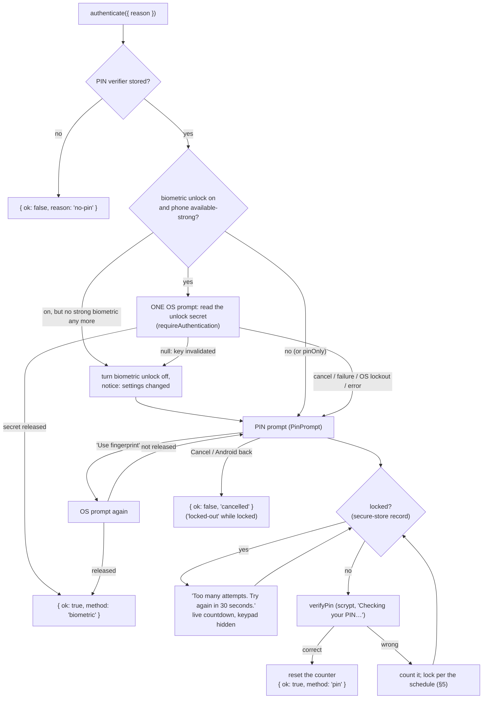
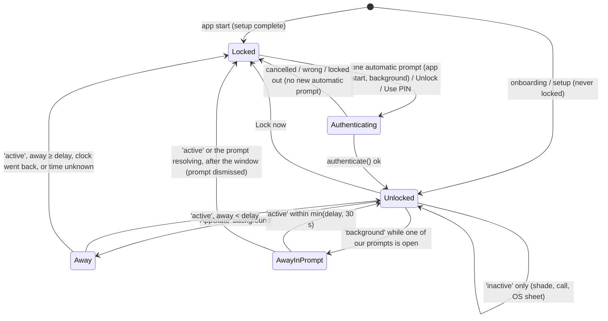

# Wallet authentication: biometrics with PIN fallback

**Sprint:** 2 · **Requirements:** FR-WAL-07 (wallet lock), FR-WAL-03 (holder control), NFR-08 ·
**Decision:** 026 (draft), building on 025 ([wallet-pin.md](wallet-pin.md)) · **Code:**
[`wallet/src/security/`](../../wallet/src/security/) (`authenticate.tsx`, `biometrics.ts`,
`pin-attempts.ts`) · **Tests:** `wallet/test/biometrics.test.tsx`

Every sensitive action in the wallet (opening it once app lock exists, approving a share,
turning biometric unlock off) calls **`authenticate({ reason })`**. It returns
`{ ok: true, method: 'biometric' | 'pin' }` or `{ ok: false, reason: 'cancelled' | 'locked-out' |
'no-pin' }`, never a secret. Nothing else may decide that the holder is present.

## 1. The flow

## 2. Why the OS has to release a secret, not answer "yes"

`LocalAuthentication.authenticateAsync()` returns a boolean to JavaScript. Any code running in the
app (a bug, a patched bundle, an instrumented rooted phone) can produce `true`; nothing is bound
to the result. So the wallet never uses it as proof.

Instead, turning biometric unlock on stores a random **32-byte unlock secret** in
`expo-secure-store` with **`requireAuthentication: true`** and `WHEN_UNLOCKED_THIS_DEVICE_ONLY`.
The operating system keeps that item behind its biometric check and gives it to the app only after
a successful scan:

| Platform | How the OS enforces it (expo-secure-store 58.0.3, read in its native source)                                                                                                                             |
| -------- | -------------------------------------------------------------------------------------------------------------------------------------------------------------------------------------------------------- |
| Android  | The value is AES-encrypted with an Android Keystore key created with `setUserAuthenticationRequired(true)`; decrypting needs a **BiometricPrompt with BIOMETRIC_STRONG and a CryptoObject** (the cipher) |
| iOS      | A Keychain item with the access control **`.biometryCurrentSet`**; the Keychain itself runs the Face ID / Touch ID check                                                                                 |

A biometric unlock is a **successful read of that item** (a well-formed 64-hex secret). The
value is not used for anything else and is dropped at once; it is never logged, returned, stored
elsewhere or shown.

**Strong biometrics only.** `detectBiometrics()` (`src/security/biometrics.ts`) maps
`hasHardwareAsync`, `isEnrolledAsync`, `supportedAuthenticationTypesAsync`, `getEnrolledLevelAsync`
and `SecureStore.canUseBiometricAuthentication()` to one of: **available-strong** (the only one that
may be enabled), available-weak-only (e.g. 2D face unlock on some Android phones), not-enrolled,
no-hardware, unsupported-in-expo-go. Android's key binding accepts only BIOMETRIC_STRONG anyway.

**Strong and weak biometrics:**

| Class (Android CDD)                                | Examples                                                                                          | In UniVault                              | Why                                                                                                                                                                                |
| -------------------------------------------------- | ------------------------------------------------------------------------------------------------- | ---------------------------------------- | ---------------------------------------------------------------------------------------------------------------------------------------------------------------------------------- |
| **Strong** (Class 3)                               | Fingerprint sensors; 3D / infrared face unlock (some Android phones); iPhone Face ID and Touch ID | Allowed (`available-strong`)             | Android Keystore releases **authentication-bound keys** (our unlock secret) only after a Class 3 biometric; Apple's Secure Enclave does the same for Face ID / Touch ID            |
| **Weak** (Class 2, or the lower convenience class) | Face unlock that uses only the front camera (a 2D image), on many Android phones                  | Not offered (`available-weak-only`): PIN | The Keystore does **not** release auth-bound keys for it, so the OS-enforced unlock is impossible; and camera-based face unlock can be spoofed with a photo or video of the holder |

On a weak-only phone with face unlock the wallet says: "This phone's face unlock uses the camera
and isn't secure enough for UniVault. You can use your PIN." ("…your fingerprint or your PIN."
when a strong fingerprint is enrolled). Note: expo-local-authentication reports only the
STRONGEST enrolled class, so a phone with a strong fingerprint enrolled is `available-strong` and
UniVault offers fingerprint unlock (Android's strong-only prompt then accepts only the strong
biometric); in the weak-only state no strong fingerprint is enrolled, so the "your PIN" wording is
the one holders see.

**No device passcode fallback.** Neither path accepts the phone's passcode: Android's prompt
allows only strong biometrics (no `DEVICE_CREDENTIAL`), and `.biometryCurrentSet` has no passcode
flag. The wallet's own PIN is the only fallback, so the phone's passcode (often known to family)
never opens the wallet.

## 3. Platforms and Expo Go

| Environment                          | Biometric unlock                                                         | Why                                                                                                                                            |
| ------------------------------------ | ------------------------------------------------------------------------ | ---------------------------------------------------------------------------------------------------------------------------------------------- |
| Android, Expo Go                     | **OS-enforced** (fingerprint; face only where the phone rates it strong) | expo-secure-store's BiometricPrompt + Keystore path runs inside Expo Go                                                                        |
| Android, development / release build | **OS-enforced**                                                          | the same                                                                                                                                       |
| iOS, Expo Go                         | **Not offered** (`unsupported-in-expo-go`): PIN only                     | Expo Go's Info.plist has no `NSFaceIDUsageDescription`, so expo-secure-store refuses `requireAuthentication` there (its documented limitation) |
| iOS, development / release build     | **OS-enforced** (Face ID or Touch ID)                                    | `app.config.ts` sets UniVault's `NSFaceIDUsageDescription`                                                                                     |

The wallet never "falls back" to a boolean check where the OS path is missing: it reports the
capability and uses the PIN.

## 4. When biometrics change

The OS invalidates the item when the enrolled biometrics change (Android: the Keystore key is
permanently invalidated by a new enrolment and expo-secure-store returns `null`; iOS:
`.biometryCurrentSet` items disappear when Face ID / Touch ID enrolment changes). The wallet also
treats "biometric unlock is on but the phone no longer has a strong biometric enrolled" the same
way. Then it deletes the secret, sets `biometricEnabled` to false, asks for the PIN and says:
"Your fingerprint settings changed. Unlock with your PIN, then turn fingerprint unlock on again in
Settings."

## 5. PIN attempt limits

On the existing failed-attempt record in the secure store (`univault.pinAttempts`, Decision 025),
in `src/security/pin-attempts.ts`:

|   Wrong PINs in a row | PIN entry locked for |
| --------------------: | -------------------- |
|                   1–4 | –                    |
|                     5 | 30 seconds           |
|                     6 | 1 minute             |
|                     7 | 5 minutes            |
|                     8 | 15 minutes           |
| 9 and every one after | 1 hour               |

- Each wrong PIN after the 5th (once the previous lock is over) locks for the next step.
- A correct PIN clears the record.
- While locked, a PIN is not even checked.
- The lock is stored in the secure store, so it survives closing and reopening the app.
- The prompt shows "Too many attempts. Try again in 30 seconds." with a live countdown (seconds
  under a minute, then minutes). Screen readers hear it when the lock starts and then at most
  every 10 s.
- In the long run that is about one guess per hour: the 1,000,000 PINs would take over 100 years.
- **Future work:** a wipe after N failures (credentials deleted, issuer re-issues) is not
  implemented; it needs a recovery story first.

## 6. Prompt options

- OS prompt text: the `reason` of each call (`authenticationPrompt`).
- Device passcode fallback: impossible on both paths (§2).
- Strong biometrics only on Android: enforced by the key binding.
- **"Use PIN" as the cancel label: not possible.** expo-secure-store's prompt has a fixed system
  Cancel button (Android `android.R.string.cancel`; iOS the system sheet). Cancelling leads to the
  wallet's PIN prompt, which offers "Use fingerprint" once. The `authenticateAsync` options that
  would allow a custom label are not used, because that call is only a boolean (§2).

## 7. Where it is used

- **Setup** (`app/setup/biometrics.tsx`, after "PIN set", only for available-strong): "Use
  fingerprint to unlock?". **Turn on** runs the OS prompt and stores the secret; a failure or
  cancel leaves it off with a short message; **Not now** finishes setup. Without strong
  biometrics the step is skipped and "PIN set" shows one line explaining why.
- **Settings → Security**:
  - a status line saying what the phone supports;
  - the "Unlock with fingerprint" switch: ON enrols the secret (OS prompt), OFF needs the PIN
    (`pinOnly`) and deletes the secret;
  - **Test unlock**: runs `authenticate({ reason: 'Test unlock' })` and shows the method or why it
    failed. It is in every build and changes nothing;
  - **Change PIN**: shown as "Coming soon" (backlog).
- **App lock and share approval** (later tasks) call `authenticate()`.

## 8. Known limitations

**The phone cannot tell UniVault WHOSE biometric matched.** Android (BiometricPrompt) and iOS
(Face ID / Touch ID) report only that the scan matched one of the biometrics enrolled on the
phone, never which finger or which person, and no app can ask. So anyone whose fingerprint (or
face) is already saved on the phone when the holder turns biometric unlock on can unlock
UniVault with it: a partner's fingerprint added for convenience, a second face on Android, a
shared family phone.

What is mitigated:

- **Biometrics enrolled later** invalidate the key (§4): a fingerprint or face added after turning
  biometric unlock on cannot release the secret; the holder must use the PIN and turn it on again.
- **The phone's passcode cannot be used** to unlock UniVault (§2): only the wallet PIN is a
  fallback, and it has its own attempt limits (§5).
- **Adding a biometric needs the phone's own passcode** (an OS rule on both platforms), so a
  stranger holding a locked phone cannot add one; and doing so would invalidate the key anyway.

What is not mitigated:

- **Biometrics other people had already enrolled** before biometric unlock was turned on: they
  unlock UniVault. The app cannot detect them.

So the wallet says it plainly where biometric unlock is turned on: the setup step and Settings →
Security show "Anyone whose fingerprint is saved on this phone will be able to unlock UniVault.
Only turn this on if every fingerprint on this phone is yours." (face wording on face-unlock
phones), with "Not now" as visible as "Turn on" and, in Settings, "You can always use your PIN
only." (`SharedBiometricNotice`, `src/security/SharedBiometricNotice.tsx`).

## 9. App lock

`LockProvider` (`src/security/app-lock.tsx`, in the root layout around the navigator) keeps the
wallet covered by the lock screen until `authenticate()` returns ok.

- **State in memory only.** `locked` is never written anywhere: a restart (or the OS killing the
  app in the background) always starts locked once setup is complete. Onboarding and `/setup/*`
  are never locked.
- **Background, not inactive.** Only `AppState` `'background'` arms the lock. `'inactive'` fires
  for the notification shade, an incoming call, the app switcher on iOS and some biometric
  sheets; locking on it would lock the wallet in the middle of normal use, and during its own
  fingerprint prompt.
- **Delay** ("Lock after leaving the app", Settings → Security; `univault.lockDelay`, a non-secret
  preference): Immediately (default), 30 seconds, 1 minute, 5 minutes. The time of going to the
  background is kept in memory; on `'active'` the app locks if `now − then ≥ delay`.
- **Clock rule:** if the clock went backwards (`now < then`) or the time is missing or not a
  number, the app locks; a user cannot stay unlocked by changing the phone's time.
- **Our own prompts, short absences only (follow-up 28 Nov):** every `authenticate()` and the
  biometric enrolment run as an "auth activity" (`src/security/auth-activity.ts`). Some phones
  report the OS biometric sheet as `'inactive'` or even `'background'`, so a return while one of
  them was open is exempt, but **only within `authExemptionMs(delay)` = min(delay, 30 s),
  measured from the moment the app went to the background**; for Immediately (delay 0) the 30 s
  cap applies (min would be 0 and lock the wallet in the middle of its own fingerprint sheet).
  Whether a prompt was open is decided when the app leaves. After a longer absence:
  - the app locks (`'background'` reason) and the open prompt is **dismissed**:
    `useAuthControl().dismissPrompts()` resolves it as `{ ok: false, reason: 'cancelled' }`. No
    PIN is checked, so **no failed attempt is counted**; digits typed so far are dropped. An
    authentication still at its OS biometric step resolves as cancelled too, even if the sheet
    later releases the secret (no late success), and one still loading never opens its PIN prompt;
  - **every prompt that resolves re-checks** (`onAuthActivityEnd`): a cancel or failure while
    the app is still away, after the window, locks at once, so a cancelled Test unlock, a
    cancelled "turn biometric unlock off / on" or any `PinPrompt` can never reveal the wallet when
    a lock is due;
  - **the lock screen's own prompt is left alone**: the app is already locked, so nothing is
    dismissed and the holder carries on where they were.
- **Privacy cover:** as soon as the app is not `'active'` (inactive or background), a full-screen
  navy cover with the UniVault mark is drawn; it goes on `'active'` (the lock screen takes over if
  the app locked). In every build. Not drawn while one of our prompts is open (it would cover the
  OS sheet).
- **Screenshots and the recent-apps preview (follow-up 28 Nov):**

  | Platform | When the OS takes the app-switcher snapshot                                                         | Release builds                                                                                                                                   | Development builds                                                                                                                                       |
  | -------- | --------------------------------------------------------------------------------------------------- | ------------------------------------------------------------------------------------------------------------------------------------------------ | -------------------------------------------------------------------------------------------------------------------------------------------------------- |
  | Android  | When the app leaves, possibly **before** JavaScript sees `'background'` (the cover may be too late) | `FLAG_SECURE` on the whole wallet (`useAppScreenCaptureBlock()`, key `univault-app`): screenshots and recordings refused, the recents card blank | Off by default (evidence screenshots); Diagnostics → **Block screenshots and recents preview** turns it on (in memory, never saved, off after a restart) |
  | iOS      | On `'inactive'`, where the navy cover is already up                                                 | expo-screen-capture's block (at least recordings blank) plus the navy cover                                                                      | The navy cover; the Diagnostics switch as on Android                                                                                                     |

  The PIN screens keep their own block (`univault-pin`, wallet-pin.md §7); expo-screen-capture
  counts the keys, so closing a PIN screen never lifts the wallet-wide block. Release vs
  development is `screenCaptureBlockingEnabled()` = `!__DEV__`; the Diagnostics switch exists in
  development builds only (the screen is inline-gated and dropped from release bundles).

- **Lock screen:** the mark, "UniVault is locked", "Unlock to continue", **Unlock** (primary;
  biometric if on, else the PIN prompt) and **Use PIN** (only when biometric unlock is on). One
  automatic `authenticate()` when it appears after an app start or a return; after a cancel or
  failure it waits for the holder (no loops). The PIN lockout countdown shows on it. The
  navigator stays mounted (same screen and scroll position after unlock), hidden from
  accessibility (`importantForAccessibility="no-hide-descendants"`,
  `accessibilityElementsHidden`) and untouchable (`pointerEvents="none"`). Android back on it
  calls `BackHandler.exitApp()` (the app goes to the background). A deep link while locked
  navigates behind the lock screen and is shown after unlock.
- **`onLock(listener)`**: called on every lock with the reason (app-start, background, manual),
  so the encrypted vault can drop decrypted data. `lastLockReason` is shown in Diagnostics (dev).

## 10. Never

- Never use a bare `authenticateAsync()` (or any boolean) as proof of the holder.
- Never put the unlock secret anywhere but its authenticated item.
- Never log the secret or the PIN, put them in route params, AsyncStorage, an error or a result.
- Never offer the device passcode instead of the wallet PIN.
- Never let one of our prompts keep the wallet unlocked through a long absence: the exemption is
  min(delay, 30 s), and a dismissed prompt is a cancel, never a failed attempt.
